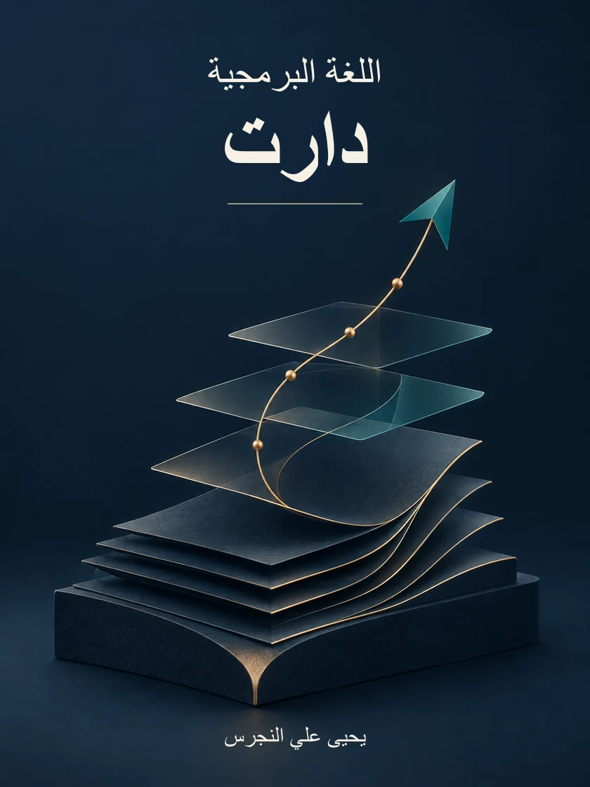

# أعمال مختارة في البحث والهندسة والمعرفة

[العربية](README.ar.md) · [English](README.md) · [Türkçe](README.tr.md)

دراسات حالة للمشروعات المعروضة في موقعي، توضّح المشكلة ودوري والبنية والمرحلة الحالية. اختر لغة الدراسة، ثم تابع القراءة في الموقع أو افتح الوجهة المتاحة بحسب حالة المشروع.

| العمل                                                                                                 | الفكرة                                                                                                                                                  | الحالة                                 |
| ----------------------------------------------------------------------------------------------------- | ------------------------------------------------------------------------------------------------------------------------------------------------------- | -------------------------------------- |
| [المنصة الأكاديمية الشخصية](case-studies/academic-portfolio/ar.md) | دراسة حالة تصميم وتطوير المنصة الأكاديمية الشخصية yahyaalali.com بثلاث لغات؛ تجربة قراءة موحّدة تجمع الأبحاث والمنشورات والمشروعات والكتب والشروحات، ببنية Astro وTypeScript وFirebase. | منشور |
| [الصندوق الذكي](case-studies/smart-bin/ar.md) | مراقبة امتلاء حاوية النفايات باستخدام ESP32، مع شاشة ومصابيح وتنبيه صوتي وقراءة الحالة عبر البلوتوث. | تحقق برمجي؛ التجربة الميدانية باقية |
| [نموذج مراقبة الطفل — جودة القياس قبل تفسيره](case-studies/baby-monitor/ar.md)                        | مراجعة نموذج أكاديمي باستخدام ESP8266 وحساسات بيئية وبصرية وصوتية وحركية، تميّز القراءة الحديثة من المفقودة أو غير الصالحة، دون ادعاء تشخيص طبي.        | مراجعة برمجية مختبرة؛ العتاد مؤجل      |
| [التحقق من محاكيات المعالجة داخل الذاكرة — uPIMulator وDownmem](case-studies/pim-simulator-validation/ar.md) | تطوّر الدراسة بروتوكول تحقق لحمل جمع متجهات مشترك على معمارية UPMEM في uPIMulator وDownmem. وتبحث في صحة مخرجات كل محاكٍ وفي العمليات التي تمثلها سجلاته. | دراسة مستقلة جارية |
| [دراسة مقرر gem5 — تدقيق منشأ المقارنة](case-studies/gem5-pim/ar.md)                                  | سبعة أزواج محاكاة تاريخية موسومة baseline وPIM؛ لا تثبت الأصول المتاحة مقارنة أداء متكافئة أو طاقة نظام مقاسة.                                          | دراسة تاريخية؛ المقارنة غير متحققة     |
| [بوابة العشارة](case-studies/ashara/ar.md) | بوابة العشارة: تجربة رقمية لمعلومات المدينة ودليل الأماكن ومواقيت الصلاة، تربط السكان بالخدمات والبلاغات والمتابعة، ببنية متعددة المنصات ورؤية لمحافظة دير الزور. | منشور |
| [أثر الوِرد](case-studies/athar-wird/ar.md) | أثر الوِرد منصة ويب منشورة لإدارة حلقات تعليم القرآن والخطط والحصص والحضور والتقييم، بصلاحيات متعددة، باستخدام Flutter وFirebase. | منشور |
| [اللغة البرمجية دارت — كتاب تعليمي عربي](case-studies/dart-book/ar.md)                                | كتاب عربي قيد التأليف لتعلّم Dart، يجمع الشرح المتدرّج والأمثلة البرمجية والتمارين وحلولها، مع وحدتين متاحتين للقراءة.                                  | قيد التأليف                            |
| [منصة إدارة البلديات السورية](case-studies/deir-ezzor-municipalities/ar.md) | دراسة حالة تصميم وتطوير منصة إدارة البلديات السورية؛ منظومة رقمية قيد التطوير لتنظيم التراتبية الإدارية، والتكليفات والصلاحيات، والمهام والمراجعة، والأنشطة والمشروعات، والتقارير ببنية Flutter و.NET وPostgreSQL. | قيد التطوير |
| [سِناد](case-studies/dental/ar.md) | تعرّف إلى سِناد لإدارة عيادات الأسنان: المواعيد وملفات المرضى ومخطط الأسنان والفوترة الداخلية في مساحة عمل للطبيب، مع رحلة واضحة للمريض لطلب الموعد. | الموقع الرسمي متاح؛ تحقق محدود |
| [تحليل مواقع وسائل التواصل — رسالة الماجستير](case-studies/location-analysis/ar.md)                   | رسالة ماجستير مكتملة عام 2024، وبحث مؤتمر مشتق، وإعادة بناء برمجية محلية منفصلة بدأت في 2026.                                                           | الرسالة مكتملة؛ إعادة البناء جارية     |
| [عيادة د. عمر علي النجرس](case-studies/omar-clinic/ar.md) | دراسة حالة تصميم وتطوير منظومة رقمية متعددة المنصات لعيادة د. عمر علي النجرس بثلاث لغات، تضم واجهات المريض والطبيب، والمواعيد، ومخطط الأسنان، ومعمارية النظام. | منشور |
| [التوجيه الذكي وجودة الخدمة في شبكات SDN–MPLS](case-studies/phd-routing/ar.md)                        | بحث دكتوراه يدرس كيف يتكيف قرار مسار البيانات مع تغير أحمال الشبكة وتعطل الروابط، ويقيّم أثره في جودة الخدمة ضمن شبكات SDN–MPLS.                        | بحث جارٍ                               |
| [رواج](case-studies/rawaj/ar.md) | رواج يجمع بيع الأفراد وتسوق المتاجر في سوق عربي وإنجليزي: منتجات جديدة ومستعملة، سلة وعروض تفاوضية، ومساحات للبائع ومتابعة للطلبات والتوصيل وما بعد البيع. | قيد التطوير |
| [ثِقة](case-studies/thiqah/ar.md) | دراسة حالة تصميم وتطوير «ثِقة»، مشروع شبكة B2B قيد التطوير لتوثيق العلاقات التجارية والفواتير والإقرارات والتحصيل والاعتراضات بين الموردين والتجار، ببنية Flutter وNestJS وPostgreSQL. | قيد التطوير |

## النماذج والأعمال الدراسية

| العمل | الحالة |
| --- | --- |
| [مختبر التفاعل البصري](case-studies/visual-interaction-lab/ar.md) | مرشح إصدار خاص متحقق محليًا |
| [نظام الأعداد بالبواقي ومبرهنة الباقي الصينية](case-studies/residue-number-system-crt/ar.md) | تنفيذ تعليمي مختبر محليًا |
| [حل Samurai Sudoku بالتزامن](case-studies/samurai-sudoku/ar.md) | تنفيذ تعليمي مختبر محليًا |

[أساسيات الشبكات — فهرس القراءة المنشور](https://yahyaalali.com/books/network-foundations/)

## اللغة البرمجية دارت — الغلاف التوضيحي الحالي

كتاب تعليمي عربي قيد التأليف؛ الوحدتان الأولى والثانية متاحتان للقراءة، والوحدة الثالثة قيد الإعداد. صورة الغلاف ليست إعلانًا عن طبعة مطبوعة.

صورة توضيحية مفاهيمية مولّدة؛ ليست واجهة فعلية أو نتيجة بحثية.

[دراسة الحالة](case-studies/dart-book/ar.md) · [اقرأ بالعربية](https://yahyaalali.com/books/dart/)

## حزم عتاد عامة محددة

- [شيفرة الصندوق الذكي المنقحة واختباراتها ومخططاتها](hardware/smart-bin/README.ar.md) — يفصل العرض بين نموذج المقرر والمراجعة اللاحقة.
- [نموذج مراقبة بيئة الطفل واختباراته ومخططاته](hardware/baby-monitor/README.ar.md) — بلا اعتمادات سحابية أو ادعاء طبي.

الأغلفة المفاهيمية منفصلة عن صور الدارات والواجهات التاريخية. لا تضم الحزمتان تاريخ المستودعات الخاصة أو ترخيص إعادة استخدام عام.

## التواصل والاستفسار عن إعادة الاستخدام

يضم هذا المستودع دراسات حالة ومواد عرض عامة، إضافة إلى شيفرة Firmware تعليمية محدودة واختبارات تعمل على الحاسوب لنموذجي Smart Bin وBaby Monitor. لا تُنشر هنا شيفرة التطبيقات الخاصة أو تاريخ تطويرها أو بيانات المالك أو ملفات الكتاب الأصلية. الصور المفاهيمية لا تثبت تشغيلًا أو نتيجة بحثية، ولا تُمنح هنا رخصة عامة لإعادة الاستخدام.

[الموقع الشخصي](https://yahyaalali.com/) · [GitHub](https://github.com/yaheaali92) · [التواصل والاستفسار عن إعادة الاستخدام](https://yahyaalali.com/contact/)
