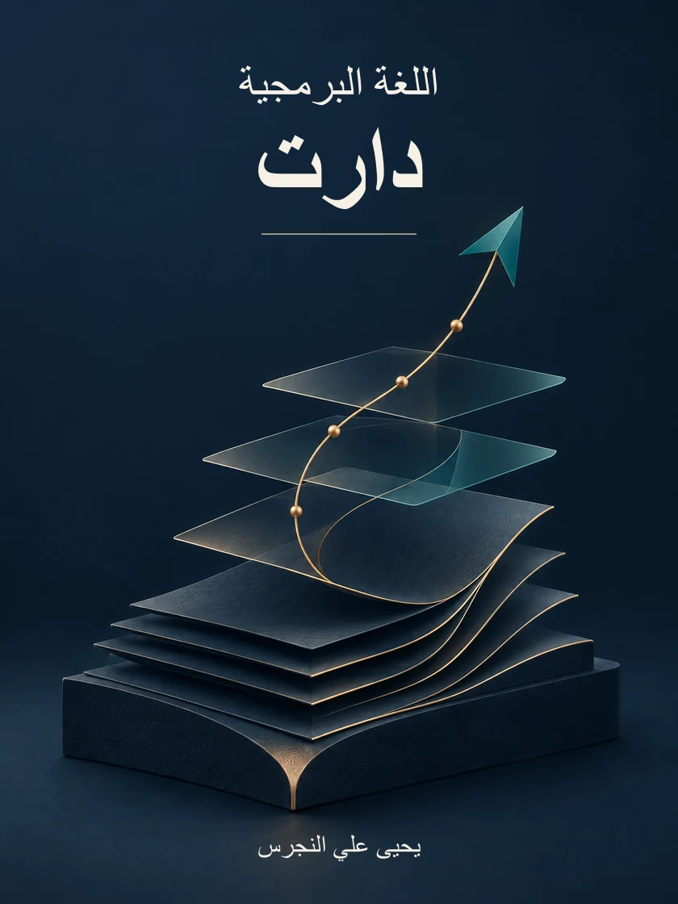

# Selected Research, Engineering and Educational Work

[العربية](README.ar.md) · [English](README.md) · [Türkçe](README.tr.md)

Case studies for the projects presented on my portfolio: their problem, my role, structure and current stage. Choose a study language, then continue on the website or visit the available destination according to the project stage.

| Work                                                                                                | Focus                                                                                                                                                                                                                | Stage                                           |
| --------------------------------------------------------------------------------------------------- | -------------------------------------------------------------------------------------------------------------------------------------------------------------------------------------------------------------------- | ----------------------------------------------- |
| [Academic Portfolio — from content to a reading experience](case-studies/academic-portfolio/en.md)  | A trilingual platform I developed to present my academic and engineering work and manage articles, case studies and a Dart book in a private, owner-only editorial workspace that separates drafts from publication. | Published                                       |
| [Smart Bin](case-studies/smart-bin/en.md) | ESP32-based waste-bin fill monitoring with a display, indicator lights, an audible alert and nearby Bluetooth state readings. | Software verified; field validation pending |
| [Baby monitoring prototype — data quality before interpretation](case-studies/baby-monitor/en.md)   | An ESP8266 academic prototype review distinguishing fresh, missing and invalid environmental, optical, acoustic and motion readings, without claiming medical diagnosis.                                             | Software review tested; hardware pending        |
| [PIM simulator validation — uPIMulator and Downmem](case-studies/pim-simulator-validation/en.md) | This study develops a validation protocol for a common UPMEM vector-addition workload in uPIMulator and Downmem. It asks whether each simulator produces the expected output and what operations its logs describe. | Independent research in progress |
| [gem5 course study — provenance audit](case-studies/gem5-pim/en.md)                                 | Seven historical baseline/PIM-labelled simulation pairs; the available artifacts do not establish a comparable performance result or measured system energy.                                                         | Historical study; comparison unverified         |
| [Ashara — city information and services](case-studies/ashara/en.md)                                 | A digital portal bringing Ashara information and service entry points together, with development aimed at extending the experience across Deir Ezzor governorate.                                                    | Published                                       |
| [Athar Al-Wird — organising Quran learning](case-studies/athar-wird/en.md)                          | An online platform connecting Quran learning circles, groups, plans, sessions and assessment across teacher, student, guardian and administrator roles.                                                              | Published                                       |
| [The Dart Programming Language — an Arabic teaching book](case-studies/dart-book/en.md)             | An Arabic-language Dart book in progress, combining explanations, code examples, exercises and solutions, with its first two units available to read.                                                                | Manuscript in progress                          |
| [Municipal administration — connected levels of work](case-studies/deir-ezzor-municipalities/en.md) | A platform for municipal activities, projects, tasks, tickets and reports, being extended from Deir Ezzor to a Syria–governorate–municipality structure.                                                             | In development                                  |
| [Sinad — organising a doctor's practice and patient appointments](case-studies/dental/en.md) | A doctor-owned practice workspace with scheduling, patient records and odontogram workflows. Selected flows were verified with synthetic data. | Official website available; bounded verification |
| [Social media location analysis — MSc thesis](case-studies/location-analysis/en.md)                 | Completed 2024 Sakarya MSc thesis, a derivative IMASCON conference paper, and a distinct privacy-conscious 2026 software rebuild.                                                                                    | Thesis completed; rebuild in development        |
| [Dr Omar Ali Al-Najras Clinic — website and app](case-studies/omar-clinic/en.md)                    | A website and Android app for a specific dental clinic, connecting doctor and service information with appointment and contact entry points in Arabic, English and Turkish.                                          | Published                                       |
| [Intelligent routing and quality of service in SDN–MPLS networks](case-studies/phd-routing/en.md)   | Doctoral research into routing decisions that respond to changing network load and failed links, evaluating their effect on quality of service in SDN–MPLS networks.                                                 | Ongoing research                                |
| [Rawaj — engineering a digital marketplace](case-studies/rawaj/en.md)                               | A multi-role marketplace project connecting sellers, buyers and platform administration, with separate interface, business-service and data responsibilities.                                                        | In development                                  |
| [THIQAH — documenting business-to-business relationships](case-studies/thiqah/en.md)                | A B2B trade-network project with identity, organisation and authorisation foundations, working towards documented invoices, receivables, payments and disputes.                                                      | In development                                  |

## Prototypes and coursework

| Work | Status |
| --- | --- |
| [Visual Interaction Lab](case-studies/visual-interaction-lab/en.md) | Local verification; private release candidate |
| [Residue Number System and CRT](case-studies/residue-number-system-crt/en.md) | Locally tested educational implementation |
| [Concurrent Samurai Sudoku](case-studies/samurai-sudoku/en.md) | Locally tested educational implementation |

[Network Foundations — published reading index](https://yahyaalali.com/en/books/network-foundations/)

## The Dart Programming Language — current illustrated cover

An Arabic teaching book in progress: the first two units are available to read, while unit three is under preparation. Its display cover does not announce a printed edition.

Generated conceptual illustration, not an actual interface or research result.

[Case study](case-studies/dart-book/en.md) · [Read in Arabic](https://yahyaalali.com/books/dart/)

## Bounded public hardware source

- [Baby-environment monitor candidate, host tests and diagrams](hardware/baby-monitor/README.md) — no cloud credentials or clinical claim.

The conceptual covers are distinct from historical circuit and interface evidence. The package carries no private repository history or general reuse licence.

## Contact and reuse enquiries

This repository contains public documentation and presentation material only. Application source code, private development history, owner data and original book files are not included. Conceptual images do not establish operational readiness or research results, and no general reuse licence is granted here.

[Portfolio](https://yahyaalali.com/en/) · [GitHub](https://github.com/yaheaali92) · [Contact and reuse enquiries](https://yahyaalali.com/en/contact/)
