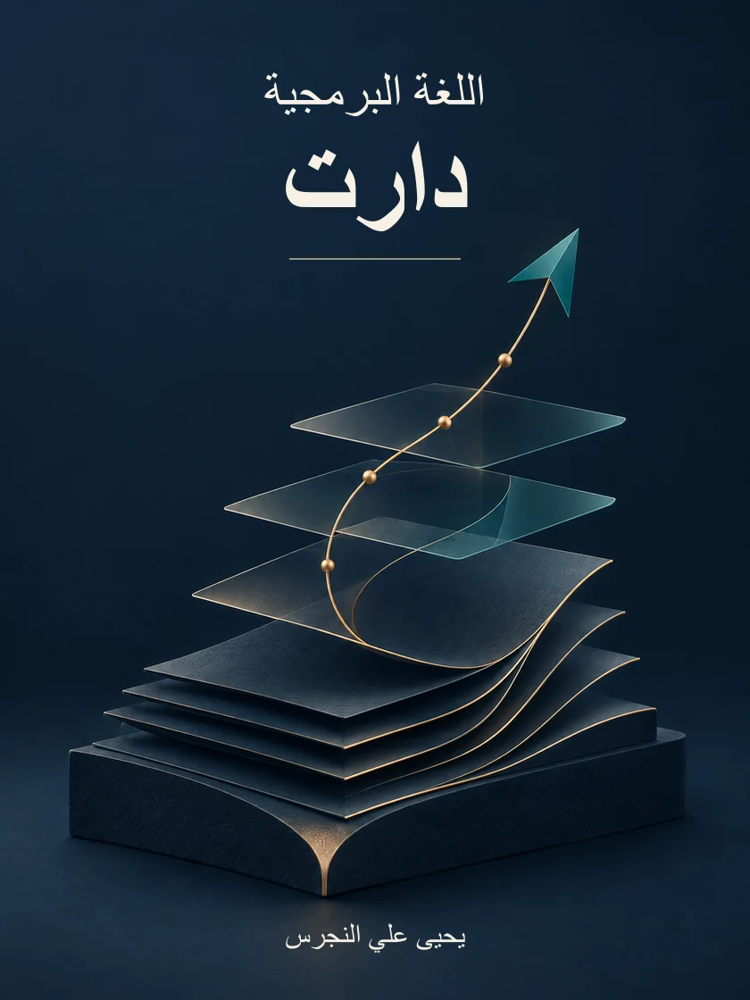

# Seçilmiş Araştırma, Mühendislik ve Öğretim Çalışmaları

[العربية](README.ar.md) · [English](README.md) · [Türkçe](README.tr.md)

Portfolyomda sunulan projelerin vaka çalışmaları: ele alınan problem, katkım, yapı ve mevcut aşama. Çalışmanın dilini seçebilir, sitede okumayı sürdürebilir veya projenin aşamasına uygun erişilebilir adresi ziyaret edebilirsiniz.

| Çalışma                                                                                               | Odak                                                                                                                                                                                                                                | Aşama                                                    |
| ----------------------------------------------------------------------------------------------------- | ----------------------------------------------------------------------------------------------------------------------------------------------------------------------------------------------------------------------------------- | -------------------------------------------------------- |
| [Akademik portfolyo — içerikten okuma deneyimine](case-studies/academic-portfolio/tr.md)              | Araştırmalarımı, yazılım projelerimi ve teknik yazılarımı üç dilde bir araya getiren; yalnızca site sahibine açık içerik düzenleme ve taslak inceleme alanıyla yapılandırılmış kitap okuma akışlarını destekleyen kişisel platform. | Yayımlandı                                               |
| [Akıllı çöp kutusu — ölçümden güvenilir uyarıya](case-studies/smart-bin/tr.md)                        | Ölçümü karardan ayırmak, sensör hatalarını ele almak ve uyarı ile üç dilli gösterimi düzenlemek için iyileştirilen ESP32 ve BLE tabanlı akademik prototip.                                                                          | Yazılım iyileştirmesi test edildi; donanım test edilmedi |
| [Bebek izleme prototipi — yorumdan önce veri kalitesi](case-studies/baby-monitor/tr.md)               | ESP8266 akademik prototipinin ortam, optik, ses ve hareket girdilerinde güncel, eksik ve geçersiz veriyi ayıran; tıbbi teşhis iddiası taşımayan incelemesi.                                                                         | Yazılım incelemesi test edildi; donanım bekliyor         |
| [Bellek içi işleme simülatörlerinin doğrulanması — uPIMulator ve Downmem](case-studies/pim-simulator-validation/tr.md) | Çalışma, uPIMulator ve Downmem üzerinde ortak bir UPMEM vektör toplama iş yükü için doğrulama protokolü geliştirir. Her simülatörün beklenen çıktıyı üretip üretmediğini ve günlüklerinde hangi işlemlerin kaydedildiğini inceler. | Devam eden bağımsız araştırma |
| [gem5 ders çalışması — kaynak zinciri denetimi](case-studies/gem5-pim/tr.md)                          | Baseline/PIM etiketli yedi tarihsel simülasyon çifti; mevcut dosyalar karşılaştırılabilir performansı veya ölçülmüş sistem enerjisini doğrulamıyor.                                                                                 | Tarihsel çalışma; karşılaştırma doğrulanmadı             |
| [Ashara — şehir bilgileri ve hizmetler](case-studies/ashara/tr.md)                                    | Ashara’nın bilgilerini ve hizmet girişlerini bir araya getiren dijital portal; geliştirme, deneyimi Deyrizor ili geneline genişletmeyi hedefliyor.                                                                                  | Yayımlandı                                               |
| [Athar Al-Wird — Kur’an öğrenimini takip etmek](case-studies/athar-wird/tr.md)                        | Kur’an halkalarını, grupları, öğrenme planlarını, dersleri ve değerlendirmeyi öğretmen, öğrenci, veli ve yönetici rolleriyle bir araya getiren çevrimiçi platform.                                                                  | Yayımlandı                                               |
| [Dart Programlama Dili — Arapça öğretim kitabı](case-studies/dart-book/tr.md)                         | Açıklamaları, kod örneklerini, alıştırmaları ve çözümleri birleştiren, yazımı süren Arapça Dart kitabı; ilk iki ünite okumaya açıktır.                                                                                              | Yazım aşamasında                                         |
| [Belediye yönetimi — birbirine bağlı çalışma düzeyleri](case-studies/deir-ezzor-municipalities/tr.md) | Faaliyetleri, projeleri, görevleri, destek taleplerini ve raporları düzenleyen; Deyrizor’dan Suriye–il–belediye yapısına genişletilen platform.                                                                                     | Geliştirme aşamasında                                    |
| [Sinad — hekim çalışma alanı ve hasta randevuları](case-studies/dental/tr.md) | Randevular, hasta kayıtları ve odontogram için hekime ait çalışma alanı. Seçili akışlar sentetik verilerle doğrulandı. | Resmî site açık; sınırlı doğrulama |
| [Sosyal Medya Lokasyon Analizi — yüksek lisans tezi](case-studies/location-analysis/tr.md)            | 2024'te tamamlanan tez, türev IMASCON bildirisi ve 2026'da başlayan ayrı gizlilik odaklı yazılım yenilemesi.                                                                                                                        | Tez tamamlandı; yenileme geliştiriliyor                  |
| [Dr. Omar Ali Al-Najras Kliniği — web sitesi ve uygulama](case-studies/omar-clinic/tr.md)             | Belirli bir diş kliniği için geliştirilen web sitesi ve Android uygulaması; hekim ve hizmet bilgilerini randevu ve iletişim girişleriyle Arapça, İngilizce ve Türkçe sunar.                                                         | Yayımlandı                                               |
| [SDN–MPLS ağlarında akıllı yönlendirme ve hizmet kalitesi](case-studies/phd-routing/tr.md)            | Değişen ağ yüküne ve bağlantı arızalarına yanıt veren yönlendirme kararlarını, SDN–MPLS ağlarında hizmet kalitesi açısından değerlendiren doktora araştırması.                                                                      | Devam eden araştırma                                     |
| [Rawaj — dijital pazar yeri mühendisliği](case-studies/rawaj/tr.md)                                   | Satıcıyı, alıcıyı ve platform yönetimini buluşturan; arayüz, iş hizmetleri ve veri sorumluluklarını ayıran çok rollü pazar yeri projesi.                                                                                            | Geliştirme aşamasında                                    |
| [THIQAH — işletmeler arası ticari ilişkileri belgelemek](case-studies/thiqah/tr.md)                   | Kimlik, organizasyon ve yetkilendirme temelleri üzerine kurulan; fatura, alacak, ödeme ve uyuşmazlık kayıtlarını hedefleyen işletmeler arası ticaret ağı projesi.                                                                   | Geliştirme aşamasında                                    |

## Prototipler ve ders çalışmaları

| Çalışma | Durum |
| --- | --- |
| [Görsel Etkileşim Laboratuvarı](case-studies/visual-interaction-lab/tr.md) | Yerelde doğrulanmış özel sürüm adayı |
| [Kalıntı Sayı Sistemi ve Çin Kalan Teoremi](case-studies/residue-number-system-crt/tr.md) | Yerelde test edilmiş eğitim uygulaması |
| [Eşzamanlı Samurai Sudoku](case-studies/samurai-sudoku/tr.md) | Yerelde test edilmiş eğitim uygulaması |

[Ağ Temelleri — yayımlanan okuma dizini](https://yahyaalali.com/tr/books/network-foundations/)

## Dart Programlama Dili — güncel temsili kapak

Yazımı süren Arapça öğretim kitabı: ilk iki ünite okunabilir, üçüncü ünite hazırlık aşamasındadır. Temsili kapak, basılı kitap duyurusu değildir.

Üretilmiş kavramsal görsel; gerçek arayüz veya araştırma sonucu değildir.

[Vaka çalışması](case-studies/dart-book/tr.md) · [Arapça oku](https://yahyaalali.com/books/dart/)

## Sınırlı genel donanım kaynak paketleri

- [Akıllı kutu yazılımı, testleri ve bağlantı şemaları](hardware/smart-bin/README.tr.md) — ders modeli ile sonraki yazılım incelemesi ayrıdır.
- [Bebek ortamı izleme adayı, testleri ve şemaları](hardware/baby-monitor/README.tr.md) — bulut kimlik bilgisi veya klinik iddia yoktur.

Kavramsal kapaklar tarihsel devre ve arayüz kanıtlarından ayrılır. Paketler özel depo geçmişi veya genel yeniden kullanım lisansı içermez.

## İletişim ve yeniden kullanım soruları

Bu depo yalnızca herkese açık dokümantasyon ve sunum materyali içerir. Uygulama kaynak kodları, özel geliştirme geçmişi, kişisel veriler ve kitabın özgün dosyaları dahil değildir. Kavramsal görseller işletime hazır olmayı veya araştırma sonuçlarını kanıtlamaz; burada genel bir yeniden kullanım lisansı verilmez.

[Portfolyo](https://yahyaalali.com/tr/) · [GitHub](https://github.com/yaheaali92) · [İletişim ve yeniden kullanım soruları](https://yahyaalali.com/tr/contact/)
