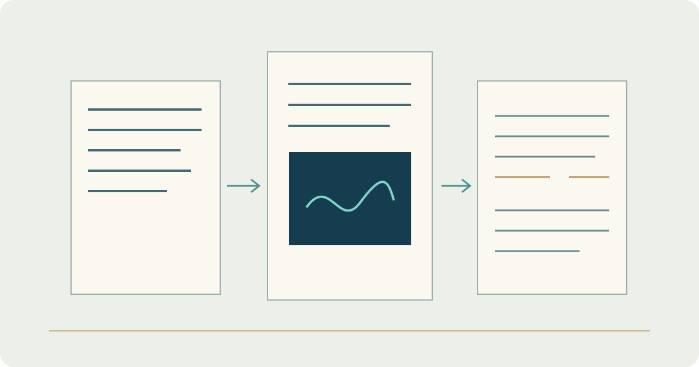

# Academic Portfolio — Multilingual Publishing

**Stage: Live**

## Context

The portfolio brings my academic background, engineering projects, technical articles and educational book material into one website. It explains the problem behind each work, my role and what readers can explore.

Arabic pages use right-to-left layout; English and Turkish pages use left-to-right layout.

## Technical structure

Astro and TypeScript provide the website structure. Firebase supports server-side services, administrator access and Firestore-backed editorial records.

## Editorial workflow

The content model distinguishes private drafts, saved revisions and published material. Editing, previewing and publishing are separate actions, with revision history supporting content review and restoration.

The book reader organises units, topics, code examples, tables, equations, questions and their linked solutions. It presents the material that has been made available without turning every saved draft into a public page.

[Read the portfolio case study](https://yahyaalali.com/en/content-library/project/academic-portfolio/)

[English](https://yahyaalali.com/en/) · [العربية](https://yahyaalali.com/) · [Türkçe](https://yahyaalali.com/tr/) · [Back to selected work](../README.md)
