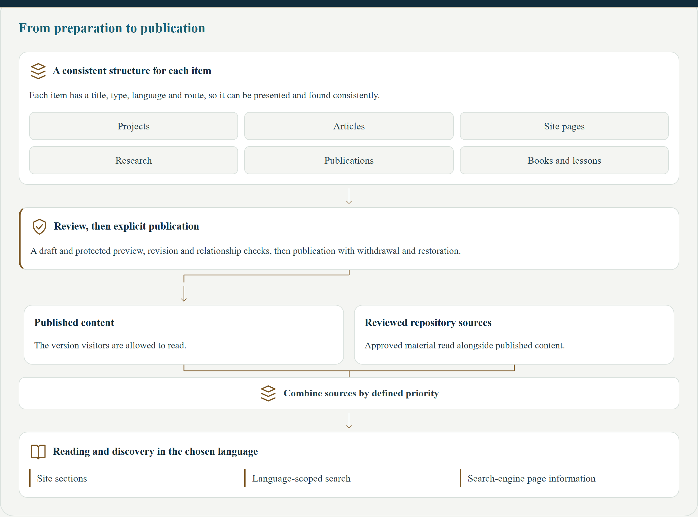
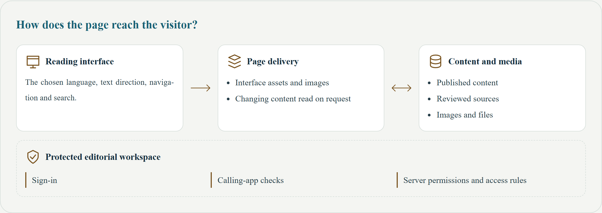

# Personal Academic Platform

[العربية](ar.md) · [English](en.md) · [Türkçe](tr.md)

[Published case study](https://yahyaalali.com/en/works/academic-portfolio/)

Web Engineering & Information Architecture · Live

Content engineering and a coherent reading experience uniting research, engineering, and learning in three languages

- **Content:** Projects · Research · Learning resources
- **Languages:** Arabic · English · Turkish
- **Status:** Live published platform, actively expanding

One place to explore software projects, research and publications, and read lessons and books in Arabic, English and Turkish.

Public views from the live platform · 22 November 2026

## Vision and Unified Knowledge Architecture

Instead of moving between scattered repositories and files, visitors find a page for each project, research item or learning resource, explaining its purpose, status and links. Each work keeps its identity within a consistent trilingual reading experience.

### Visual Identity — Research · Engineering · Knowledge

The three interwoven bands represent how these pillars reinforce one another, while the cyan path linking the two nodes conveys connection. The same lettering-free emblem unifies the platform's Arabic, English, and Turkish interfaces.

## Inside the Live Platform Interfaces

This gallery showcases five independent public views from the live platform, captured from visitor pages in the matching language to reflect the actual browsing and reading experience:

Capture of the live public interface · 2026-11-22

### Home and Reading Identity

A public entry point combining personal profile context, visual identity, featured research and project highlights, and clear top-level navigation.

[Visit source page](https://yahyaalali.com/en/)

Capture of the live public interface · 2026-11-22

### Unified Works Directory

An organized index separating digital products and solutions from engineering prototypes and coursework experiments, using unified cards that show maturity and link directly to details, live sites, and documentation.

[Visit source page](https://yahyaalali.com/en/works/)

Capture of the live public interface · 2026-11-22

### Structured Book and Lesson Reader

A progressive reading experience shown through Lesson 1 of _Network Foundations_ across all three languages, combining book navigation, unit and lesson headings, reading progress, and learning objectives; the _Dart_ reader is also available in Arabic.

[Visit source page](https://yahyaalali.com/en/books/network-foundations/network-foundations-lesson-1/)

Capture of the live public interface · 2026-11-22

### Academic Research Track

A dedicated scholarly space highlighting doctoral research and university theses with contextual links to related outputs while keeping every bibliographic record independent.

[Visit source page](https://yahyaalali.com/en/research/)

Capture of the live public interface · 2026-11-22

### Language-Scoped Local Search

A standalone discovery interface with a localized search input and mixed public results across platform sections for quick access to titles and topics.

[Visit source page](https://yahyaalali.com/en/search/)

## How the Platform Serves Its Readers

Reading paths are designed so every audience reaches relevant material directly without noise:

### For Researchers and Engineering Collaborators

1. Connected navigation between research records and related publications in the same language, preserving clear references and bibliographic identity
   .
2. Detailed engineering case studies covering problem context, design, interfaces, architecture, and personal contribution for each product and project
   .
3. Transparent classification distinguishing released products from in-development systems, research prototypes, and coursework experiments
   .

### For Learners and Technical Readers

1. A structured book and lesson reader organizing units, topics, exercises, and version-linked solutions with in-page outlines and code copying
   .
2. Technical guides and articles connected to practical engineering work, supporting smooth movement between reading and real projects
   .
3. Client-side text search within the active interface language, including Arabic character and diacritic normalization
   .

## From preparing content to reading a page

The first diagram follows content through organization, review and publication. The second shows how a page reaches the visitor while administration stays protected.

Publication is an explicit decision after review. Approved sources are combined by defined priority, while internal editorial data stays outside public reading.

Diagram text and details

### From preparation to publication

#### A consistent structure for each item

Each item has a title, type, language and route, so it can be presented and found consistently.

- Projects
- Articles
- Site pages
- Research
- Publications
- Books and lessons

#### Review, then explicit publication

A draft and protected preview, revision and relationship checks, then publication with withdrawal and restoration.

#### Published content

The version visitors are allowed to read.

#### Reviewed repository sources

Approved material read alongside published content.

Combine sources by defined priority

#### Reading and discovery in the chosen language

- Site sections
- Language-scoped search
- Search-engine page information

Interface assets are served directly and changing content is read on request with bounded freshness. The editorial workspace stays outside the public cache.

Diagram text and details

### How does the page reach the visitor?

#### Reading interface

The chosen language, text direction, navigation and search.

#### Page delivery

- Interface assets and images
- Changing content read on request

#### Content and media

- Published content
- Reviewed sources
- Images and files

#### Protected editorial workspace

- Sign-in
- Calling-app checks
- Server permissions and access rules

## Technology, Contribution, and Links

### Tools and Technologies

#### Interface

`Astro` · `TypeScript`

#### Delivery and data

`Firebase Hosting` · `Cloud Functions Gen2` · `Cloud Run` · `Cloud Firestore`

#### Protection and media

`Firebase Authentication` · `App Check` · `Cloud Storage`

### My Contribution

I designed the platform and its identity, developed its interfaces, services and publishing tools, and organized its content and trilingual reading paths.

### Public Access and Scope

The captures show public reading pages; editorial and administrative tools remain in a protected workspace.

### Project Links

### Project links

- [Visit Website](https://yahyaalali.com/en/)
- [Visit source page](https://yahyaalali.com/en/works/)
- [Visit source page](https://yahyaalali.com/en/books/network-foundations/network-foundations-lesson-1/)
- [Visit source page](https://yahyaalali.com/en/research/)
- [Visit source page](https://yahyaalali.com/en/search/)
- [Published case study](https://yahyaalali.com/en/works/academic-portfolio/)

[Back to projects](../../README.md)
