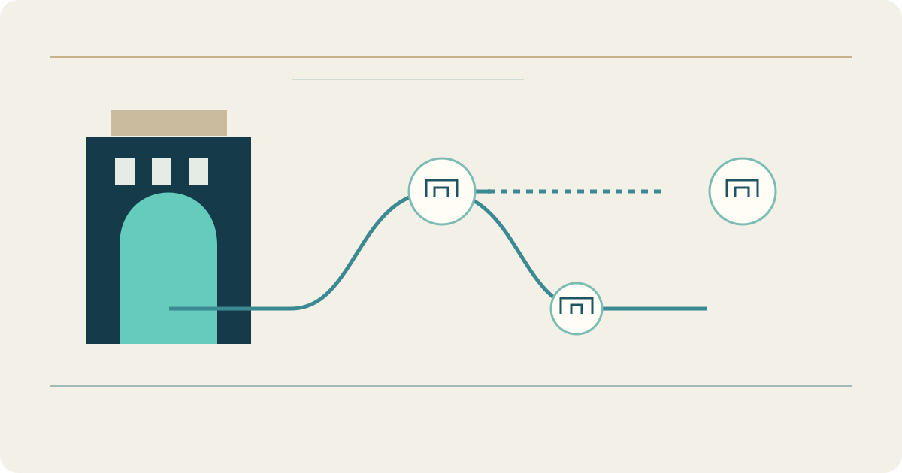

# Ashara — A City Portal

**Stage: Live city website; governorate expansion planned**

Ashara brings city information and public service entry points into one website. Visitors can browse news and public information, check weather and prayer times, and find the relevant service. Account-based services lead into sign-in. The public interface is available at [ashara-city.com](https://ashara-city.com/).

I develop the application and its integration with the backend. The project combines Flutter interfaces with Django services and distinguishes public information from authenticated administrative work.

Development is directed towards a wider Deir Ezzor governorate experience, with organised space for each city and its content. That expansion remains in development. The [municipal operations platform](municipal-operations.md) is a separate project for administrative work.

[Read the project case study](https://yahyaalali.com/en/content-library/project/ashara/) · [Visit the city portal](https://ashara-city.com/) · [Back to selected work](../README.md)
