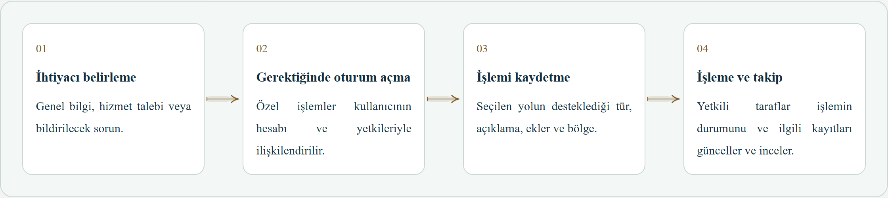
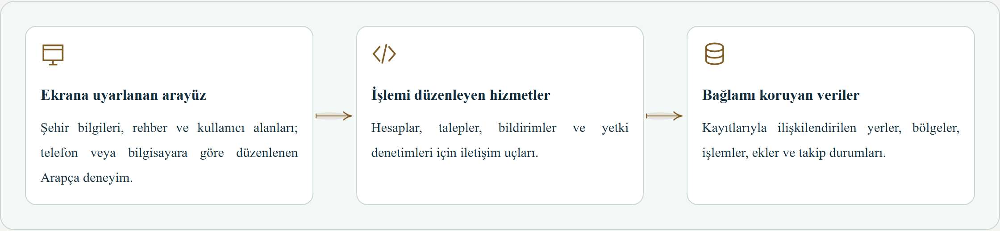

# Aşara Portalı

[العربية](ar.md) · [English](en.md) · [Türkçe](tr.md)

[Yayımlanan proje incelemesi](https://yahyaalali.com/tr/works/ashara/)

Şehir ve Toplum · Yayımlandı

Şehir bilgisinden hizmetlere; yerel yaşamla daha açık bir bağ

Şehir haberlerini, yerleri ve günlük bilgileri bir araya getiren dijital portal; bunları hizmet, sorun bildirimi ve takip alanlarıyla buluşturur. Aşara’dan başlayan ve Deyrizor iline uzanan vizyon; telefon, tablet ve bilgisayara uyum sağlayan düzenlerle sunulur.

Şehrin kamusal alanları ve dijital hizmetlerle ilişkisini anlatan kavramsal görsel; gerçek bir Aşara fotoğrafı veya uygulama ekran görüntüsü değildir.

- **Diller:** Arapça
- **Platformlar:** Web, mobil ve masaüstü için ortak temel
- **Kimler için:** Sakinler, ziyaretçiler, hizmet ekipleri ve yöneticiler

## Şehri insanlara yaklaştırmak

Şehrin günlük soruları tekrarlanır: bir yer, tesis veya acil durum numarası nerede, hava nasıl, sıradaki namaz ne zaman, bir hizmete ihtiyaç duyduğumda ya da sorunla karşılaştığımda nereden başlamalıyım? Fikir, bu başlangıçları tek bir portalda buluşturmaktır. Ziyaretçi genel bilgiye doğrudan ulaşırken vatandaş, hesabıyla ilişkili işlemlere açık bir yol bulur.

Aşara, vizyonun sınırı değil başlangıç noktasıdır. Bilgileri, yerleri ve hizmetleri yerel bağlamlarıyla düzenlemek; her yerin kimliğini koruyarak Deyrizor ilinin şehir, kasaba ve bölgelerine yayılabilecek bağlantılı bir deneyime temel oluşturur.

### Deyrizor: bir harf, bir köprü ve Fırat

Portalın simgesi Deyrizor’la bağını üç öğede toplar: şehrin Arapça adının ilk harfi olan dâl; başta asma köprü olmak üzere şehrin köprülerini anımsatan köprü; ve şehirden geçen, yaşamını şekillendiren Fırat. Altın biçim ve turkuaz akış; bu öğeleri yere, insanlara ve hizmetlere ait ortak bir kimlikte buluşturur.

### Görsel kimliğin anlamı

1. **Dâl · Deyrizor**
   Altın biçim, Deyrizor’un Arapça adının ilk harfi olan dâlden doğar.
2. **Köprü · şehrin hafızası**
   Deyrizor’un iki yakasını ve insanlarını buluşturan köprüleri, özellikle asma köprüyü anımsatır.
3. **Fırat · yerin yaşamı**
   Turkuaz akış, Deyrizor’dan geçen Fırat’ı temsil ederek kimliği şehrin yaşamına ve coğrafyasına bağlar.

## Portalın içinde

Herkese açık arayüz ayrıntılarında bir tur: hizmet ve bildirim girişleri, namaz vakitleri, yer rehberi araçları ve Şehrin Nabzı. Her alanın, bilgiye ulaşmaktan sonraki adımı seçmeye uzanan açık bir amacı vardır.

Arayüz Arapçadır; bu çalışma için ekranlar Times New Roman ile görüntülenmiştir.

### Ziyaretçinin başlangıç noktasındaki hizmetler

Hizmet talebi ve sorun bildirimi için ayrı girişler; bunların yanında şehir rehberi ve hizmet durumu. Her alan, kalabalık bir listeye dönüşmeden kendi amacıyla okunur.

[Siteyi Ziyaret Et](https://ashara-city.com/)

### Günün bilgileri ve namaz vakitleri

Namaz saatleri ve sıradaki vakte kalan süre günlük deneyimi destekler. Görünen saatler çekim tarihine aittir; bu sayfa canlı takvim veya bildirim değildir.

[Siteyi Ziyaret Et](https://ashara-city.com/)

### Yerel mekân rehberi

Arama ve kategoriler, bir yeri yerel bağlamında bulmaya yardımcı olur. Bu ayrıntı rehber araçlarını gösterir; etkileşimli harita portalın kendisinde incelenir.

[Siteyi Ziyaret Et](https://ashara-city.com/)

### Şehrin Nabzı

Kayıtlı hizmet durumunu, uyarıları ve bakım bilgilerini okumaya ayrılan alan. Görüntüdeki durum çekim anına aittir; kapsamlı saha takibi veya garantili anlık güncelleme kanıtı değildir.

[Siteyi Ziyaret Et](https://ashara-city.com/)

## Bilgiden takibe

Portal; bilgiyi, işlemi ve takibi birbirine bağlar. Ziyaretçi açık içeriğe ulaşır, vatandaş kendi işlemleri için bir alan bulur; yetkili ekipler talepleri ele alıp durumlarını günceller. Sorumlulukların ve sonraki adımların daha açık olduğu bir yolculuk oluşur.

### Sakinler ve ziyaretçiler için

Şehir bilgileri ve yerel rehber; ardından mevcut hizmetlere ve hesap yetkilerine göre talepleri, bildirimleri, faturaları, duyuruları ve desteği birleştiren vatandaş alanı.

### Hizmet ekipleri ve yöneticiler için

İşlemleri karşılama, görev dağıtımı ve uygulamayı izleme; bölgeleri, birimleri, varlıkları, projeleri, stokları, sözleşmeleri ve raporları tanımlı rollerle düzenleme.

Talebi düzenleyen açıklayıcı akış; ayrıntılar hizmete ve kullanıcının yetkisine bağlıdır.

Şema metni ve ayrıntıları

1. **İhtiyacı belirleme**
   Genel bilgi, hizmet talebi veya bildirilecek sorun.
2. **Gerektiğinde oturum açma**
   Özel işlemler kullanıcının hesabı ve yetkileriyle ilişkilendirilir.
3. **İşlemi kaydetme**
   Seçilen yolun desteklediği tür, açıklama, ekler ve bölge.
4. **İşleme ve takip**
   Yetkili taraflar işlemin durumunu ve ilgili kayıtları günceller ve inceler.

## Deneyim ile hizmeti bağlayan yapı

Bilgi ve hizmet arayüzü, hesapları ve iş kurallarını yöneten sunucu, her işlemin bağlamını saklayan veriler. Bu ayrım; sakinlerin deneyimini hizmet ekipleri ve yönetimle birleştirirken hizmetlerin sorumlulukları açık biçimde büyümesini sağlar.

Birbirine bağlı üç katman: kullanıcı deneyimi, hizmet işleme ve veri kayıtları.

Şema metni ve ayrıntıları

1. **Ekrana uyarlanan arayüz**
   Şehir bilgileri, rehber ve kullanıcı alanları; telefon veya bilgisayara göre düzenlenen Arapça deneyim.
2. **İşlemi düzenleyen hizmetler**
   Hesaplar, talepler, bildirimler ve yetki denetimleri için iletişim uçları.
3. **Bağlamı koruyan veriler**
   Kayıtlarıyla ilişkilendirilen yerler, bölgeler, işlemler, ekler ve takip durumları.

Flutter; web, Android, iOS, Windows, macOS ve Linux için ortak bir temel sağlar; düzenler telefon, tablet ve bilgisayara uyum gösterir. Şu anda ziyaret edilebilen adres web sürümüdür; cihaz sürümleri yayımlandığında indirme bağlantıları eklenir. Ürün vizyonu bir web sitesinden daha geniştir.

## Araçlar, teknolojiler ve proje bağlantıları

#### Arayüz ve deneyim

Flutter · Dart · Provider · Dio

#### Hizmetler ve iş kuralları

Python · Django · Django REST Framework

#### Veri ve entegrasyonlar

Django ORM · SharedPreferences · Google Maps

### Katkı

Portalın deneyimi, arayüzleri, hizmetleri ve veri düzeni üzerinde çalışıyorum: açık bilgilerin sıralanması ve uyumlu gezinmeden rollerin ayrılmasına, işlemlerin iş akışları ve takiple bağlanmasına kadar.

Portalı keşfedin veya fikrini ve yapısını anlamak için proje belgelerini okuyun.

### Proje bağlantıları

- [Siteyi Ziyaret Et](https://ashara-city.com/)
- [Yayımlanan proje incelemesi](https://yahyaalali.com/tr/works/ashara/)

[Projelere dön](../../README.tr.md)
