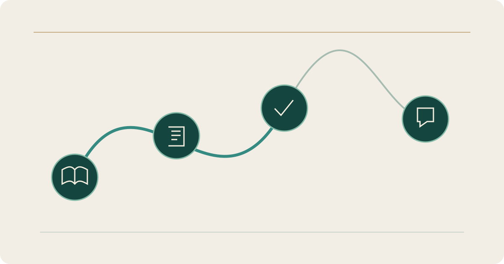

# Athar Al-Wird — Quran Teaching and Practice

**Stage: Online; development continues**

## Context

Athar Al-Wird is an Arabic-first Quran teaching and practice platform. It connects learning circles, groups, study plans, sessions and progress follow-up, with separate administrator, teacher, student and guardian roles.

Students can follow their assigned plan and session times. Teachers relate practice, progress and assessment to the learning group, while guardians and administrators see the information relevant to their roles.

## My role and technical structure

I develop the Flutter application and its server-side workflows. The current web service uses Firebase; the domain moved from the earlier synthetic staging environment to the production-backed application in October 2026.

## Access and current work

The online application opens at its sign-in screen. Account access and available functions depend on the assigned role; it is not an unrestricted demonstration containing only synthetic data. Development continues on the user experience, account lifecycle and operational verification.

[Open the application sign-in](https://atharwird.com/) · [Read the project overview](https://yahyaalali.com/en/content-library/project/athar-wird/) · [Back to selected work](../README.md)
