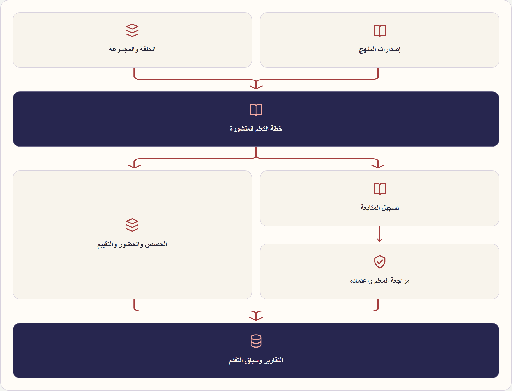
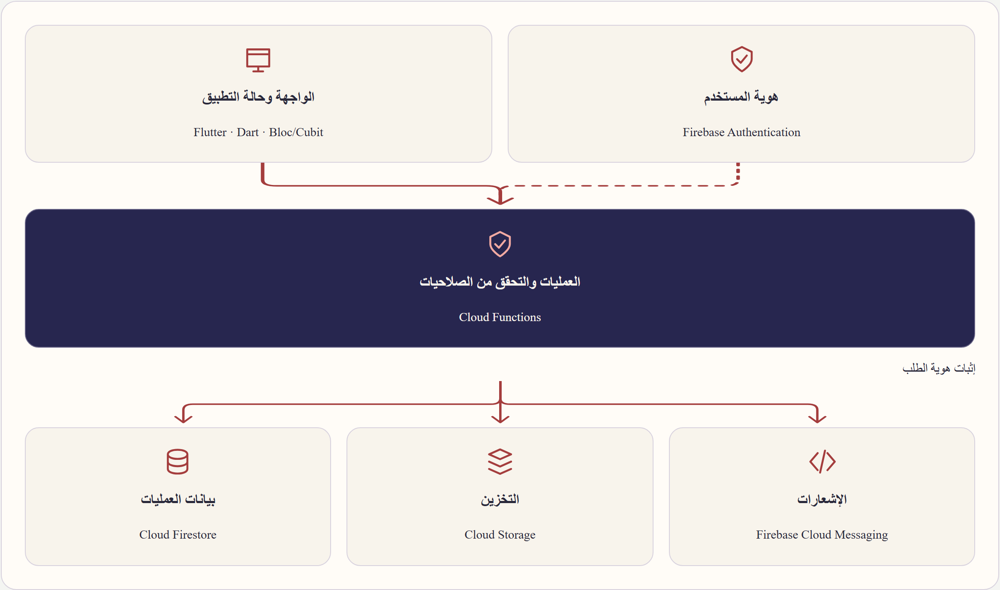

# أثر الوِرد

[العربية](ar.md) · [English](en.md) · [Türkçe](tr.md)

[دراسة الحالة المنشورة](https://yahyaalali.com/works/athar-wird/)

تكنولوجيا التعليم · منشور على الويب

من الوِرد اليومي إلى أثرٍ موثّق

- **المنصة:** تطبيق ويب
- **اللغة:** العربية
- **الحالة:** منشور على الويب

منصة ويب منشورة تربط حلقات تعليم القرآن الكريم بالمناهج والخطط والحصص والحضور والتقييم، وتوفّر مسارات عمل تتوافق مع مسؤوليات الإدارة والمعلم والطالب وولي الأمر.

مكوّنات التطبيق الفعلية · بيانات اصطناعية · واجهة التطبيق المعروضة بالعربية

## الفكرة والهوية البصرية

لا تنتهي متابعة تعليم القرآن عند تحديد موعد الحصة أو تسجيل حضور الطالب. فكل حلقة ترتبط بمجموعات وأعضاء، وكل خطة تستند إلى منهج ومحتوى، وكل إنجاز يحتاج إلى سياق يوضح ما سُجّل وما اعتُمد.

عندما تُدار هذه العناصر في مسارات منفصلة، تصبح المحافظة على ترابط الرحلة التعليمية أكثر صعوبة. ومن هنا جاءت فكرة «أثر الوِرد»: جمع تلك العلاقات في تجربة واحدة منظّمة، مع تحديد ما يستطيع كل مستخدم رؤيته أو تنفيذه بحسب صلاحياته.

### الهوية البصرية

علامة مستلهمة من حرف الثاء في «أثر»، بجسم عاجي مرسوم خصيصًا وثلاث نقاط مرجانية ترمز إلى التخطيط والتلاوة والمراجعة. تجمع الهوية بين الحبر النيلي والورق العاجي، ليرتبط الرمز باسم التطبيق وإيقاع الوِرد اليومي.

## جولة داخل واجهات التطبيق

واجهات من مكوّنات التطبيق الفعلية، معزولة محليًا ببيانات اصطناعية؛ تعرض طريقة تنظيم العمل دون إظهار سجلات حقيقية أو الادعاء بأنها لقطات من حسابات الإنتاج. التطبيق عربي، وتُترجم شروحات دراسة الحالة هنا إلى ثلاث لغات.

مكوّنات التطبيق الفعلية · بيانات اصطناعية

### لوحة البداية وتنظيم العمل

نظرة عامة تجمع مؤشرات المتابعة وإجراءات التنقل إلى مجالات العمل. القيم الظاهرة بيانات عرض اصطناعية.

مكوّنات التطبيق الفعلية · بيانات اصطناعية

### المناهج ومرجعية التعلّم

واجهة تنظيم المناهج والإصدارات، في سياق إدارة المحتوى التعليمي.

مكوّنات التطبيق الفعلية · بيانات اصطناعية

### مساحة المعلّم

مساحة عمل المعلّم للتنقل بين الخطط والحصص ومتابعة التعلّم.

مكوّنات التطبيق الفعلية · بيانات اصطناعية

### مساحة الطالب وولي الأمر

واجهة الأسرة للاطلاع على المسارات والسجل التعليمي المصرح بهما.

مكوّنات التطبيق الفعلية · بيانات اصطناعية

### الحصص والحضور والمتابعة

مساحة تنظيم الحصص وربط مواعيدها بالحضور والتقييم وفق الإجراءات المتاحة.

### مواقيت الصلاة ضمن إيقاع اليوم

يحسب التطبيق مواقيت الصلاة بحسب الموقع والتوقيت المحلي، ويعرض الصلاة القادمة والوقت المتبقي لها. يمكن تحديد الموقع بإذن المستخدم أو اختيار المدينة يدويًا، مع إعدادات لطريقة الحساب.

مكوّنات التطبيق الفعلية · بيانات اصطناعية

#### الصلاة القادمة ومواقيت اليوم

واجهة المواقيت الأصلية تعرض الصلاة التالية والعدّ التنازلي وجدول اليوم. اللقطة تستخدم مدينة عامة وتاريخًا ثابتًا للعرض؛ ليست مواقيت إرشادية للصلاة الآن.

مكوّنات التطبيق الفعلية · بيانات اصطناعية

#### اختيار المدينة والتحكم بالموقع

بديل واضح لتحديد الموقع: اختيار مدينة من القائمة دون الحاجة إلى مشاركة موقع الجهاز. في الحاضنة استُخدمت إحداثيات عامة مصطنعة، دون طلب GPS أو حفظ موقع شخصي.

المواقيت حسابية وتتأثر بالموقع وطريقة الحساب؛ تُراجع مع المواقيت المحلية المعتمدة. الصور من المكوّنات الأصلية في حاضنة محلية، وليست سجلًا لموقع مستخدم.

## تجربة مترابطة لأربعة أدوار

ينظّم «أثر الوِرد» العمل من إدارة الحلقة والمجموعة إلى إعداد الخطة التعليمية والحصة ومتابعة التقدم، مع مساحة وظيفية تعكس مسؤوليات كل طرف:

### الإدارة

إدارة الحسابات والدعوات والحلقات والمجموعات والمناهج والإشراف والتقارير ضمن حدود الصلاحيات.

### المعلم

إعداد الخطط، وإدارة الحصص، وتسجيل الحضور والتقييم، ومراجعة تقدم الطلاب ضمن نطاقه التعليمي.

### الطالب

الاطلاع على خطته وسجله التعليمي وتسجيل المتابعة والإنجاز وفق الإجراءات المصرح بها.

### ولي الأمر

متابعة المعلومات التعليمية للطلاب المرتبطين به وفق التفويض، والمشاركة في مسارات المتابعة المتاحة له.

## هندسة الرحلة التعليمية

### من المنهج إلى تقدّم له سياق

تلتقي الحلقة ومرجعية المنهج في خطة منشورة؛ تبقى متابعة الأسرة منفصلة عن مراجعة المعلم واعتماده.

نص المخطط وتفاصيله

الحلقة والمجموعة

إصدارات المنهج

خطة التعلّم المنشورة

الحصص والحضور والتقييم

تسجيل المتابعة

مراجعة المعلم واعتماده

التقارير وسياق التقدم

### واجهة واضحة ومسؤوليات محمية

مسؤوليات الخدمات الأساسية؛ يتحقق المسار الخادمي من الهوية والصلاحيات، ولا تمنح الواجهة وحدها إذن الوصول.

نص المخطط وتفاصيله

الواجهة وحالة التطبيق

Flutter · Dart · Bloc/Cubit

هوية المستخدم

Firebase Authentication

العمليات والتحقق من الصلاحيات

Cloud Functions

إثبات هوية الطلب

بيانات العمليات

Cloud Firestore

التخزين

Cloud Storage

الإشعارات

Firebase Cloud Messaging

**القرارات الهندسية وحدودها**

### 1. الصلاحيات تتجاوز الواجهة

تُفحص الهوية والدور والعلاقات المرتبطة بالحلقات والطلاب في المسار الخادمي. لذلك لا يعتمد التحكم في الوصول على إخفاء عناصر الواجهة وحده، بل على نطاق التفويض الفعلي.

### 2. مناهج ذات إصدارات

يدعم نموذج البيانات إصدارات المناهج وربط الخطط بمحتواها، بما يساعد على الحفاظ على مرجعية الخطة التعليمية عند تحديث المنهج.

### 3. فصل التسجيل عن الاعتماد

يميّز سير العمل بين المتابعة التي يسجلها الطالب أو ولي الأمر، وبين ما يراجعه المعلم أو يعتمده ضمن صلاحياته.

### 4. الحصة أكبر من رابط اجتماع

تُعامل مواعيد الحصص وحالاتها والحضور والتقييم بوصفها إجراءات مترابطة ومتميزة. ففتح رابط الاجتماع لا يعني وحده تسجيل حضور معتمد.

### 5. سجل نشاط وإيصالات للعمليات

تدعم البنية مراجعة الإجراءات من خلال سجل النشاط، وتستخدم بعض مسارات العمل إيصالات للعمليات تساعد في التعامل المنضبط مع المحاولات المتكررة.

### 6. فصل المسؤوليات التقنية

يدير Flutter وDart تجربة المستخدم وحالة الواجهة، بينما تُستخدم خدمات Firebase للمصادقة والبيانات والعمليات الخادمية والتخزين والإشعارات بحسب مسؤولية كل خدمة. وتستفيد العمليات التي يتطلب تنفيذها ذلك من معاملات Firestore.

## التقنيات والمساهمة والروابط

#### الواجهة وإدارة الحالة

Flutter · Dart · Bloc/Cubit

#### الهوية والعمليات

Firebase Authentication · Cloud Functions

#### البيانات والخدمات المساندة

Cloud Firestore · Cloud Storage · Firebase Cloud Messaging

### المساهمة الهندسية

شمل دوري توجيه تجربة الاستخدام العربية، وتنظيم مسارات الأدوار، وربط متطلبات العمل التعليمي بالواجهات والخدمات. وتبرز في المشروع قرارات موثقة تتعلق بالتفويض، وإصدارات المناهج، وفصل التسجيل عن الاعتماد، والمحافظة على سياق المتابعة.

### حالة النشر

**أثر الوِرد منشور على الويب** عبر نطاقه الرسمي. وتتطلب مساحات العمل الداخلية حسابًا وصلاحيات مناسبة.

تستند دراسة الحالة إلى الشيفرة والتوثيق وسجلات تحقق محددة، ويستمر تطوير المنصة وتحسين تجربتها. لا يتضمن هذا الوصف ادعاءً بإطلاق تطبيقات في المتاجر أو إثبات جميع السيناريوهات التشغيلية على الإنتاج.

### روابط المشروع

- [زيارة الموقع](https://atharwird.com/)
- [دراسة الحالة المنشورة](https://yahyaalali.com/works/athar-wird/)

[العودة إلى قائمة المشروعات](../../README.ar.md)
