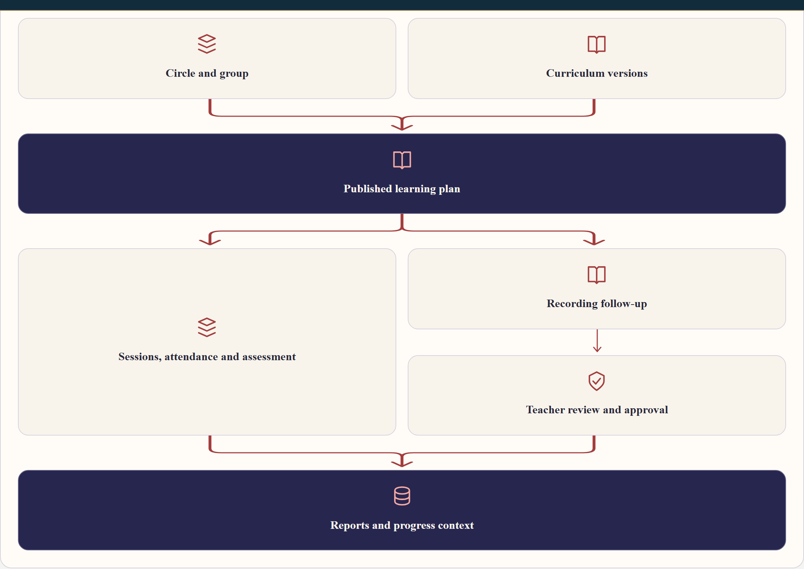
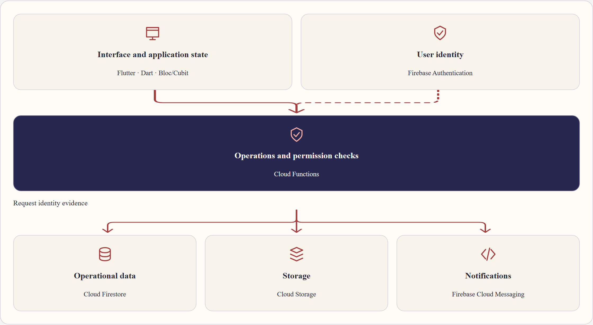

# Athar Al-Wird

[العربية](ar.md) · [English](en.md) · [Türkçe](tr.md)

[Published case study](https://yahyaalali.com/en/works/athar-wird/)

Education Technology · Published on the web

From daily practice to a traceable educational record

- **Platform:** Web application
- **Language:** Arabic
- **Availability:** Published on the web

A published web platform connecting Quran learning circles with curricula, study plans, sessions, attendance, and assessment. It provides role-specific workflows aligned with the responsibilities of administrators, teachers, learners, and guardians.

Actual application components · Synthetic data · The application interface is Arabic

## The Idea and Visual Identity

Tracking a learner’s progress goes beyond scheduling a session or recording attendance. Each learning circle has groups and members; each study plan draws on curriculum content; and each recorded achievement needs context to distinguish a submitted update from an approved result.

When these elements are managed through separate workflows, maintaining a coherent learning record becomes more difficult. Athar Al-Wird brings these relationships into one structured experience while defining what each user is authorized to view or perform.

### Visual Identity

A custom ivory mark inspired by the Arabic letter thāʾ in Athar, with three coral dots representing planning, recitation and review. Midnight-blue ink and ivory paper connect the symbol to the app’s name and the rhythm of daily learning.

## Inside the Application

Actual application components rendered in an isolated local shell with synthetic data. These images explain the interface without exposing real records or presenting them as captures from production accounts. The app is Arabic; the case-study explanations are available in three languages.

Actual application components · Synthetic data

### Dashboard and work organization

An overview brings follow-up indicators and navigation into one workspace. All displayed values are synthetic demonstration data.

Actual application components · Synthetic data

### Curricula and learning references

The interface for organizing curricula and their versions within educational content management.

Actual application components · Synthetic data

### The teacher workspace

The teacher’s workspace for navigating plans, sessions and learning follow-up.

Actual application components · Synthetic data

### The learner and parent workspace

The family interface for the permitted learning paths and educational record.

Actual application components · Synthetic data

### Sessions, attendance and follow-up

A workspace connecting session scheduling with attendance and assessment procedures.

### Prayer times within the daily rhythm

The app calculates prayer times using location and local time, and shows the next prayer and the remaining time. Users can permit location detection or choose a city manually, with calculation-method settings.

Actual application components · Synthetic data

#### The next prayer and today’s times

The original prayer panel shows the next prayer, a countdown and the daily schedule. The capture uses a public city and a fixed demonstration date; it is not guidance for prayer times now.

Actual application components · Synthetic data

#### City selection and location control

A clear alternative to location detection: choose a city without sharing the device location. The isolated shell uses public demonstration coordinates, without GPS requests or personal location storage.

Calculated times depend on location and method; compare them with approved local timetables. Images show original components in a local shell, not a user’s location record.

## A Connected Experience for Four Roles

Athar Al-Wird connects circle and group management with planning, sessions, assessment, and progress tracking. Each role receives workflows aligned with its responsibilities:

### Administration

Manages accounts, invitations, circles, groups, curricula, oversight, and reporting within defined permissions.

### Teacher

Prepares plans, manages sessions, records attendance and assessments, and reviews learners’ progress within an assigned scope.

### Learner

Accesses authorized study plans and learning records and submits progress updates through permitted workflows.

### Guardian

Follows authorized learners’ educational records and participates in permitted follow-up activities.

## Engineering the Learning Journey

### From Curriculum to Meaningful Progress

The circle and curriculum reference meet in a published plan. Family check-ins remain separate from teacher review and approval.

Diagram text and details

Circle and group

Curriculum versions

Published learning plan

Sessions, attendance and assessment

Recording follow-up

Teacher review and approval

Reports and progress context

### A Clear Interface and Protected Responsibilities

Core service responsibilities. Server-side processing checks identity and permissions; the interface alone does not grant access.

Diagram text and details

Interface and application state

Flutter · Dart · Bloc/Cubit

User identity

Firebase Authentication

Operations and permission checks

Cloud Functions

Request identity evidence

Operational data

Cloud Firestore

Storage

Cloud Storage

Notifications

Firebase Cloud Messaging

**Engineering Decisions and Boundaries**

### 1. Authorization Beyond the Interface

Identity, roles, and relationships are evaluated on the server side. Access control relies on authorization scopes, not merely on hiding interface elements.

### 2. Version-Aware Curricula

The data model supports curriculum versions and links study plans to their content, helping preserve the context of plans when a curriculum changes.

### 3. Recording and Approval Are Distinct

The workflow distinguishes progress submitted by a learner or guardian from actions reviewed or approved by an authorized teacher.

### 4. A Session Is More Than a Meeting Link

Scheduling, session states, attendance, and assessment are related but distinct operations. Opening a meeting link does not, by itself, establish approved attendance.

### 5. Activity Records and Operation Receipts

Activity records support the review of actions, while operation receipts help selected workflows handle repeated requests in a controlled manner.

### 6. Separation of Technical Responsibilities

Flutter and Dart handle the interface and application state. Firebase services support authentication, data, server-side operations, storage, and notifications according to their responsibilities. Firestore transactions are used where required by the implemented operations.

## Technologies, Contribution and Links

#### Interface and State

Flutter · Dart · Bloc/Cubit

#### Identity and Operations

Firebase Authentication · Cloud Functions

#### Data and Supporting Services

Cloud Firestore · Cloud Storage · Firebase Cloud Messaging

### Engineering Contribution

My contribution included shaping the Arabic user experience, organizing role-specific workflows, and connecting educational requirements with application screens and supporting services. Documented engineering decisions include scoped authorization, versioned curricula, separate recording and approval flows, and contextual progress tracking.

### Availability

**Athar Al-Wird is published on the web** through its official domain. Access to internal workspaces requires an authorized account.

This case study reflects source implementation, documentation, and bounded verification records. Development and improvements continue; no app-store release or comprehensive production acceptance is claimed.

### Project links

- [Visit Website](https://atharwird.com/)
- [Published case study](https://yahyaalali.com/en/works/athar-wird/)

[Back to projects](../../README.md)
