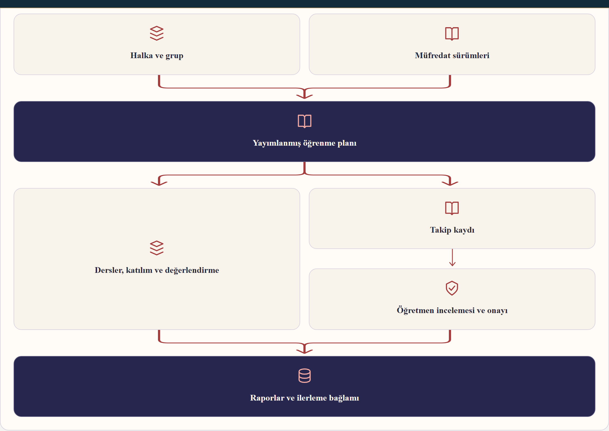
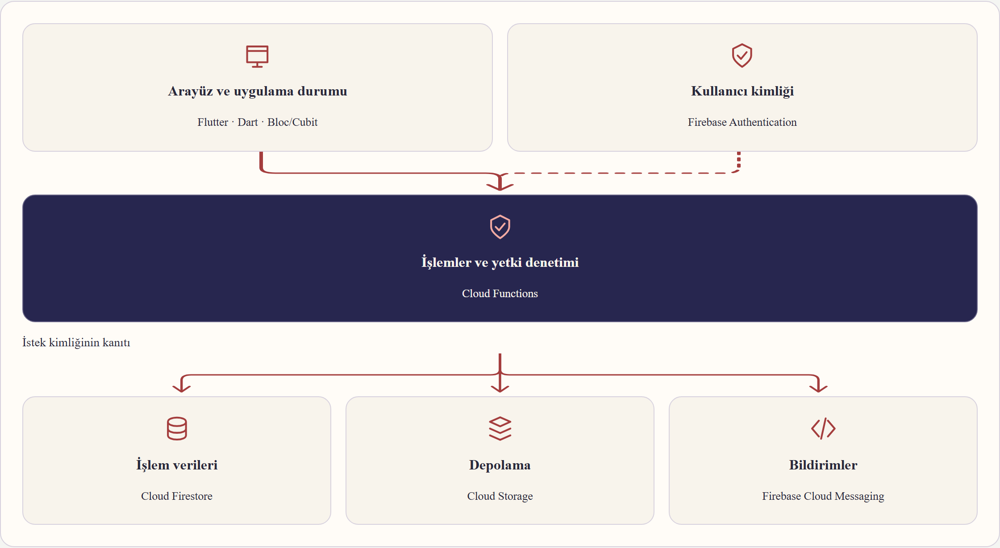

# Athar Al-Wird

[العربية](ar.md) · [English](en.md) · [Türkçe](tr.md)

[Yayımlanan proje incelemesi](https://yahyaalali.com/tr/works/athar-wird/)

Eğitim Teknolojisi · Web'de yayında

Günlük çalışmalardan izlenebilir eğitim kayıtlarına

- **Platform:** Web uygulaması
- **Dil:** Arapça
- **Yayın durumu:** Web’de yayında

Kur’an eğitim halkalarını müfredat, çalışma planları, dersler, devam takibi ve değerlendirme süreçleriyle birleştiren, web üzerinde yayımlanmış bir platform. İş akışları yönetici, öğretmen, öğrenci ve veli rollerinin sorumluluklarına göre yapılandırılmıştır.

Gerçek uygulama bileşenleri · Sentetik veriler · Uygulama arayüzü Arapçadır

## Fikir ve Görsel Kimlik

Bir öğrencinin gelişimini takip etmek, yalnızca ders saati belirlemek veya yoklama almakla sınırlı değildir. Eğitim halkaları gruplar ve üyelerle, çalışma planları müfredat içeriğiyle, ilerleme kayıtları ise bildirilen durum ile onaylanan sonucu ayıran süreçlerle ilişkilidir.

Bu unsurlar birbirinden bağımsız iş akışlarında yönetildiğinde eğitim sürecinin bütünlüğünü korumak zorlaşabilir. Athar Al-Wird, bu ilişkileri kullanıcıların görüntüleme ve işlem yetkilerini gözeten düzenli bir deneyimde bir araya getirir.

### Görsel Kimlik

Athar adındaki Arapça s̱ā (ث) harfinden esinlenen, özel çizilmiş fildişi gövde ve planlama, tilavet ve tekrarı temsil eden üç mercan nokta. Gece mavisi mürekkep ve fildişi kâğıt, simgeyi uygulamanın adına ve günlük öğrenme ritmine bağlar.

## Uygulamanın İçinden

Gerçek uygulama bileşenleri, sentetik verilerle yalıtılmış yerel bir ortamda görüntülenmiştir. Görseller gerçek kayıtları açığa çıkarmaz ve üretim hesaplarından alınmış ekran görüntüleri olarak sunulmaz. Uygulama Arapçadır; vaka çalışmasının açıklamaları üç dilde sunulur.

Gerçek uygulama bileşenleri · Sentetik veriler

### Başlangıç paneli ve iş düzeni

Takip göstergeleri ve çalışma alanlarına geçiş tek bir panelde toplanır. Görünen değerler sentetik gösterim verileridir.

Gerçek uygulama bileşenleri · Sentetik veriler

### Müfredat ve öğrenme kaynakları

Eğitim içeriği kapsamında müfredatı ve sürümlerini düzenleyen arayüz.

Gerçek uygulama bileşenleri · Sentetik veriler

### Öğretmen çalışma alanı

Planlara, derslere ve öğrenme takibine geçiş sağlayan öğretmen alanı.

Gerçek uygulama bileşenleri · Sentetik veriler

### Öğrenci ve veli alanı

Ailenin yetkili olduğu öğrenme yollarını ve eğitim kaydını gösteren arayüz.

Gerçek uygulama bileşenleri · Sentetik veriler

### Dersler, katılım ve takip

Ders zamanlamasını katılım ve değerlendirme işlemleriyle ilişkilendiren çalışma alanı.

### Günün ritminde namaz vakitleri

Uygulama, konum ve yerel saate göre namaz vakitlerini hesaplar; sıradaki namazı ve kalan süreyi gösterir. Kullanıcı izin vererek konumunu belirleyebilir veya şehri elle seçebilir; hesaplama yöntemi de ayarlanabilir.

Gerçek uygulama bileşenleri · Sentetik veriler

#### Sıradaki namaz ve günlük vakitler

Özgün vakit paneli sıradaki namazı, geri sayımı ve günlük çizelgeyi gösterir. Görselde genel bir şehir ve sabit bir örnek tarih kullanılır; güncel namaz vakti rehberi değildir.

Gerçek uygulama bileşenleri · Sentetik veriler

#### Şehir seçimi ve konum denetimi

Konum belirlemeye açık bir alternatif: cihaz konumunu paylaşmadan şehir seçimi. Yalıtılmış ortamda genel örnek koordinatlar kullanıldı; GPS isteği yapılmadı, kişisel konum kaydedilmedi.

Hesaplanan vakitler konuma ve yönteme bağlıdır; onaylı yerel takvimle karşılaştırılmalıdır. Görseller özgün bileşenlerin yerel gösterimidir; bir kullanıcının konum kaydı değildir.

## Dört Rol İçin Bağlantılı Deneyim

Platform, halka ve grup yönetimini planlama, ders, değerlendirme ve ilerleme takibiyle ilişkilendirir. Her rol kendi sorumluluklarına uygun iş akışlarına erişir:

### Yönetim

Hesapları, davetleri, eğitim halkalarını, grupları, müfredatı, denetimi ve raporlamayı yetki sınırları içinde yönetir.

### Öğretmen

Yetki alanında planlar hazırlar, dersleri yönetir, devam ve değerlendirme kayıtlarını işler, öğrencilerin gelişimini inceler.

### Öğrenci

Kendisine açık çalışma planını ve öğrenim kaydını görüntüler; izin verilen iş akışlarıyla ilerleme bilgisi girer.

### Veli

Yetkili olduğu öğrencilerin eğitim kayıtlarını takip eder ve izin verilen takip işlemlerine katılır.

## Öğrenme Yolculuğunun Mühendisliği

### Müfredattan Anlamlı İlerlemeye

Halka ve müfredat kaynağı yayımlanmış bir planda birleşir. Ailenin takip kayıtları, öğretmenin inceleme ve onayından ayrı tutulur.

Şema metni ve ayrıntıları

Halka ve grup

Müfredat sürümleri

Yayımlanmış öğrenme planı

Dersler, katılım ve değerlendirme

Takip kaydı

Öğretmen incelemesi ve onayı

Raporlar ve ilerleme bağlamı

### Açık Bir Arayüz ve Korunan Sorumluluklar

Temel hizmetlerin sorumlulukları. Kimlik ve yetki denetimi sunucu tarafında yapılır; arayüz tek başına erişim izni vermez.

Şema metni ve ayrıntıları

Arayüz ve uygulama durumu

Flutter · Dart · Bloc/Cubit

Kullanıcı kimliği

Firebase Authentication

İşlemler ve yetki denetimi

Cloud Functions

İstek kimliğinin kanıtı

İşlem verileri

Cloud Firestore

Depolama

Cloud Storage

Bildirimler

Firebase Cloud Messaging

**Mühendislik Kararları ve Sınırlar**

### 1. Arayüzün Ötesinde Yetkilendirme

Kimlik, rol ve ilgili kullanıcı ilişkileri sunucu tarafında değerlendirilir. Erişim denetimi yalnızca arayüz öğelerinin gizlenmesine değil, yetkilendirme kapsamına dayanır.

### 2. Sürüm Takibi Yapılan Müfredat

Veri modeli, müfredat sürümlerini ve çalışma planlarının ilgili içerikle bağlantısını destekleyerek müfredat değiştiğinde planın bağlamının korunmasına yardımcı olur.

### 3. Kayıt ve Onayın Ayrılması

Öğrenci veya velinin bildirdiği ilerleme ile yetkili öğretmenin inceleme veya onay işlemi birbirinden ayrılır.

### 4. Dersin Toplantı Bağlantısından Daha Geniş Bir Kapsamı Vardır

Ders planlaması, ders durumu, devam kaydı ve değerlendirme birbiriyle ilişkili ancak ayrı işlemlerdir. Toplantı bağlantısının açılması tek başına onaylanmış devam anlamına gelmez.

### 5. Etkinlik Kayıtları ve İşlem Makbuzları

Etkinlik kayıtları işlemlerin incelenmesini destekler. İşlem makbuzları ise belirli iş akışlarında yinelenen isteklerin kontrollü biçimde ele alınmasına yardımcı olur.

### 6. Teknik Sorumlulukların Ayrılması

Flutter ve Dart, kullanıcı arayüzü ile uygulama durumunu yönetir. Firebase hizmetleri kimlik doğrulama, veri, sunucu işlemleri, depolama ve bildirimler için ilgili sorumlulukları üstlenir. Gerekli işlemlerde Firestore transaction mekanizmalarından yararlanılır.

## Teknolojiler, Katkı ve Bağlantılar

#### Arayüz ve Durum Yönetimi

Flutter · Dart · Bloc/Cubit

#### Kimlik ve İşlemler

Firebase Authentication · Cloud Functions

#### Veri ve Destek Hizmetleri

Cloud Firestore · Cloud Storage · Firebase Cloud Messaging

### Mühendislik Katkısı

Projeye katkım; Arapça kullanıcı deneyiminin şekillendirilmesini, role özgü iş akışlarının düzenlenmesini ve eğitim gereksinimlerinin uygulama ekranları ile destekleyici hizmetlere bağlanmasını kapsadı. Kapsama bağlı yetkilendirme, sürümlü müfredat, kayıt ve onay işlemlerinin ayrılması ve bağlamı koruyan ilerleme takibi belgelenmiş mühendislik kararları arasındadır.

### Yayın Durumu

**Athar Al-Wird web üzerinde yayındadır.** İç çalışma alanlarına erişim için yetkili kullanıcı hesabı gerekir.

Bu vaka incelemesi, kaynak kod uygulamalarına, belgelere ve kapsamı belirli doğrulama kayıtlarına dayanır. Geliştirme ve iyileştirmeler sürmektedir; uygulama mağazası sürümleri veya üretim ortamında tüm senaryoların kabulü iddia edilmemektedir.

### Proje bağlantıları

- [Siteyi Ziyaret Et](https://atharwird.com/)
- [Yayımlanan proje incelemesi](https://yahyaalali.com/tr/works/athar-wird/)

[Projelere dön](../../README.tr.md)
