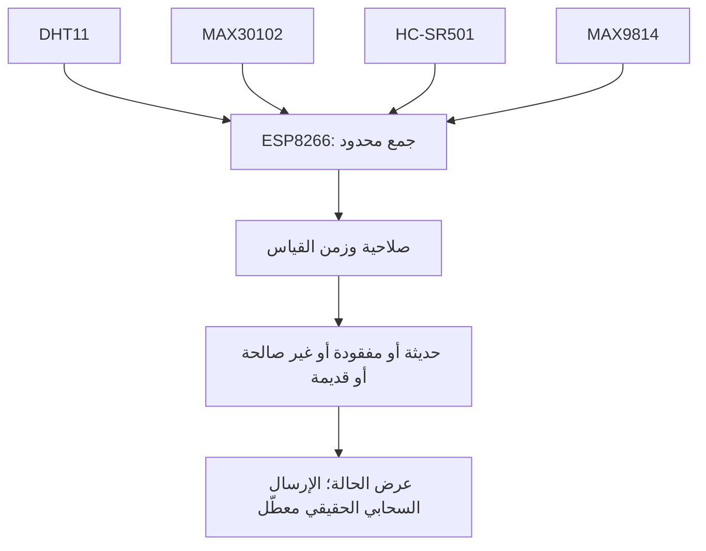

# نموذج مراقبة الطفل — جودة القياس قبل تفسيره

[العربية](ar.md) · [English](en.md) · [Türkçe](tr.md) · [العودة إلى الموقع](https://yahyaalali.com/content-library/project/baby-monitor/)

غلاف مفاهيمي للمراقبة وجودة البيانات، لا صورة عتاد أو واجهة تشغيل.

## الفكرة والسياق

بدأ هذا العمل بوصفه مشروع مقرر أكاديمي في 2024 يجمع مدخلات حسية في لوحة واحدة، ويعرضها عبر Serial وArduino IoT Cloud. تتناول مراجعته الحالية سؤالًا هندسيًا: كيف نميّز قياسًا حديثًا من صفر نتج عن فشل الحساس أو قيمة قديمة بقيت بعد انقطاعه؟

## المكونات وحدود القياس

| المكوّن  | المدخل الفعلي                                      | حدود التفسير                                   |
| -------- | -------------------------------------------------- | ---------------------------------------------- |
| DHT11    | حرارة البيئة ورطوبتها                              | ليس قياسًا لحرارة الجسم                        |
| MAX30102 | إشارات ضوئية حمراء وتحت حمراء لتقدير النبض والتشبع | لا تثبت صلاحية الخوارزمية وحدها الدقة السريرية |
| HC-SR501 | إشارة حركة PIR                                     | لا تثبت سقوطًا أو سلوكًا بعينه                 |
| MAX9814  | عينة تناظرية من مضخّم ميكروفون                     | ليست ديسيبل معايرة أو تشخيصًا للبكاء           |

## مساهمتي في المراجعة الحديثة

طوّرت في أكتوبر 2026 نسخة مستقلة تفصل قبول العينة عن عرضها وإشعار تغير حالتها، مع حفظ أصول المقرر دون تعديل. هذه مرحلة لاحقة وليست إضافة تُنسب إلى التسليم القديم؛ والمكتبات وخوارزمية معالجة الإشارة من عمل أصحابها. تتبع الشيفرة والتقارير المحددة Arduino IoT Cloud؛ لم أدمج بها وصف Blynk افتراضًا.

## من العينة إلى الحالة

تحمل القراءة حالة واضحة: مفقودة، حديثة، غير صالحة، أو قديمة. لا يتحول فشل الحساس إلى وضع طبيعي، ولا تُرسل آخر قيمة صحيحة كقياس جديد. تُجدول القراءات بالزمن بدل عدد الدورات، وتستمر القنوات الأخرى عند فشل بدء الحساس البصري. تفريغ المخزن محدود، بلا انتظار العينة إلى أجل غير محدد.

يُبلّغ انتقال الحالة مع تهدئة محددة وحفظ الانتقال المؤجل بدل إسقاطه. اختُبرت سياسة تأخير إعادة الاتصال وحجب القيم القديمة بمدخلات مصطنعة؛ لا ينفذ المرشح إرسالًا سحابيًا حقيقيًا أو يستعمل اعتمادات قديمة. العتبات الصحية التاريخية غير المعايرة ليست إعدادات طبية معتمدة في النسخة الجديدة.

## ما اختُبر وما بقي

نجحت 34 حالة منطق C++ محلية، و8 سيناريوهات تفاعل للمحوّل أعيدت بالعربية والإنجليزية والتركية بحساسات وSerial وخوارزمية بديلة. شملت فشل الحساس، والقيم غير المقبولة كقراءات حسّاس، مثل NaN و±Infinity، والتقادم، وترتيب العينات، والتفاف الساعة، والجدولة، والإشعارات والاتصال المصطنع. هذه ليست قياسات طفل أو جهاز، ولا تحققًا من خوارزمية النبض نفسها.

لم يُنجز بناء ESP8266 باستخدام SDK ومكتبات اللوحة الفعلية، أو اختبار التوصيل والمعايرة وزمن المشغلات والطاقة. لا ادعاء دقة أو اعتماد سريري. الغلاف مولّد ومفاهيمي، والمخطط وصف لمسار البيانات لا خطة توصيل. المصدر وتاريخه والاختبارات التفصيلية خاصة؛ التوثيق العام يعرض الفكرة والنتائج الآمنة.

## المراجع التقنية

- [Adafruit DHT](https://github.com/adafruit/DHT-sensor-library/blob/master/DHT.cpp)
- [SparkFun MAX3010x](https://github.com/sparkfun/SparkFun_MAX3010x_Sensor_Library/blob/master/src/MAX30105.cpp)
- [MAX30102](https://www.analog.com/en/products/max30102.html)
- [MAX9814](https://www.analog.com/en/products/max9814.html)
- [ESP8266](https://arduino-esp8266.readthedocs.io/en/latest/reference.html)

## مسار بيانات توضيحي

