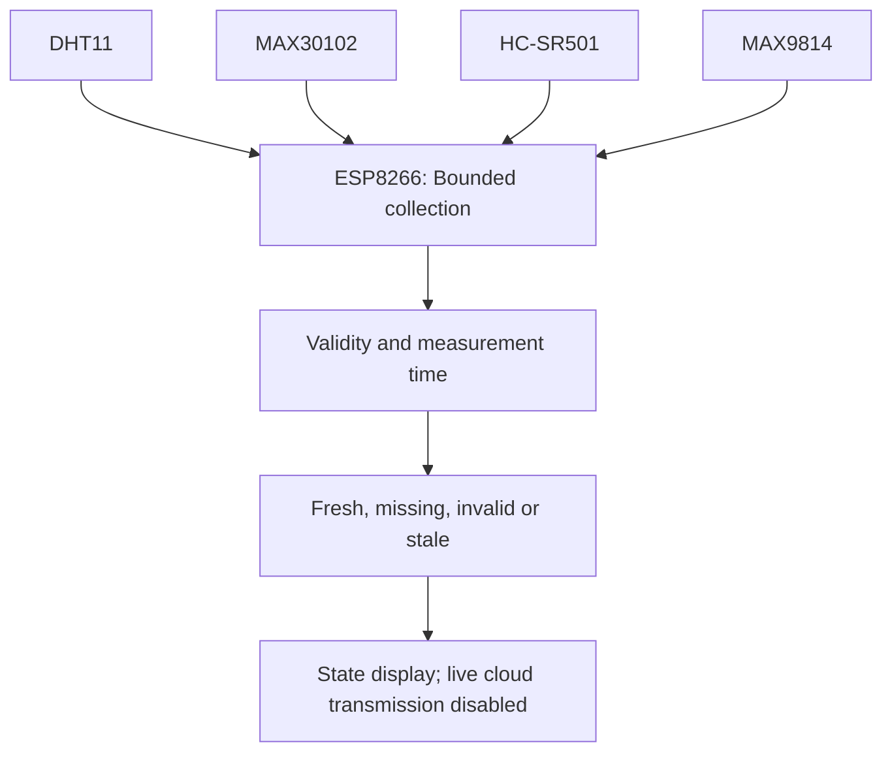

# Sensor-based baby environment monitor — connected academic prototype

[العربية](ar.md) · [English](en.md) · [Türkçe](tr.md) · [Return to the site](https://yahyaalali.com/en/content-library/project/baby-monitor/)

Conceptual cover for observation and data quality; not a running product.

## Idea and context

This work began as a 2024 course project gathering sensor inputs on one board and displaying them through Serial and Arduino IoT Cloud. Its review asks an engineering question: how can a reader distinguish a fresh measurement from a failure-generated zero or an old value left after a disconnect?

## Components and interpretation

| Component | Actual input                                                  | Interpretation limit                                          |
| --------- | ------------------------------------------------------------- | ------------------------------------------------------------- |
| DHT11     | Ambient temperature and humidity                              | Not body temperature                                          |
| MAX30102  | Red/infrared optical input for pulse and saturation estimates | Algorithm validity alone does not establish clinical accuracy |
| HC-SR501  | PIR motion signal                                             | Does not establish a fall or specific behaviour               |
| MAX9814   | Analogue microphone-amplifier sample                          | Not calibrated decibels or a crying diagnosis                 |

## My modern contribution

In October 2026 I developed an independent revision separating sample acceptance from presentation and state-change notification, preserving original course files. These are later changes, not part of the old submission; libraries and the signal-processing algorithm belong to their authors. The bounded source and reports follow Arduino IoT Cloud; Blynk was not merged by assumption.

## From sample to state

Readings have explicit missing, fresh, invalid or stale states. Failure cannot become a normal indication, and the last good value cannot travel as a new measurement. Time-based schedules replace loop counts; other channels remain usable when the optical sensor fails to start. FIFO draining is bounded and never waits indefinitely for samples.

State transitions use a bounded cooldown and a pending transition instead of silently losing it. Reconnect delays and stale-value masking were tested synthetically; the candidate makes no live cloud transmission and reuses no old credentials. Historical, uncalibrated health thresholds are not approved medical settings.

## Verification and limits

34 local C++ logic cases passed, plus 8 adapter-interaction scenarios repeated in Arabic, English and Turkish with fake sensors, Serial and algorithm output. They cover faults, non-finite/stale data, sample order, clock rollover, scheduling, notifications and simulated connection state. These are not child/device measurements or validation of the pulse algorithm itself.

The candidate compiled for NodeMCU/ESP8266 with Arduino CLI 1.5.1, core 3.1.2 and the pinned libraries in the [build contract](../../hardware/baby-monitor/build-target.json); the external MAX3010x library emitted a macro-redefinition warning. Wiring, calibration, driver timing and power were not tested on hardware. No accuracy or clinical approval is claimed. The generated cover is conceptual. A sanitized source candidate and host tests are now public; the original report, credentials and development history remain private.

## Technical references

- [Adafruit DHT](https://github.com/adafruit/DHT-sensor-library/blob/master/DHT.cpp)
- [SparkFun MAX3010x](https://github.com/sparkfun/SparkFun_MAX3010x_Sensor_Library/blob/master/src/MAX30105.cpp)
- [MAX30102](https://www.analog.com/en/products/max30102.html)
- [MAX9814](https://www.analog.com/en/products/max9814.html)
- [ESP8266](https://arduino-esp8266.readthedocs.io/en/latest/reference.html)

## Illustrative data flow

## Historical evidence versus conditional reference

The historical D3/D4/D2/D1/A0 map reflects the sketch and report, not safe power wiring. The cropped [Fritzing figure](../../hardware/baby-monitor/assets/baby-monitor-historical-fritzing.webp) and [Arduino IoT Cloud dashboard](../../hardware/baby-monitor/assets/baby-monitor-historical-cloud.webp) are course-report illustrations. Dashboard values are not reproducible child measurements without raw logs, timing and calibration.

The proposed candidate moves DHT11 to D6 and PIR to D7 to avoid boot-strapping pins. Its MAX30102 breakout power/level shifting and NodeMCU A0 input range remain conditional. The [sanitized public package](../../hardware/baby-monitor/README.md) contains code, synthetic tests and the [trilingual wiring guide](../../hardware/baby-monitor/WIRING.md); it does not establish a physical or clinical result.
