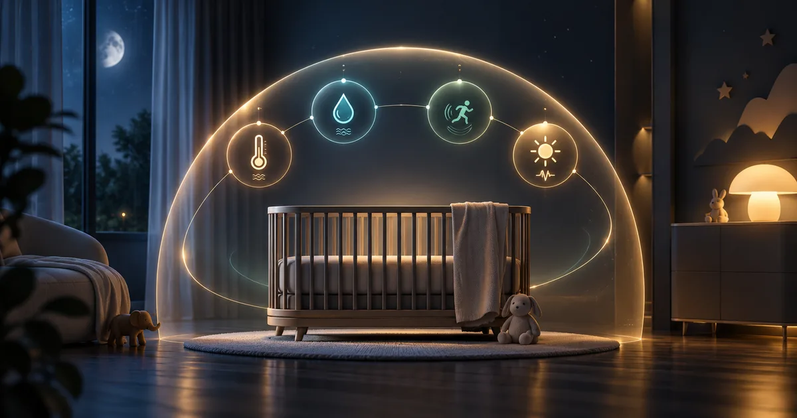
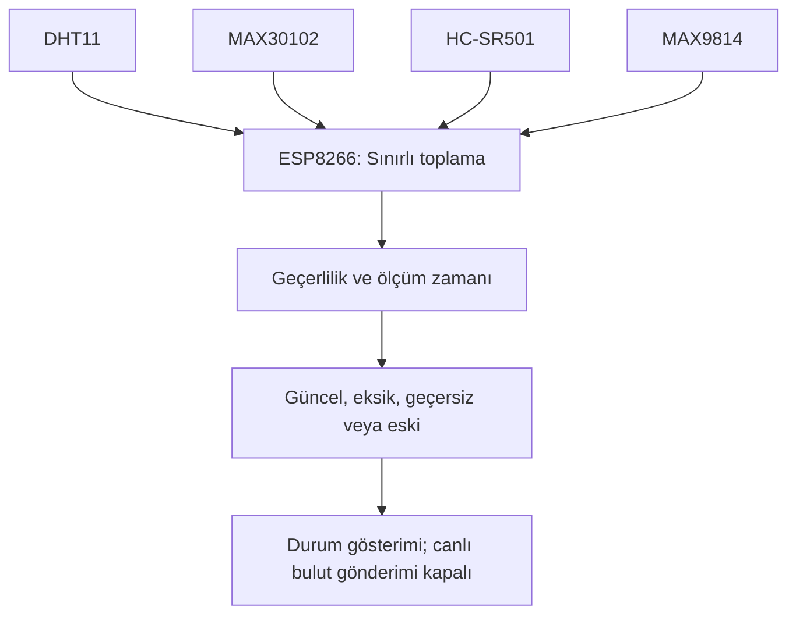
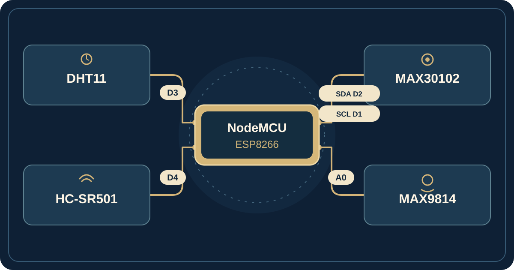
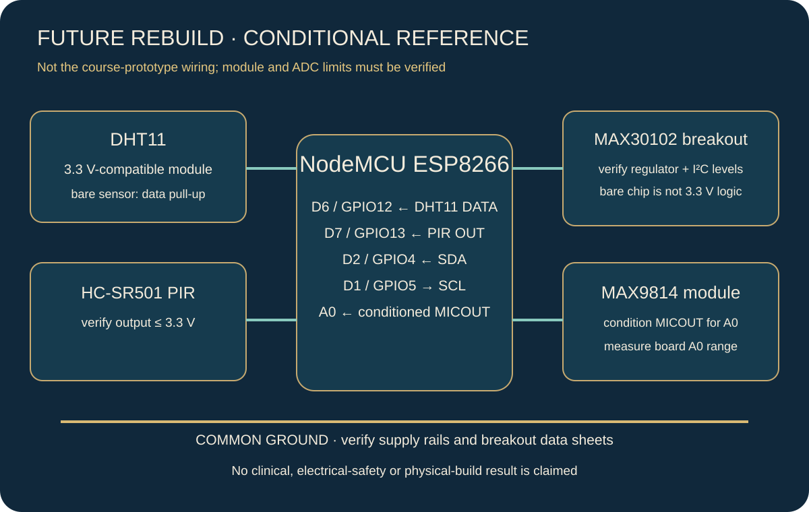

# Sensörlerle bebek ortamı izleme — bağlantılı akademik prototip

[العربية](ar.md) · [English](en.md) · [Türkçe](tr.md) · [Siteye dön](https://yahyaalali.com/tr/content-library/project/baby-monitor/)

Gözlem ve veri kalitesi için kavramsal kapak; çalışan ürün değildir.

## Fikir ve bağlam

Çalışma 2024 ders projesi olarak sensör girdilerini tek kartta topluyor, Serial ve Arduino IoT Cloud üzerinden gösteriyordu. Güncel incelemesi güncel ölçümün, sensör hatasından doğan sıfırdan veya bağlantı kesildikten sonra bellekte kalan eski değerden nasıl ayrılacağını ele alır.

## Bileşenler ve yorum sınırları

| Bileşen  | Gerçek girdi                                             | Yorum sınırı                                      |
| -------- | -------------------------------------------------------- | ------------------------------------------------- |
| DHT11    | Ortam sıcaklığı ve nemi                                  | Vücut sıcaklığı değildir                          |
| MAX30102 | Nabız/doygunluk tahmini için kırmızı ve kızılötesi girdi | Algoritma geçerliliği klinik doğruluğu kanıtlamaz |
| HC-SR501 | PIR hareket sinyali                                      | Düşmeyi veya belirli davranışı kanıtlamaz         |
| MAX9814  | Mikrofon yükseltecinden analog örnek                     | Kalibre desibel veya ağlama teşhisi değildir      |

## Güncel katkım

Ekim 2026'da örnek kabulünü, gösterimden ve durum-değişikliği bildiriminden ayıran bağımsız sürümü geliştirdim. Özgün ders dosyaları korundu. Bu değişiklikler eski teslim tarihine mal edilmez; kitaplıklar ve sinyal işleme algoritması yazarlarına aittir. İncelenen sınırlı kaynak ve raporlar Arduino IoT Cloud yolundadır; Blynk varsayımsal olarak birleştirilmedi.

## Örnekten duruma

Okumalarda eksik, güncel, geçersiz veya eski durumu açıkça belirtilir. Sensör hatası normal durum olmaz; son geçerli değer yeni ölçüm diye gönderilmez. Döngü sayısı yerine süreyle zamanlama yapılır; optik sensör başlamadığında diğer kanallar sürer. FIFO okuma sınırlıdır, örnek için sonsuz bekleme yoktur.

Durum geçişinde sınırlı bekleme ve kaybolmayan bekleyen geçiş kullanılır. Bağlantı gecikmesi ve eski veriyi gizleme yapay girdilerle test edildi; aday gerçek bulut gönderimi yapmaz, eski kimlik bilgilerini kullanmaz. Kalibre edilmemiş tarihsel sağlık eşikleri onaylı tıbbi ayar değildir.

## Doğrulama ve sınırlar

34 yerel C++ mantık senaryosu ve sahte sensör, Serial ve algoritma çıktısıyla üç dilde tekrarlanan 8 bağdaştırıcı etkileşim senaryosu başarılı oldu. Hata, sonlu olmayan/eski veri, örnek sırası, sayaç taşması, zamanlama, bildirim ve benzetilen bağlantı incelendi. Bunlar çocuk/cihaz ölçümü veya nabız algoritmasının doğrulaması değildir.

NodeMCU/ESP8266 adayı Arduino CLI 1.5.1, çekirdek 3.1.2 ve [derleme sözleşmesindeki](../../hardware/baby-monitor/build-target.json) sabit sürümlü kitaplıklarla derlendi; dış MAX3010x kitaplığından makro yeniden tanımlama uyarısı geldi. Bağlantı, kalibrasyon, sürücü süresi ve güç gerçek donanımda test edilmedi. Doğruluk/klinik onay iddiası yoktur. Üretilmiş kapak kavramsaldır. Temizlenmiş aday kaynak ve bilgisayar testleri şimdi açıktır; özgün rapor, kimlik bilgileri ve özel geliştirme geçmişi saklıdır.

## Teknik kaynaklar

- [Adafruit DHT](https://github.com/adafruit/DHT-sensor-library/blob/master/DHT.cpp)
- [SparkFun MAX3010x](https://github.com/sparkfun/SparkFun_MAX3010x_Sensor_Library/blob/master/src/MAX30105.cpp)
- [MAX30102](https://www.analog.com/en/products/max30102.html)
- [MAX9814](https://www.analog.com/en/products/max9814.html)
- [ESP8266](https://arduino-esp8266.readthedocs.io/en/latest/reference.html)

## Açıklayıcı veri akışı

## Tarihsel kanıt ve koşullu bağlantı

D3/D4/D2/D1/A0 haritası kod ve rapordaki tarihsel atamayı gösterir; güvenli beslemeyi kanıtlamaz. [Fritzing çizimi](../../hardware/baby-monitor/assets/baby-monitor-historical-fritzing.webp) ve [Arduino IoT Cloud panosu](../../hardware/baby-monitor/assets/baby-monitor-historical-cloud.webp) rapordan kesitlerdir. Pano sayıları ham kayıt, zaman bilgisi ve kalibrasyon olmadan doğrulanmış çocuk ölçümü sayılmaz.

Aday DHT11'i D6'ya ve PIR'ı D7'ye taşıyarak açılış uçlarından uzaklaştırır. MAX30102 modülünün regülatör ve I²C düzeyleri ile kesin NodeMCU kartının A0 aralığı hâlâ doğrulanmalıdır. [Temizlenmiş genel paket](../../hardware/baby-monitor/README.tr.md) kod, yapay testler ve [üç dilli bağlantı kılavuzu](../../hardware/baby-monitor/WIRING.md) içerir; fiziksel veya klinik sonuç değildir.
