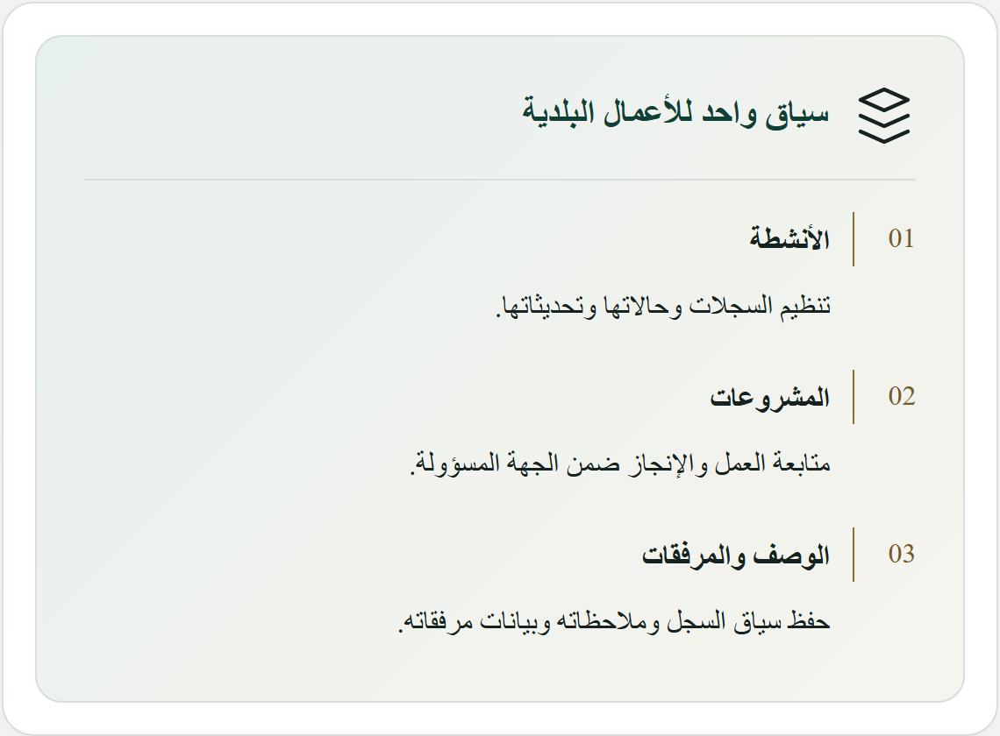
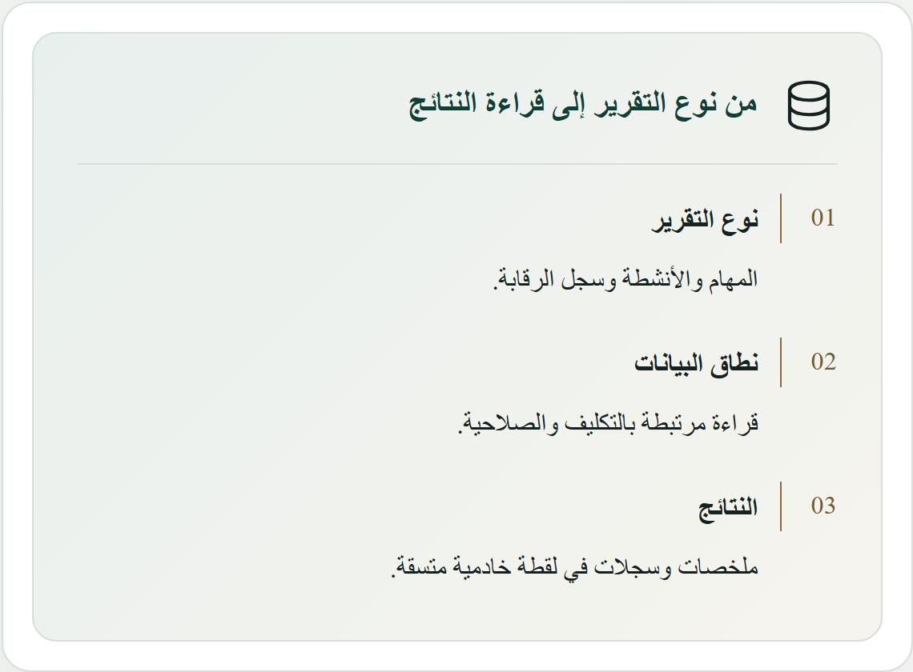
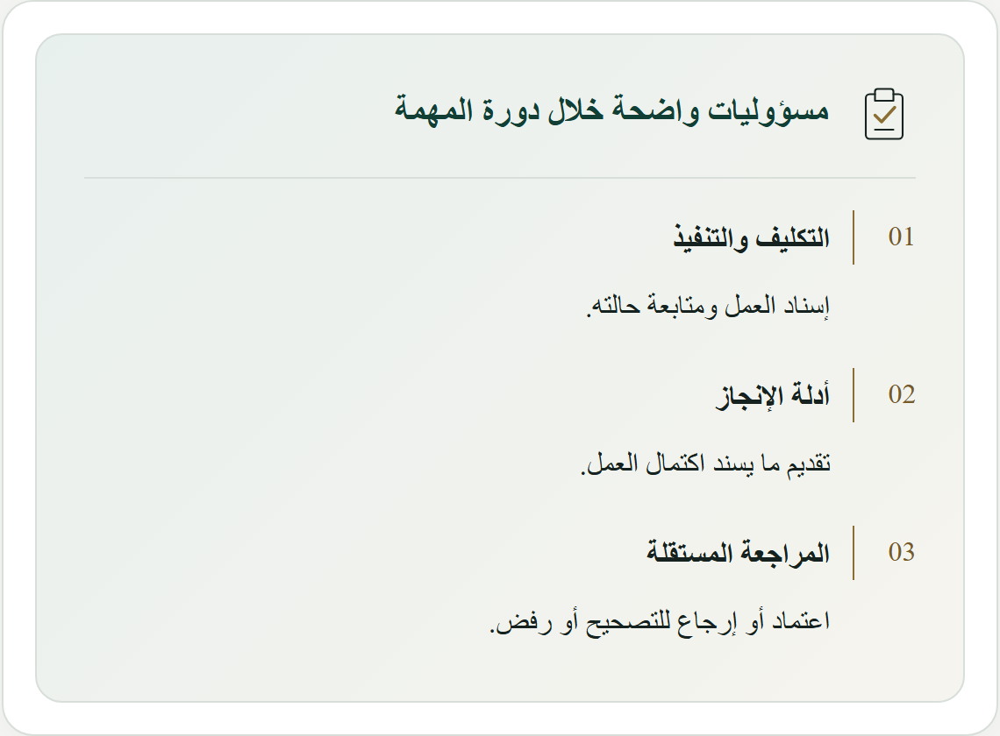
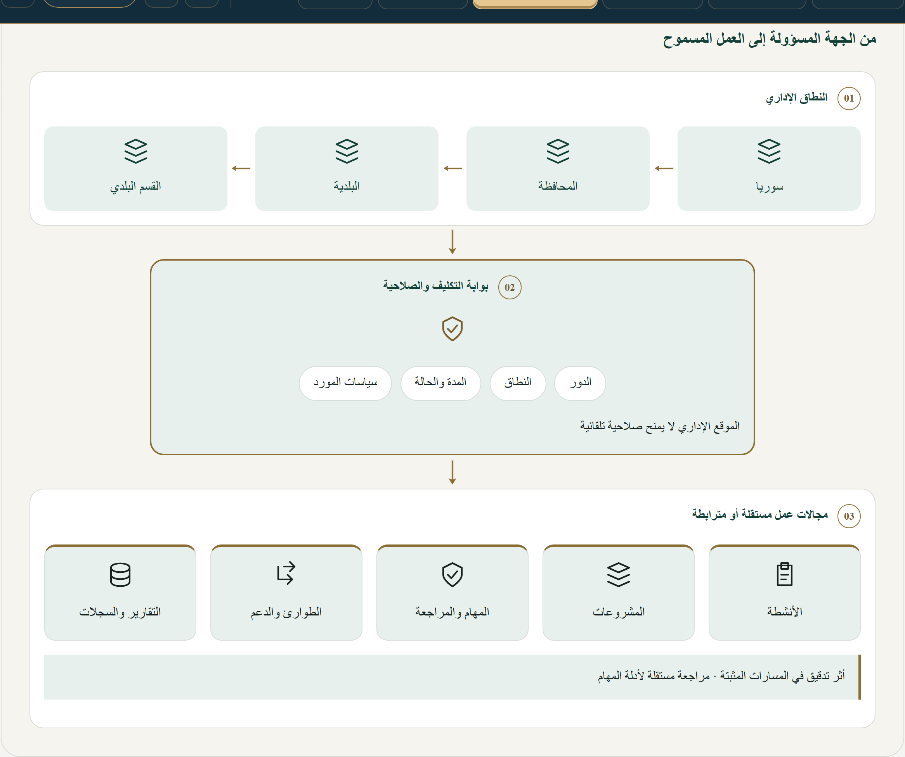
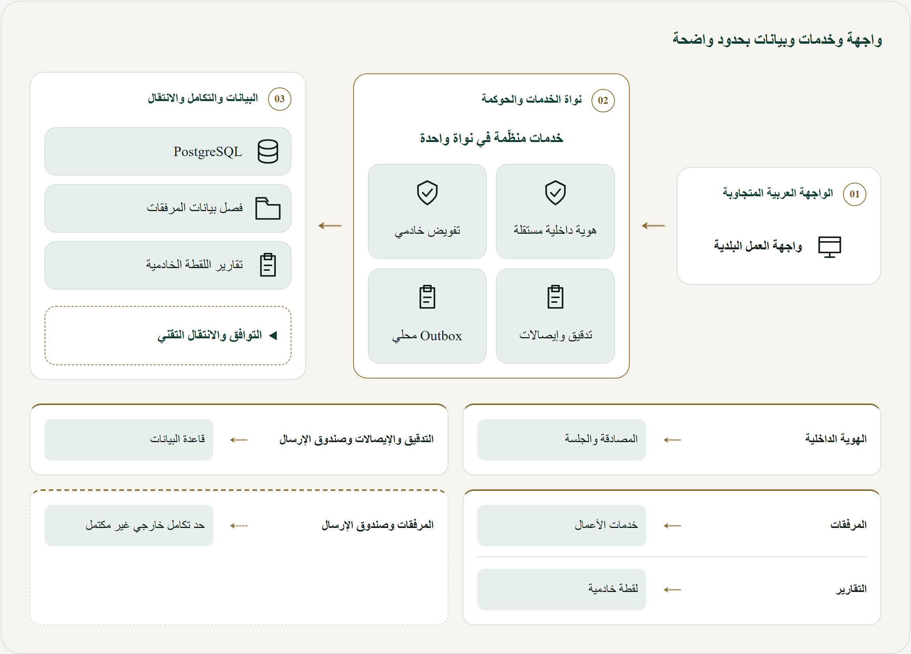

# منصة إدارة البلديات السورية

[العربية](ar.md) · [English](en.md) · [Türkçe](tr.md)

[دراسة الحالة المنشورة](https://yahyaalali.com/works/deir-ezzor-municipalities/)

الإدارة المحلية الرقمية · قيد التطوير

منظومة رقمية لتنظيم العمل البلدي والإدارة المحلية عبر مستويات إدارية مترابطة

- **نوع المشروع:** منصة لإدارة العمل البلدي
- **الواجهة:** العربية
- **الحالة:** قيد التطوير

منصة رقمية قيد التطوير تهدف إلى تحويل العمل البلدي اليومي من إجراءات متفرقة إلى منظومة مترابطة تجمع النطاق الإداري، والتكليفات والصلاحيات، وإدارة الأنشطة والمشروعات والمهام والمراجعة والتقارير في تجربة عمل واحدة واضحة.

عرض ببيانات تجريبية

مشاهد من حاضن محلي ببيانات اصطناعية؛ لا تمثل جلسة إنتاجية.

## الرؤية وتنظيم العمل البلدي متعدد المستويات

لا تقتصر إدارة العمل البلدي على تسجيل نشاط أو إنشاء مهمة معزولة؛ فكل إجراء إداري أو ميداني يرتبط بجهة مسؤولة، وصلاحية محددة، ومستندات ينبغي أن تبقى منظمة وقابلة للمراجعة. حين تنفصل المهمة عن البلدية أو المشروع أو التقرير المرتبط بها، تتشتت المتابعة ويصعب تقييم الإنجاز.

انطلق هذا المشروع من احتياجات تنظيم العمل البلدي في دير الزور، ثم اتّسع تصميمه ليقوم على نموذج متعدد المستويات يستوعب سوريا، فالمحافظة، فالبلدية، فالقسم البلدي ضمن بنية واحدة. يتيح هذا التنظيم بناء أساس مشترك قابل للتوسع دون إعادة تشكيل قواعد العمل لكل جهة جديدة، مع احتفاظ كل مستوى بحدود بياناته ومسؤولياته.

### الهوية البصرية

العقاب الذهبي، شعار الجمهورية العربية السورية، يستلهم رمز الدولة لعام 1945. ووفق الشرح الرسمي، يجسّد دولة تحمي شعبها؛ ترمز النجوم الثلاث إلى تحرر الشعب، وريش الجناحين الأربع عشرة إلى المحافظات ووحدة البلاد.

## جولة داخل واجهات المنصة

خمس محطات تشرح تجربة العمل. لقطتا الدور والدخول من مكوّنين فعليين ببيانات اصطناعية؛ واللوحات الثلاث الوسطى شروح عامة مستندة إلى الشيفرة، وليست لقطات تشغيل. الصور ثابتة ولا تنفّذ الأزرار الظاهرة داخلها.

لقطة مكوّن فعلي · بيانات اصطناعية · صورة ثابتة

### لوحة الدور ونطاق التكليف

واجهة منظّمة تعرض شريط نطاق التكليف الخاص بالدور الإداري (مثل رئيس البلدية)، وتوزّع مساحات العمل المتاحة بوضوح بين الأقسام والموظفين، والمهام، والمشروعات والعقود، وبيانات البلدية.

لوحة شرح عامة مستندة إلى الشيفرة · ليست واجهة تشغيل

### الأنشطة والمشروعات البلدية

مساحة عمل تشغيلية تعرض سجل الأنشطة بحالاتها وتحديثاتها معرّفة بلقطة بيانات متسقة، وتفتح نافذة تفاصيل منظّمة للوصف وملاحظات المراجعة وبيانات المرفقات، ضمن الغلاف نفسه الذي يخدم مسار المشروعات ونسب إنجازها.

نص المخطط وتفاصيله

#### سياق واحد للأعمال البلدية

1. الأنشطة
   تنظيم السجلات وحالاتها وتحديثاتها.
2. المشروعات
   متابعة العمل والإنجاز ضمن الجهة المسؤولة.
3. الوصف والمرفقات
   حفظ سياق السجل وملاحظاته وبيانات مرفقاته.

لوحة شرح عامة مستندة إلى الشيفرة · ليست واجهة تشغيل

### التقارير وقراءة النتائج

اختيار نوع التقرير وقراءة ملخصاته وسجلاته ضمن النطاق المسموح.

نص المخطط وتفاصيله

#### من نوع التقرير إلى قراءة النتائج

1. نوع التقرير
   المهام والأنشطة وسجل الرقابة.
2. نطاق البيانات
   قراءة مرتبطة بالتكليف والصلاحية.
3. النتائج
   ملخصات وسجلات في لقطة خادمية متسقة.

لوحة شرح عامة مستندة إلى الشيفرة · ليست واجهة تشغيل

### المهام والتنفيذ والمراجعة

قلب المتابعة التنفيذية في المنصة؛ ينظّم دورة حياة المهمة عبر ثماني حالات واضحة من المسودة والإسناد والتنفيذ وحتى انتظار المراجعة أو الاعتماد، مع حوار مخصّص لاتخاذ قرار مراجعة الأدلة بالاعتماد أو الإرجاع للتصحيح أو الرفض.

نص المخطط وتفاصيله

#### مسؤوليات واضحة خلال دورة المهمة

1. التكليف والتنفيذ
   إسناد العمل ومتابعة حالته.
2. أدلة الإنجاز
   تقديم ما يسند اكتمال العمل.
3. المراجعة المستقلة
   اعتماد أو إرجاع للتصحيح أو رفض.

لقطة مكوّن فعلي · بيانات اصطناعية · صورة ثابتة

### دخول الكوادر المخوّلة

مدخل مخصّص للمستخدمين المخوّلين بتصميم هادئ ومتجاوب يجمع حقول الدخول، ورسائل حالة الجلسة والخدمة، ومرتكزات العمل المؤسسي: إدارة مترابطة، وصلاحيات محددة، ومتابعة موثقة.

## كيف تخدم المنصة الإدارة والعمل الميداني؟

صُمّمت المنظومة لتمنح كل مستوى وظيفي أدواته المباشرة ضمن حدود تكليفه وصلاحياته:

### مساحة القيادة والإدارة البلدية

1. تنظيم التراتبية الإدارية وربط الوصول بتكليفات واضحة تحدد الدور والنطاق والمدة والحالة، بدلاً من الصلاحيات العشوائية.
2. متابعة مسارات الأنشطة والمشروعات والعقود والخدمات والمرافق ضمن نطاق الجهة المسؤولة.
3. استعراض التقارير المرجعية ومتابعة أحداث الرقابة وسجلات العمل بصورة منظّمة وقابلة للتدقيق.

### مساحة التنفيذ والمراجعة والرقابة

1. إدارة دورة المهام من الإنشاء والإسناد وبدء التنفيذ حتى تقديم أدلة الإنجاز واستئناف التصحيح عند الحاجة.
2. فصل التنفيذ عن المراجعة عبر مسار مستقل لفحص الأدلة واتخاذ قرار الاعتماد أو الإرجاع أو الرفض.
3. توثيق التغييرات داخل معاملات قاعدة البيانات بسجلات تدقيق وإيصالات، مع فصل البيانات الوصفية للمرفقات عن محتواها.

## الحوكمة ومعمارية المنصة

يوضح المخطط الأول كيف يرتبط العمل بالتكليف والصلاحية. ويوضح الثاني حدود الواجهة والخدمات والبيانات، وما بقي غير مكتمل في الانتقال والتكامل.

التراتب يحدد نطاق السجل؛ والتكليف يحدد إمكان التنفيذ. مجالات العمل ليست خطوات إجبارية متتابعة، وتبقى مراجعة أدلة المهام مستقلة.

نص المخطط وتفاصيله

### من الجهة المسؤولة إلى العمل المسموح

01النطاق الإداري

1. سوريا
2. المحافظة
3. البلدية
4. القسم البلدي

02بوابة التكليف والصلاحية

الدور

النطاق

المدة والحالة

سياسات المورد

الموقع الإداري لا يمنح صلاحية تلقائية

03مجالات عمل مستقلة أو مترابطة

- الأنشطة
- المشروعات
- المهام والمراجعة
- الطوارئ والدعم
- التقارير والسجلات

أثر تدقيق في المسارات المثبتة · مراجعة مستقلة لأدلة المهام

النواة مثبتة ضمن مرشح محلي؛ التكامل الخارجي والتكافؤ في الانتقال غير مكتملين. يبقى المسار السابق محفوظًا ولا يمثل المخطط نشرًا حكوميًا.

نص المخطط وتفاصيله

### واجهة وخدمات وبيانات بحدود واضحة

01الواجهة العربية المتجاوبة

واجهة العمل البلدية

02نواة الخدمات والحوكمة

#### خدمات منظّمة في نواة واحدة

- هوية داخلية مستقلة
- تفويض خادمي
- تدقيق وإيصالات
- Outbox محلي

03البيانات والتكامل والانتقال

- PostgreSQL
- فصل بيانات المرفقات
- تقارير اللقطة الخادمية

**التوافق والانتقال التقني**

PocketBase — المسار السابق المحفوظ

انتقال تدريجي؛ التكافؤ والتكامل الخارجي غير مكتملين

- الهوية الداخلية
  المصادقة والجلسة
- التدقيق والإيصالات وصندوق الإرسال
  قاعدة البيانات
- المرفقات
  خدمات الأعمال
  التقارير
  لقطة خادمية
- المرفقات وصندوق الإرسال
  حد تكامل خارجي غير مكتمل

## التقنيات والمساهمة والروابط

### الأدوات والتقنيات

#### الواجهة

`Flutter` · `Dart`

#### الخدمات والبيانات

`C#` · `.NET 10` · `PostgreSQL`

#### الانتقال والموثوقية

`PocketBase` · `Outbox` · تدقيق وإيصالات

### دوري في المشروع

أتولى قيادة رؤية المنصة وتحديد نطاقها ومتطلباتها وهندستها، ومراجعة تصميم الواجهات ونموذج الصلاحيات والبيانات، ومتابعة مراحل التطوير والانتقال التقني والاختبار لضمان اتساق المخرجات مع متطلبات العمل البلدي المنظّم.

### المرحلة الحالية ونطاق العرض

يمثل هذا العمل مبادرة هندسية مستقلة قيد التطوير والاختبار لتنظيم العمل البلدي في سوريا، وليس بوابة حكومية معتمدة أو خدمة منشورة رسمياً لدى البلديات حتى الآن. يتوفر مدخل الويب للمنصة للعرض المباشر، بينما تستند المعاينات والواجهات الداخلية في هذه الصفحة إلى شيفرة المشروع ببيانات تجريبية اصطناعية.

### روابط المشروع

- [زيارة الموقع](https://dz-municipalities.com/)
- [دراسة الحالة المنشورة](https://yahyaalali.com/works/deir-ezzor-municipalities/)

[العودة إلى قائمة المشروعات](../../README.ar.md)
