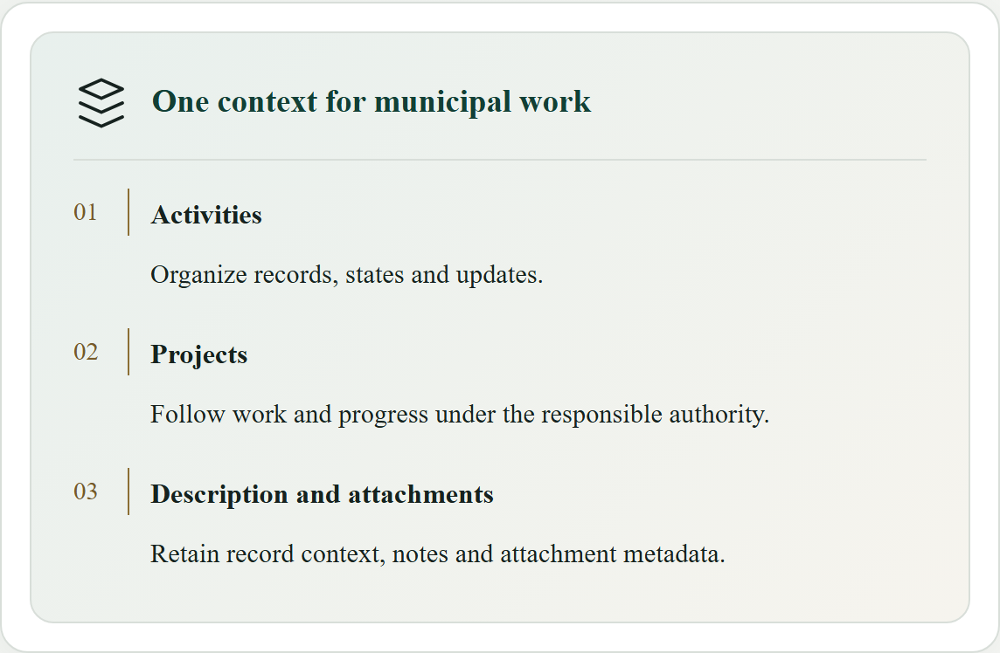
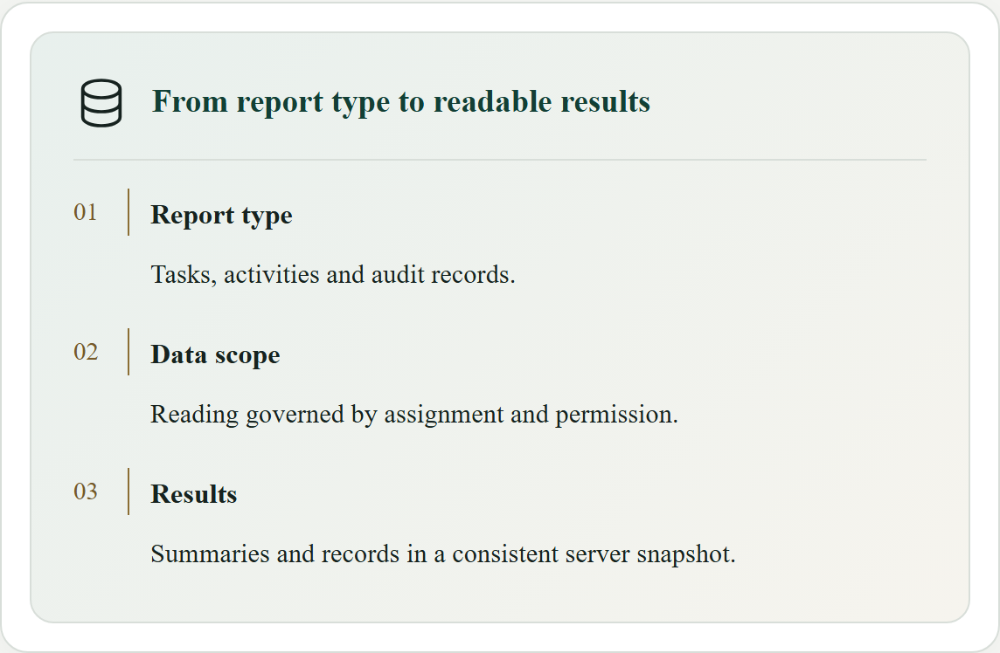
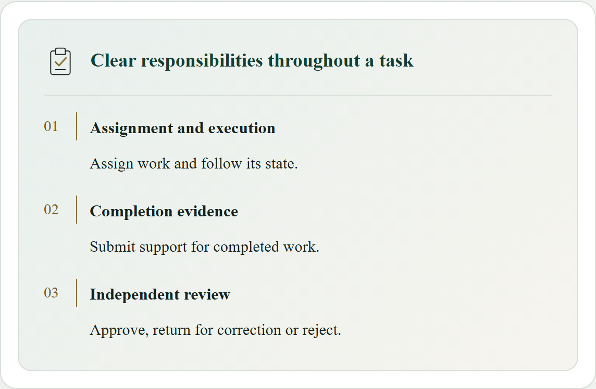
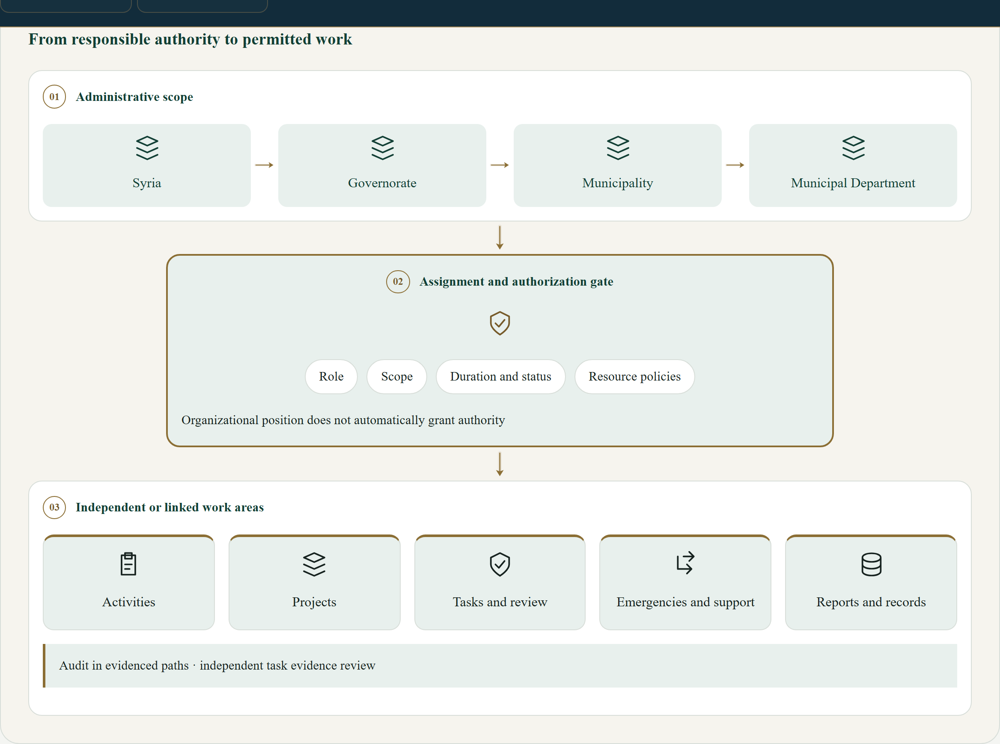
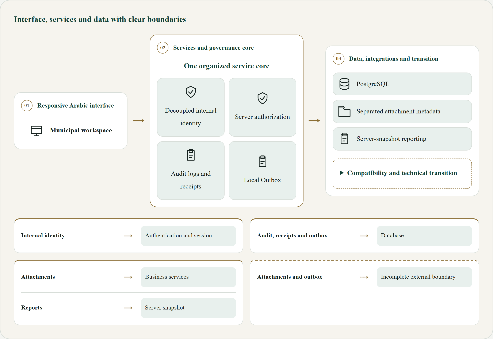

# Syrian Municipal Administration Platform

[العربية](ar.md) · [English](en.md) · [Türkçe](tr.md)

[Published case study](https://yahyaalali.com/en/works/deir-ezzor-municipalities/)

Digital Local Governance · In Development

A digital platform organizing municipal operations and local administration across connected administrative tiers

- **Project type:** Municipal management platform
- **Interface:** Arabic
- **Status:** In development

An in-development digital platform designed to bring day-to-day municipal work out of fragmented workflows and into a single connected structure—uniting administrative scope, scoped assignments and permissions, activities, projects, tasks, independent review, and reporting.

Synthetic-data demo

Local demonstrations with synthetic data; not a production session.

## Vision and Multi-Tier Municipal Organization

Running municipal operations takes far more than logging an isolated activity or task. Every administrative or field action belongs to a responsible authority, a defined permission boundary, and records that must remain structured and reviewable. When tasks become detached from their municipality, project, or follow-up report, oversight breaks down.

The project began from practical municipal organization needs in Deir ez-Zor and expanded into a multi-tier administrative model spanning Syria, governorates, municipalities, and municipal departments. This shared foundation supports growth across local authorities without rebuilding workflows for each entity, while keeping every tier's data and responsibilities cleanly bounded.

### Visual Identity

The golden eagle, the emblem of the Syrian Arab Republic, draws on the state’s 1945 symbol. In the official account, it represents a state protecting its people; the three stars signify the people’s liberation, and the 14 wing feathers represent the governorates and national unity.

## Inside the Platform Interfaces

Five stations explain the working experience. Role and login captures use actual components with synthetic data. The three middle panels are general source-based explanations, not running application screens. Images are static; controls pictured inside them do not operate.

Actual component capture · synthetic data · static image

### Role and assignment scope

A focused workspace displaying the active assignment scope banner for an administrative role (such as Municipality Head) and organizing available work areas across Departments & Staff, Tasks, Projects & Contracts, and Municipality Data.

General source-based explanation · not an operating screen

### Municipal activities and projects

An operational workspace listing activities with statuses, timestamps, and a consistent data snapshot identifier, paired with a structured details dialog covering descriptions, review notes, and attachment metadata—built on the same shell powering municipal projects and progress tracking.

Diagram text and details

#### One context for municipal work

1. Activities
   Organize records, states and updates.
2. Projects
   Follow work and progress under the responsible authority.
3. Description and attachments
   Retain record context, notes and attachment metadata.

General source-based explanation · not an operating screen

### Reports and reading results

Choose a report type and read summaries and records within the permitted scope.

Diagram text and details

#### From report type to readable results

1. Report type
   Tasks, activities and audit records.
2. Data scope
   Reading governed by assignment and permission.
3. Results
   Summaries and records in a consistent server snapshot.

General source-based explanation · not an operating screen

### Tasks, execution and review

The operational core of execution tracking; orchestrates an eight-state lifecycle from draft, assignment, and execution through pending review and approval, paired with a dedicated review dialog for approving, returning for correction, or rejecting submitted evidence.

Diagram text and details

#### Clear responsibilities throughout a task

1. Assignment and execution
   Assign work and follow its state.
2. Completion evidence
   Submit support for completed work.
3. Independent review
   Approve, return for correction or reject.

Actual component capture · synthetic data · static image

### Authorized staff entry

A calm, responsive entry point for authorized staff combining credential inputs, session and service notices, and the platform's three core pillars: connected administration, defined permissions, and documented follow-up.

## How the Platform Serves Leadership and Field Operations

Capabilities are structured around clear responsibilities so every role accesses the right tools within its active assignment scope:

### Leadership and Municipal Administration

1. Structuring administrative tiers and tying access to explicit assignments—defining role, scope, duration, and status rather than informal privileges
   .
2. Overseeing municipal activities, projects, contracts, services, and facilities within the responsible authority's boundary
   .
3. Reviewing reference reports, audit events, and operational records through an organized, verifiable structure
   .

### Execution, Review, and Oversight

1. Managing the full task lifecycle from creation, assignment, and execution to submitting completion evidence and handling corrections
   .
2. Separating execution from verification through an independent review flow for approving, returning, or rejecting evidence
   .
3. Recording administrative changes inside database transactions with audit logs and receipts, while separating attachment metadata from file content
   .

## Governance Model and System Architecture

The first diagram relates work to assignment and authorization. The second separates interface, services and data, including the incomplete transition and integration boundaries.

Hierarchy determines record scope; assignments determine execution rights. Work areas are not compulsory sequential steps, and task-evidence review remains independent.

Diagram text and details

### From responsible authority to permitted work

01Administrative scope

1. Syria
2. Governorate
3. Municipality
4. Municipal Department

02Assignment and authorization gate

Role

Scope

Duration and status

Resource policies

Organizational position does not automatically grant authority

03Independent or linked work areas

- Activities
- Projects
- Tasks and review
- Emergencies and support
- Reports and records

Audit in evidenced paths · independent task evidence review

The core is evidenced in a local candidate. External integration and transition parity remain incomplete; the legacy path is preserved. This is not a government deployment.

Diagram text and details

### Interface, services and data with clear boundaries

01Responsive Arabic interface

Municipal workspace

02Services and governance core

#### One organized service core

- Decoupled internal identity
- Server authorization
- Audit logs and receipts
- Local Outbox

03Data, integrations and transition

- PostgreSQL
- Separated attachment metadata
- Server-snapshot reporting

**Compatibility and technical transition**

PocketBase — preserved legacy path

Staged transition; parity and external integrations incomplete

- Internal identity
  Authentication and session
- Audit, receipts and outbox
  Database
- Attachments
  Business services
  Reports
  Server snapshot
- Attachments and outbox
  Incomplete external boundary

## Technology, Contribution, and Links

### Tools and Technologies

#### Interface

`Flutter` · `Dart`

#### Services and data

`C#` · `.NET 10` · `PostgreSQL`

#### Transition and reliability

`PocketBase` · `Outbox` · audit and receipts

### My Contribution

I lead the platform's vision, scope, requirements, and architectural direction—reviewing interface design, authorization and data models, and guiding development, technical migration, and verification to keep deliverables aligned with structured municipal work.

### Current Stage and Scope

This platform is an independent engineering initiative under active development and testing for municipal administration in Syria; it is not an officially endorsed government portal or a live public deployment across municipalities yet. Its web entry point is accessible online, while internal workflow descriptions and interface previews on this page are built from the codebase using synthetic demo data.

### Project Links

### Project links

- [Visit Website](https://dz-municipalities.com/)
- [Published case study](https://yahyaalali.com/en/works/deir-ezzor-municipalities/)

[Back to projects](../../README.md)
