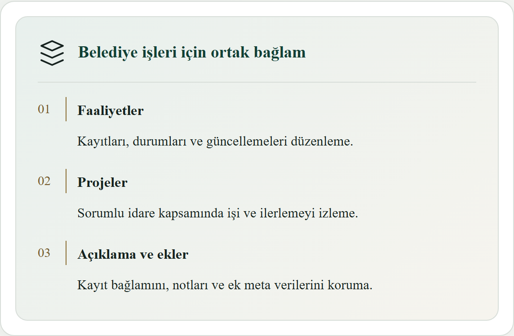
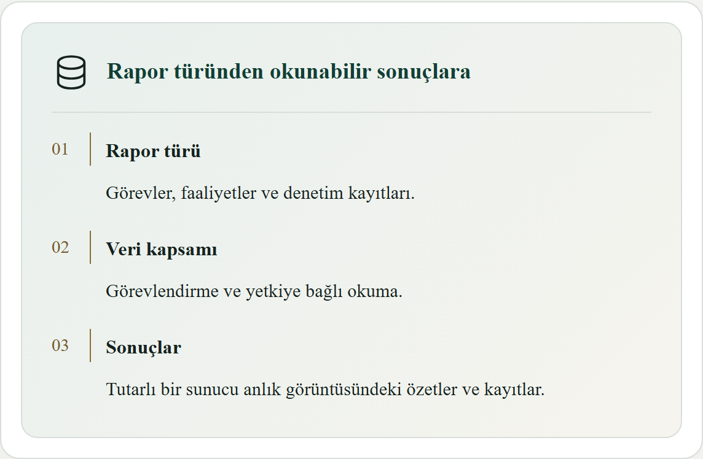
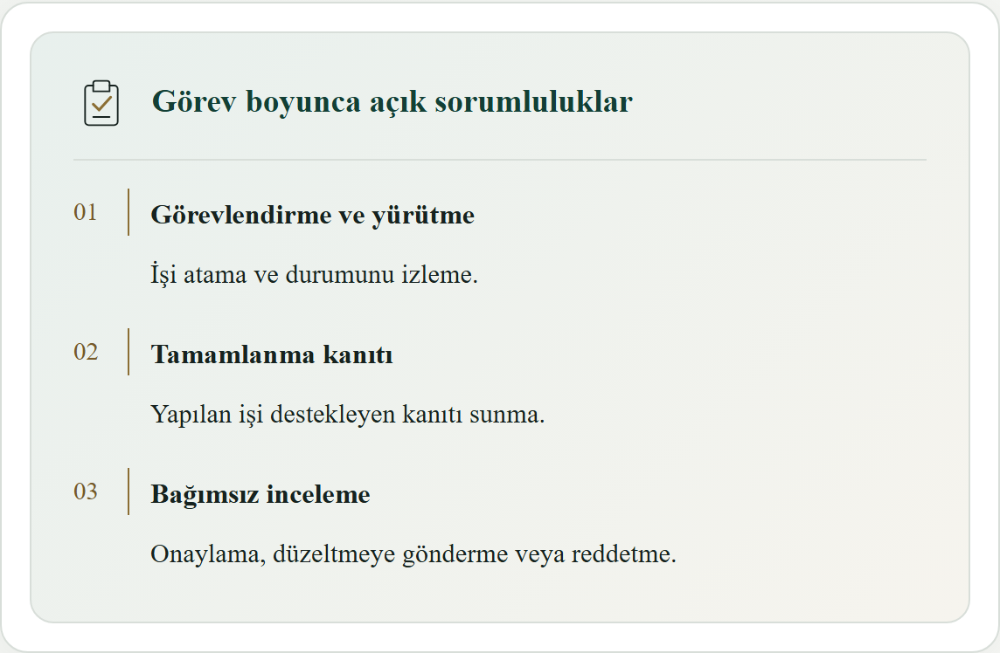
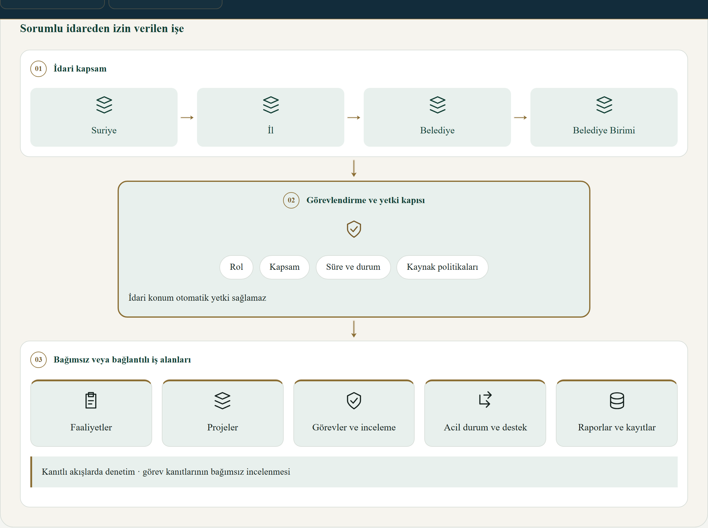
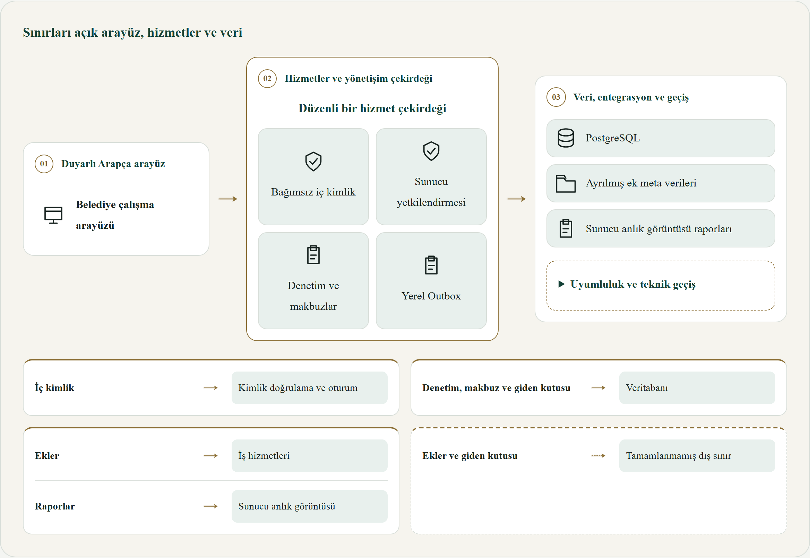

# Suriye Belediyeleri Yönetim Platformu

[العربية](ar.md) · [English](en.md) · [Türkçe](tr.md)

[Yayımlanan proje incelemesi](https://yahyaalali.com/tr/works/deir-ezzor-municipalities/)

Dijital Yerel Yönetim · Geliştirme Aşamasında

Belediye çalışmalarını ve yerel yönetimi birbirine bağlı idari kademelerde düzenleyen dijital platform

- **Proje türü:** Belediye yönetim platformu
- **Arayüz:** Arapça
- **Durum:** Geliştirme aşamasında

Günlük belediye işlemlerini dağınık süreçlerden çıkarıp tek bir bağlantılı yapıya taşımak üzere geliştirilen dijital bir platform. İdari kapsamı, görevlendirmeleri ve yetkileri; faaliyetler, projeler, görevler, bağımsız inceleme ve raporlama akışlarıyla tek bir çalışma deneyiminde buluşturur.

Sentetik veri gösterimi

Sentetik verilerle yerel gösterimler; üretim oturumu değildir.

## Vizyon ve Çok Kademeli Belediye Yönetimi

Belediye yönetimi, yalnızca tekil bir faaliyeti veya görevi kaydetmekten ibaret değildir. Her idari veya saha işlemi sorumlu bir birime, tanımlı bir yetki sınırına ve düzenli biçimde incelenebilir kayıtlara bağlıdır. Görev; belediyeden, projeden veya ilgili rapordan koptuğunda takip dağılır ve değerlendirme zorlaşır.

Bu proje, Deyrizor'daki belediye çalışmalarını düzenleme ihtiyacından doğdu; ardından Suriye, il, belediye ve belediye birimi kademelerini kapsayan çok katmanlı bir yönetim modeline genişledi. Bu ortak temel, her yeni birim için iş kurallarını sıfırdan kurmadan büyümeyi desteklerken her kademenin veri ve sorumluluk sınırlarını korur.

### Görsel Kimlik

Suriye Arap Cumhuriyeti’nin arması olan altın kartal, devletin 1945 tarihli simgesinden esinlenir. Resmî açıklamaya göre halkını koruyan devleti temsil eder; üç yıldız halkın özgürleşmesini, kanatlardaki 14 tüy ise illeri ve ülkenin birliğini simgeler.

## Platform Arayüzlerinden Görünümler

Beş durak çalışma deneyimini açıklar. Rol ve giriş görüntüleri, sentetik verilerle gerçek bileşenlerden alınmıştır. Ortadaki üç panel, çalışan uygulama ekranı değil, kaynak koda dayalı genel açıklamalardır. Görseller sabittir; içlerinde görünen kontroller çalışmaz.

Gerçek bileşen görüntüsü · sentetik veri · sabit görsel

### Rol ve görevlendirme kapsamı

İdari rolün (örneğin Belediye Başkanı) aktif görevlendirme kapsam şeridini gösteren ve mevcut çalışma alanlarını Birimler ve Personel, Görevler, Projeler ve Sözleşmeler ile Belediye Verileri başlıkları altında düzenleyen ekran.

Kaynak koda dayalı genel açıklama · çalışan ekran değil

### Belediye faaliyetleri ve projeleri

Faaliyet kayıtlarını durumları, güncelleme zamanları ve tutarlı veri anlık görüntüsü kimliğiyle listeleyen; açıklama, inceleme notları ve ek meta verileri için düzenli bir detay penceresi sunan, aynı çerçevede proje ve ilerleme takibini de destekleyen operasyon alanı.

Şema metni ve ayrıntıları

#### Belediye işleri için ortak bağlam

1. Faaliyetler
   Kayıtları, durumları ve güncellemeleri düzenleme.
2. Projeler
   Sorumlu idare kapsamında işi ve ilerlemeyi izleme.
3. Açıklama ve ekler
   Kayıt bağlamını, notları ve ek meta verilerini koruma.

Kaynak koda dayalı genel açıklama · çalışan ekran değil

### Raporlar ve sonuçların okunması

İzin verilen kapsamda rapor türünü seçme, özetleri ve kayıtları okuma.

Şema metni ve ayrıntıları

#### Rapor türünden okunabilir sonuçlara

1. Rapor türü
   Görevler, faaliyetler ve denetim kayıtları.
2. Veri kapsamı
   Görevlendirme ve yetkiye bağlı okuma.
3. Sonuçlar
   Tutarlı bir sunucu anlık görüntüsündeki özetler ve kayıtlar.

Kaynak koda dayalı genel açıklama · çalışan ekran değil

### Görevler, yürütme ve inceleme

Yürütme takibinin merkezi; taslak, atama ve yürütmeden inceleme bekleme ve onaya kadar sekiz aşamalı görev yaşam döngüsünü yönetir ve kanıt inceleme kararı için onay, düzeltmeye iade veya ret seçeneklerini içeren özel bir pencere sunar.

Şema metni ve ayrıntıları

#### Görev boyunca açık sorumluluklar

1. Görevlendirme ve yürütme
   İşi atama ve durumunu izleme.
2. Tamamlanma kanıtı
   Yapılan işi destekleyen kanıtı sunma.
3. Bağımsız inceleme
   Onaylama, düzeltmeye gönderme veya reddetme.

Gerçek bileşen görüntüsü · sentetik veri · sabit görsel

### Yetkili personel girişi

Yetkili kullanıcılar için yalın ve duyarlı bir giriş ekranı; kimlik alanlarını, oturum ve hizmet bildirimlerini ve platformun üç temel ilkesini (bağlantılı yönetim, tanımlı yetkiler ve belgeli takip) bir araya getirir.

## Platform Yönetim ve Saha Çalışmalarına Nasıl Hizmet Eder?

İşlevler, her rolün kendi aktif görevlendirme sınırları içinde doğru araçlara doğrudan ulaşabileceği biçimde düzenlendi:

### Yönetim ve Belediye Liderliği Alanı

1. İdari hiyerarşiyi yapılandırmak ve erişimi keyfî yetkiler yerine rol, kapsam, süre ve durumu tanımlayan açık görevlendirmelere bağlamak
   .
2. Sorumlu birimin sınırları içinde faaliyetleri, projeleri, sözleşmeleri, hizmetleri ve tesisleri izlemek
   .
3. Referans raporları, denetim olaylarını ve çalışma kayıtlarını düzenli ve doğrulanabilir bir yapıda incelemek
   .

### Yürütme, İnceleme ve Denetim Alanı

1. Görev yaşam döngüsünü oluşturma, atama ve yürütmeden tamamlanma kanıtlarının sunulmasına ve gerektiğinde düzeltme sürecine kadar yönetmek
   .
2. Kanıtların incelenip onaylanması, düzeltmeye iade edilmesi veya reddedilmesi için yürütme ile doğrulamayı bağımsız bir akışla ayırmak
   .
3. Değişiklikleri veri tabanı işlemleri içinde denetim kayıtları ve makbuzlarla belgelemek; eklerin meta verilerini dosya içeriğinden ayırmak
   .

## Yönetişim Modeli ve Sistem Mimarisi

İlk şema işi görevlendirme ve yetkiyle ilişkilendirir. İkincisi arayüzü, hizmetleri ve veriyi; tamamlanmamış geçiş ve entegrasyon sınırlarıyla birlikte ayırır.

Hiyerarşi kayıt kapsamını, görevlendirme ise işlem yetkisini belirler. İş alanları zorunlu ardışık adımlar değildir; görev kanıtının incelenmesi bağımsız kalır.

Şema metni ve ayrıntıları

### Sorumlu idareden izin verilen işe

01İdari kapsam

1. Suriye
2. İl
3. Belediye
4. Belediye Birimi

02Görevlendirme ve yetki kapısı

Rol

Kapsam

Süre ve durum

Kaynak politikaları

İdari konum otomatik yetki sağlamaz

03Bağımsız veya bağlantılı iş alanları

- Faaliyetler
- Projeler
- Görevler ve inceleme
- Acil durum ve destek
- Raporlar ve kayıtlar

Kanıtlı akışlarda denetim · görev kanıtlarının bağımsız incelenmesi

Çekirdek yerel adayda kanıtlanmıştır. Dış entegrasyon ve geçiş denkliği tamamlanmamıştır; önceki yol korunur. Şema devlet tarafından yayımlanmış bir hizmeti göstermez.

Şema metni ve ayrıntıları

### Sınırları açık arayüz, hizmetler ve veri

01Duyarlı Arapça arayüz

Belediye çalışma arayüzü

02Hizmetler ve yönetişim çekirdeği

#### Düzenli bir hizmet çekirdeği

- Bağımsız iç kimlik
- Sunucu yetkilendirmesi
- Denetim ve makbuzlar
- Yerel Outbox

03Veri, entegrasyon ve geçiş

- PostgreSQL
- Ayrılmış ek meta verileri
- Sunucu anlık görüntüsü raporları

**Uyumluluk ve teknik geçiş**

PocketBase — korunan önceki yol

Kademeli geçiş; denklik ve dış entegrasyonlar tamamlanmadı

- İç kimlik
  Kimlik doğrulama ve oturum
- Denetim, makbuz ve giden kutusu
  Veritabanı
- Ekler
  İş hizmetleri
  Raporlar
  Sunucu anlık görüntüsü
- Ekler ve giden kutusu
  Tamamlanmamış dış sınır

## Teknoloji, Katkım ve Bağlantılar

### Araçlar ve Teknolojiler

#### Arayüz

`Flutter` · `Dart`

#### Hizmetler ve veri

`C#` · `.NET 10` · `PostgreSQL`

#### Geçiş ve güvenilirlik

`PocketBase` · `Outbox` · denetim ve makbuzlar

### Projeye Katkım

Platformun vizyonunu, kapsamını, gereksinimlerini ve mimari yönünü yönetiyor; arayüz tasarımını, yetkilendirme ve veri modellerini inceliyor; çıktıların düzenli belediye işleyişiyle uyumlu kalması için geliştirme, teknik geçiş ve doğrulama süreçlerini takip ediyorum.

### Güncel Aşama ve Kapsam

Bu çalışma, Suriye'de yerel yönetimi düzenlemeye yönelik geliştirme ve test aşamasında olan bağımsız bir mühendislik girişimidir; henüz belediyelerce resmen benimsenmiş bir kamu portalı değildir. Platformun web girişi çevrimiçi olarak erişilebilirdir; bu sayfadaki iç iş akışı açıklamaları ve arayüz önizlemeleri kaynak koddan sentetik deneme verileriyle hazırlanmıştır.

### Proje Bağlantıları

### Proje bağlantıları

- [Siteyi Ziyaret Et](https://dz-municipalities.com/)
- [Yayımlanan proje incelemesi](https://yahyaalali.com/tr/works/deir-ezzor-municipalities/)

[Projelere dön](../../README.tr.md)
