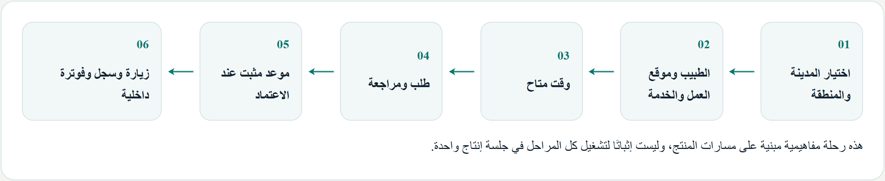
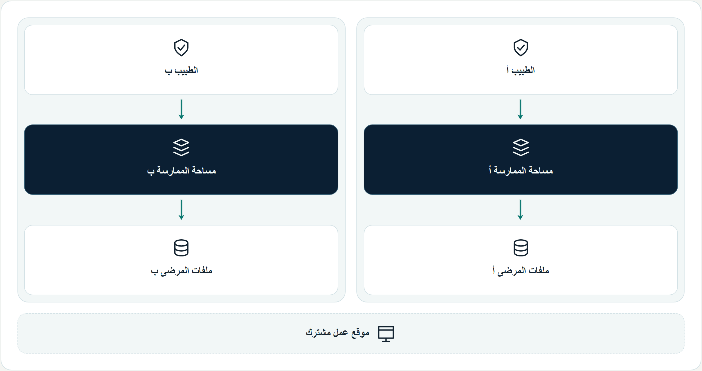
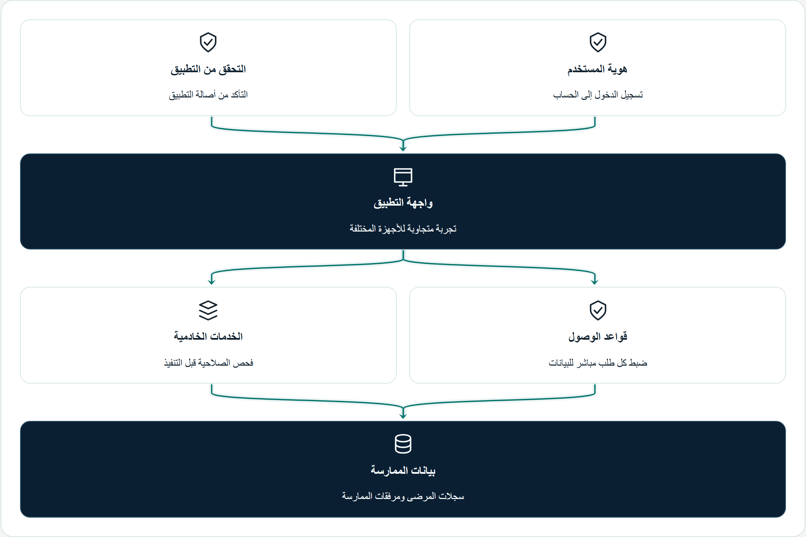

# سِناد

[العربية](ar.md) · [English](en.md) · [Türkçe](tr.md)

[دراسة الحالة المنشورة](https://yahyaalali.com/works/dental/)

الصحة الرقمية · نسخة ويب متاحة

إدارة عيادات الأسنان في تجربة مترابطة؛ من موعد المريض إلى سجل الزيارة ومتابعة أعمال الطبيب.

- **المجال:** إدارة عيادات الأسنان
- **اللغات:** العربية · الإنجليزية · التركية
- **الإتاحة:** نسخة ويب متاحة

تصوّر معماري مفاهيمي · لقطات الواجهات الفعلية أدناه

سِناد منظومة رقمية تقوم على فكرة أن ممارسة طبيب الأسنان تتجاوز عنوان العيادة. تجمع المنصة مواقع عمل الطبيب وخدماته ودوامه والمواعيد والزيارات ضمن سياق واحد، وتربطها بتجربة المريض في البحث عن الطبيب وطلب الموعد ومتابعته. ويظل الوصول إلى ملفات المرضى منظمًا وفق صلاحيات كل ممارسة ودور المستخدم.

## الرؤية والهوية البصرية

قد يقسم طبيب الأسنان أسبوعه بين عيادته ومركز طبي آخر. وفي كل موقع تختلف الخدمات والدوام والمواعيد، بينما تبقى متابعة المرضى والزيارات جزءًا من ممارسة الطبيب نفسه. من هنا جاء سِناد: تنظيم العمل حول الطبيب بدل اختزاله في عنوان واحد، وإتاحة رحلة مفهومة للمريض حتى يجد الطبيب والخدمة والموقع والوقت المناسب.

يربط هذا النموذج المواعيد والسجلات والزيارات ضمن مساحة ممارسة مستقلة، ويتيح للفريق المساند أداء مهامه من دون أن يصبح مجرد اشتراك الأطباء في المكان سببًا لمشاركة ملفات المرضى.

### الهوية البصرية

اسم سِناد يستحضر معنى السند؛ رفيق رقمي لتنظيم يوم الطبيب وتيسير رحلة المريض. تجمع العلامة بين شكل السن وحرف S الذي يصل الرمز باسم SINAD، وتمنح درجات الكحلي والفيروزي والذهبي الهوية طابعًا مهنيًا هادئًا.

## تجربة سِناد من الداخل

محطات منتقاة توضح كيف تنتقل تجربة سِناد من اكتشاف الطبيب إلى تنظيم ممارسته ومتابعة الزيارة. تستند صور العرض إلى مكوّنات التطبيق الأصلية باستخدام بيانات اصطناعية.

### 01 — اكتشاف الطبيب والخدمة

يتيح البحث استعراض الأطباء ومواقع عملهم بحسب المدينة والمنطقة، مع تطبيع النص الذي يراعي اختلافات الكتابة العربية والتركية، ثم الانتقال إلى الخدمة والأوقات المعروضة.

### 02 — من الإتاحة إلى طلب الموعد

يختار المريض الخدمة والموقع والوقت، ويتابع حالة طلبه أو تغيير الموعد. يميز النظام بين الطلب الذي ينتظر القرار والموعد المثبت، مع مسارات للحجز العائلي وفق السياسة.

### 03 — يوم الطبيب عبر مواقع عمل متعددة

ينظم الطبيب خدماته ومددها ومواعيد العمل والاستثناءات في أكثر من موقع ضمن ممارسته، مع منطق للتحقق من تعارض الأوقات.

### 04 — ملف المريض ومخطط الأسنان التفاعلي

تجمع الزيارة والسجل ومخطط الأسنان تفاصيل الرعاية في سياق واحد. يعرض المخطط الأسنان الدائمة واللبنية والأسطح والطبقات السريرية (سابق، تشخيص، مخطّط، مكتمل)، ويتيح تسجيل الحالات والتغييرات مع أثر للمراجعة والتدقيق.

**الأسنان اللبنية — لقطة مكملة**

### 05 — الفوترة والمتابعة المالية

تربط سجلات الفوترة الداخلية الزيارة بالفاتورة والدفعات والعملات وفق الصلاحيات، لتبقى المتابعة المالية في سياق العمل اليومي.

## منظومة متكاملة للطبيب والمريض والفريق

تلتقي الأدوار عند الموعد والزيارة، ولكل مستخدم مساحة عمل تتفق مع مسؤوليته.

### طبيب الأسنان

يدير ممارسته ومواقع العمل والخدمات والدوام، ويتابع المواعيد وملفات المرضى والزيارات ومخطط الأسنان والفوترة ضمن نطاقه.

### المريض

يبحث عن الأطباء ومواقعهم، ويختار الخدمة والوقت، ويقدم طلب الموعد أو تغييره ويتابع حالته، مع حساب شخصي مستقل عن اشتراك الطبيب.

### الاستقبال والفريق المساند

ينظم الطلبات والمهام والبيانات الإدارية المفوضة، دون أن تمنحه وظيفته وحدها وصولًا مفتوحًا إلى السجلات السريرية.

### إدارة المنصة

تنظّم جوانب حوكمة الحسابات ودعوات الأطباء ومراجعة مواقع العمل، مع فصل الصلاحيات الإدارية عن الاطلاع السريري.

### من العيادة إلى الهاتف

تجربة متجاوبة بالعربية والإنجليزية والتركية، تنظّم قراءة المواعيد والسجلات على الحاسوب وتسهّل متابعة الطلبات من الهاتف. ترتكز على أساس برمجي متعدد المنصات؛ إتاحة الويب لا تعني إصدارًا تجاريًا أو طرحًا في متاجر التطبيقات.

### اشتراك يرتبط بالممارسة

ينظم نموذج الاشتراك مساحة الطبيب عبر مواقع عمله، بينما تبقى حسابات المرضى وفوترة الزيارات منفصلة عنه. تتضمن الباقة المنشورة فترة تجربة وحصة ملفات، ولا يحتاج حساب المريض إلى اشتراك الطبيب. تُعرض تفاصيل السعر والتجربة وحصة الملفات وشروط التجديد والإلغاء في موقع المنتج، ليبقى المرجع التجاري محدثًا. [الباقة والاشتراك](https://sinaddental.com/pricing.html?lang=ar).

## الهندسة وراء رحلة الموعد والسجل

### شكل 01 — من اكتشاف الطبيب إلى الزيارة

نص المخطط وتفاصيله

1. اختيار المدينة والمنطقة
2. الطبيب وموقع العمل والخدمة
3. وقت متاح
4. طلب ومراجعة
5. موعد مثبت عند الاعتماد
6. زيارة وسجل وفوترة داخلية

هذه رحلة مفاهيمية مبنية على مسارات المنتج، وليست إثباتًا لتشغيل كل المراحل في جلسة إنتاج واحدة.

### شكل 02 — مكان مشترك، سجلات مستقلة

يمكن لطبيبين العمل في المركز نفسه مع بقاء مساحة كل ممارسة مستقلة. تضبط العضوية وإسناد الرعاية صلاحية الاطلاع على الملف؛ لا تنتقل الصلاحيات تلقائيًا عبر العنوان المشترك.

نص المخطط وتفاصيله

الطبيب أ

مساحة الممارسة أ

ملفات المرضى أ

الطبيب ب

مساحة الممارسة ب

ملفات المرضى ب

موقع عمل مشترك

### شكل 03 — المعمارية وحدود الوصول

تبدأ الحماية بإثبات هوية المستخدم والتحقق من أصالة التطبيق. تمر الطلبات عبر قواعد وصول مباشرة، أو عبر خدمات خادمية تتحقق من الصلاحيات قبل التنفيذ. يصل المساران إلى بيانات الممارسة ضمن حدودهما؛ واجهة التطبيق وحدها لا تمنح صلاحية الاطلاع.

نص المخطط وتفاصيله

هوية المستخدم

تسجيل الدخول إلى الحساب

التحقق من التطبيق

التأكد من أصالة التطبيق

واجهة التطبيق

تجربة متجاوبة للأجهزة المختلفة

قواعد الوصول

ضبط كل طلب مباشر للبيانات

الخدمات الخادمية

فحص الصلاحية قبل التنفيذ

بيانات الممارسة

سجلات المرضى ومرفقات الممارسة

**قرارات هندسية مختارة**

### اتساق المواعيد

إعادة التحقق من الإتاحة عند الإرسال، وحماية المواعيد القائمة، وحسم تغيير الموعد والسجل المرتبط به بمعاملة خادمية؛ يظل الأصل قائمًا إذا رُفض التغيير.

### اتساق السجل السريري

رقم مراجعة متوقع ومعرّف عملية وأثر للتغيير في مخطط الأسنان؛ يهدف التصميم إلى منع الكتابة فوق مراجعة أخرى دون تنبيه، مع حفظ سياق التعديل. يتضمن تصميم المخطط أنظمة ترقيم FDI وUniversal وPalmer، ومسارات موثقة في الشيفرة للتاريخ والتراجع المصرح به والتصدير.

### هوية المستخدم والأجهزة

فصل الهوية عن أصالة التطبيق، وربط اعتماد الأجهزة وسحب وصولها وأثر التدقيق بسياق الحساب.

### فصل العمليات المالية

فوترة الزيارة والدفعة المسجلة داخليًا منفصلتان عن اشتراك الطبيب وتحصيل مزود الدفع. دليل تكامل Paddle تجريبي محدد؛ القبول التجاري الكامل مستقل.

## التقنيات والمساهمة والروابط

### الأدوات والتقنيات

#### الواجهة والتطبيق

`Flutter` · `Dart`

#### البيانات والخدمات

`Cloud Firestore` · `Cloud Storage` · `Cloud Functions`

#### الهوية والحماية

`Firebase Authentication` · `App Check`

### دوري في المشروع

قدت تصميم سِناد وتطوير نموذج الممارسة المرتبط بالطبيب، وعملت على بناء واجهات التطبيق ومسارات الهوية والمواعيد والبيانات، وتحديد حدود الصلاحيات ومراجعة أدلة الاختبار. يمثل سِناد مشروعًا مستقلًا لتقديم حل رقمي قابل للتوسع لممارسات طب الأسنان.

الموقع الرسمي متاح للزيارة، وتخضع الوظائف المحمية للحساب والصلاحيات. تعرض هذه الدراسة شواهد من بيئات اختبار محددة، ولا تعد اعتمادًا سريريًا أو قبولًا تجاريًا شاملًا أو إعلانًا لإصدارات أصلية غير منشورة.

### روابط المشروع

- [زيارة الموقع](https://sinaddental.com/?lang=ar)
- [الباقة والاشتراك](https://sinaddental.com/pricing.html?lang=ar)
- [دراسة الحالة المنشورة](https://yahyaalali.com/works/dental/)

[العودة إلى قائمة المشروعات](../../README.ar.md)
