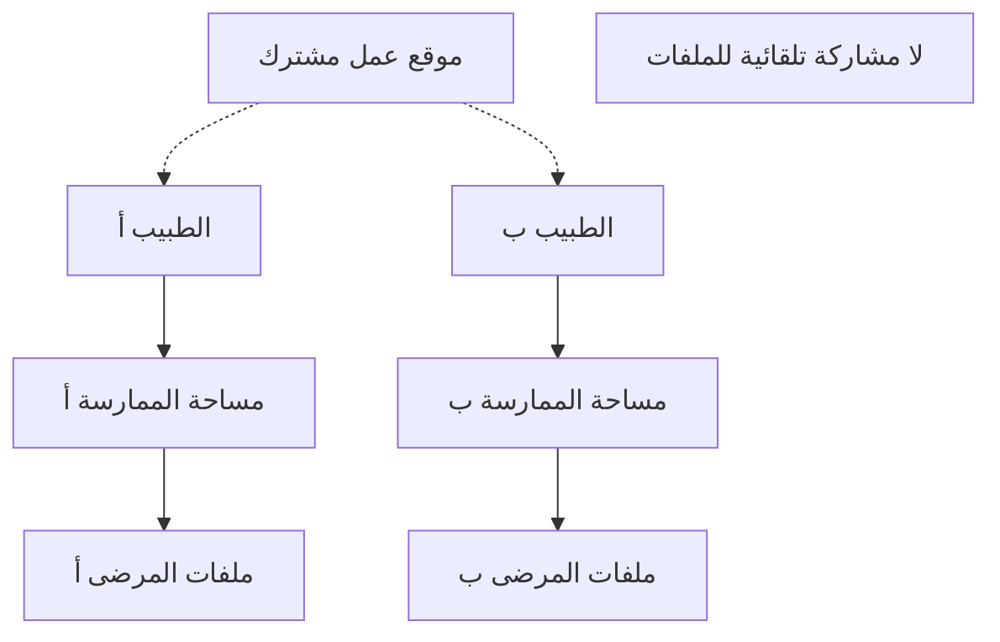

# سِناد — إدارة ممارسة طبيب الأسنان ومواعيد المرضى

[العربية](ar.md) · [English](en.md) · [Türkçe](tr.md)

**مساحة واحدة للممارسة. مواقع عمل متعددة. وصول منضبط إلى سجلات المرضى.**

منصة تجمع تنظيم دوام طبيب الأسنان وخدماته ومواقع عمله مع رحلة المريض لاختيار الوقت وطلب الموعد ومتابعته، وتربط ذلك بملفات المرضى والزيارات ومخطط الأسنان للأدوار المصرح لها.


رسم مفاهيمي لنموذج الممارسة والموعد.

## لماذا سِناد؟

قد يوزّع طبيب الأسنان أسبوعه بين عيادته الخاصة ومركز طبي أو أكثر. وعندما تُدار أوقات الدوام وطلبات المواعيد بصورة منفصلة في كل مكان، تصبح متابعة التوافر الفعلي للطبيب وحالة الطلبات أكثر تعقيدًا، ويظهر احتمال التعارض بين الجداول.

وهناك تحدٍّ آخر لا يتعلق بالتوقيت وحده: **إذا عمل طبيبان في المركز نفسه، فهل يعني اشتراكهما في المكان أن ملفات مرضاهما أصبحت مشتركة؟**

انطلق تصميم «سِناد» من مبدأ **الممارسة المرتبطة بالطبيب (Doctor-First Practice)**؛ فمساحة العمل والسجلات ترتبط بممارسة الطبيب نفسه، بينما تُضاف العيادة أو المركز بوصفه موقع عمل ضمن تلك الممارسة. يتيح هذا النموذج تنظيم عمل الطبيب عبر أماكن متعددة، دون اعتبار الموقع المشترك تصريحًا تلقائيًا للوصول إلى ملفات المرضى.

### واجهة بثلاث لغات

يتاح اختيار لغة الواجهة. تستخدم العربية اتجاه RTL، وتستخدم الإنجليزية والتركية اتجاه LTR. أمثلة العناوين أدناه من موارد التوطين.

- **العربية** — المواعيد · اللغة (RTL)
- **English** — Appointments · Language (LTR)
- **Türkçe** — Randevular · Dil (LTR)

## رحلة الطرفين

### مسار الطبيب

1. حساب وأهلية أو دعوة
2. تهيئة الممارسة والمواقع والخدمات
3. ضبط الدوام والإتاحة
4. مراجعة طلبات المواعيد

### مسار المريض

1. إنشاء حساب
2. البحث عن الطبيب والخدمة
3. اختيار الموقع والوقت وإرسال الطلب
4. متابعة الموعد أو طلب تغييره

تُضبط مدة الخدمة وساعات الدوام والاستثناءات لكل موقع. يفحص الخادم تداخل الفترات الزمنية المطلقة عبر المواقع والمناطق الزمنية ويحمي المواعيد القائمة. وعند تقديم الطلب يعيد التحقق من الأهلية والإتاحة والتكرار وفق سياسة الحجز، بما فيها الحالات المحددة للحجز العائلي.

**طلب موعد** — قيد المراجعة. **موعد مثبت** — حالة مستقلة بعد الاعتماد.

تُحسم الموافقة على إعادة الجدولة داخل معاملة ذرية تتحقق من حالة الموعد الأصلي وتحدّث قرار التغيير وسجله معًا. يبقى الموعد الأصلي قائمًا إذا رُفض التغيير. ويظل الموعد الملغى ظاهرًا في سجل الحالات.

### اشتراك مرتبط بالممارسة

يبدأ الطبيب بإنشاء حسابه وتهيئة مساحة ممارسته، ثم يضبط مواقع العمل والخدمات وأوقات الدوام. يرتبط الاشتراك بممارسة الطبيب عبر مواقع عمله، ويشمل النموذج فترة تجربة وخطة مدفوعة وخيارات لإدارة الاشتراك وتجديده وإلغائه. حساب المريض مستقل عن اشتراك الطبيب، وفوترة الزيارات منفصلة عنه.

تفاصيل السعر ومدة التجربة وحصة الملفات وشروط الاشتراك منشورة في صفحة الباقة الرسمية. يقتصر دليل Paddle في هذه الدراسة على بيئة Sandbox. [الباقة والاشتراك](https://sinaddental.com/pricing.html?lang=ar)

## ما بعد الموعد

تدعم مساحة الطبيب البحث في ملفات المرضى وأرشفتها، وطلب ربط الملف بالممارسة وإسناد الرعاية أو سحب الإسناد. تُفصل البيانات الإدارية عن الملاحظات السريرية وفق الدور والصلاحية.

في مخطط الأسنان يحدد المستخدم المخوّل السن والسطح وطبقة التشخيص وسبب التعديل للأسنان اللبنية أو الدائمة. يتحقق الخادم من رقم المراجعة المتوقع، ويكتب التعديل وحدثه وأثر التدقيق في معاملة واحدة. توجد مسارات للتاريخ والتراجع المصرح به وتصدير الملخص.

تتضمن الشيفرة تسجيل الزيارات وإصدار فواتيرها وربط الدفعات والتصفية حسب التاريخ وموقع العمل والعملة. تبقى الخطط العلاجية والموافقة الرقمية في نطاق التطوير.

## المكان مقابل صلاحية الملف

يُفرّق «سِناد» بين **الدور الذي يؤديه المستخدم** و**المكان الذي يعمل فيه الطبيب**. وتقوم تجربته على أربعة أدوار أساسية:

1. **طبيب الأسنان (Doctor):** ينظم مساحة الممارسة والمواقع والخدمات والدوام والمواعيد والمتابعة السريرية المصرح بها.
2. **المريض (Patient):** يبحث عن الأوقات المتاحة، ويقدم طلبات المواعيد أو إعادة الجدولة، ويتابع الحالة وروابط ملفه بالممارسة.
3. **الاستقبال والفريق المساند (Staff):** يتولى المهام التنظيمية والبيانات الإدارية المفوّضة، دون وصول سريري مفتوح بسبب الدور وحده.
4. **مشغّل المنصة (Platform Admin):** يدير جوانب من حوكمة بيئة التجربة، مثل دعوات الأطباء ومراجعة عناوين العمل وحالات الحسابات، دون أن تمنحه هذه الصفة وصولًا تلقائيًا إلى السجلات السريرية.

يُضاف المركز بوصفه موقع عمل للممارسة. ترتبط صلاحية الاطّلاع على الملف بعضوية مساحة الطبيب وإسناد الرعاية والسياسة ذات الصلة.



يمكن للطبيبين العمل في العنوان نفسه. لكلٍ منهما مساحة مستقلة، ويحتاج الوصول إلى الملف تفويضًا ضمن سياقها.

## القرارات الهندسية ومساهمتي

قدتُ بلورة نموذج ملكية الممارسة وفصل نطاق «سِناد» وبيئات بياناته بوصفه منتجًا مستقلًا، وعملتُ على تطوير واجهات Flutter وربط مسارات الهوية والبيانات والحجز، إلى جانب المشاركة في تحديد نطاق الاختبارات ومراجعة نتائجها.

**الواجهة وسياق الممارسة.** تنظيم شاشات عربية من اليمين إلى اليسار، وإنجليزية وتركية من اليسار إلى اليمين، وتمرير الممارسة والدور النشط بين واجهات التطبيق حتى لا يضيع سياق العمل.

Flutter · Dart · Material 3 · Bloc/Cubit · TenantContextScope

**الهوية وأصالة العميل والأجهزة.** فصل إثبات هوية المستخدم عن أصالة نسخة التطبيق، مع تضمين الشيفرة مسارات لإدارة الأجهزة المعتمدة وإعادة مصادقة الهاتف الموثق للإجراءات الحساسة.

Firebase Auth · Firebase App Check · account_device_service

**الدوام والحجز والمعاملات.** فحص تداخل الدوام عبر مواقع ومناطق زمنية مختلفة، وإعادة التحقق من إتاحة الوقت، وحسم قرارات تغيير الموعد داخل معاملة خادمية ذرية.

Cloud Functions · TypeScript · Node.js 22 · Firestore Transactions

**البيانات السريرية والتفويض.** حفظ المخطط بمراجعة متوقعة وسجل تدقيق؛ مع الفصل بين وصول Flutter المباشر المحكوم بـSecurity Rules والدوال الخادمية التي تستخدم Admin SDK وتحتاج إلى تحقق تفويض مستقل.

Cloud Firestore/Storage Rules · odontogram_service · سجلات تدقيق

**تكامل الخدمات والاشتراك.** ترتبط حالة الاشتراك بالممارسة، وتدعم قنوات منفصلة الإشعارات والدعوات. لكل تكامل نطاق تحقق مستقل.

FCM · Postmark · Paddle Sandbox

```mermaid
flowchart TD
    client["عميل Flutter"]
    auth["إثبات الهوية — Firebase Auth"]
    check["أصالة العميل — App Check"]
    direct["وصول مباشر"]
    rules["Security Rules"]
    cloud["Firestore / Storage"]
    call["دالة خادمية"]
    authorise["تحقق العضوية والإسناد والسياسة"]
    admin["Admin SDK · معاملة عند الحاجة"]
    records["بيانات الممارسة ضمن النطاق"]
    client --> auth
    client --> check
    auth -.-> direct
    auth -.-> call
    check -.-> direct
    check -.-> call
    direct --> rules --> cloud --> records
    call --> authorise --> admin --> records
```

تحدد القواعد صلاحية الوصول المباشر. تتحقق الدالة من الصلاحية قبل القراءة أو الكتابة باستخدام Admin SDK. يساعد App Check في إثبات أصالة العميل.

## التقنيات، الأدلة، وطرق الاستكشاف

- **الواجهة والتجربة:** Flutter · Dart · Material 3 · Bloc/Cubit · AR / EN / TR
- **الهوية وحدود الوصول:** Firebase Auth · App Check · Firestore / Storage Security Rules
- **الخدمات ومنطق الأعمال:** Cloud Functions · TypeScript · Firestore Transactions
- **البيانات والملفات:** Cloud Firestore · Cloud Storage · سجلات التغيّر والتدقيق
- **الاتصال والتكاملات:** FCM · Postmark · Paddle Sandbox

### الدليل المتاح

- **الموقع الرسمي لسِناد.** يضم تعريفًا بالمنتج ومدخلَي الطبيب والمريض وصفحة الباقة. يتوقف الوصول إلى الوظائف المحمية على الحساب والصلاحيات. [زيارة موقع سِناد الرسمي](https://sinaddental.com/?lang=ar)
- **شواهد التنفيذ.** جولات اصطناعية منفصلة وثّقت إعداد الممارسة والدوام، وطلبات الحجز وتغيير الموعد وسجل الإلغاء. وثّق اختبار Chrome في 26 أكتوبر 2026 تعديل المخطط وتدقيقه وحجب الوصول بعد سحب الإسناد. يظل اختبار مسار الاستدعاء الإنتاجي لغير العضو منفصلًا.

**نطاق الإتاحة والتحقق.** الموقع الرسمي متاح للزوار. الوصول إلى الوظائف المحمية مرتبط بالحساب والصلاحيات. القبول التجاري والسريري مساران مستقلان، ولا تتناول هذه الدراسة تشغيل بيانات مرضى حقيقية أو إثبات التحصيل المالي في الإنتاج.

[تابع القراءة على الموقع](https://yahyaalali.com/works/dental/) · [العودة إلى الأعمال المختارة](../../README.md)
