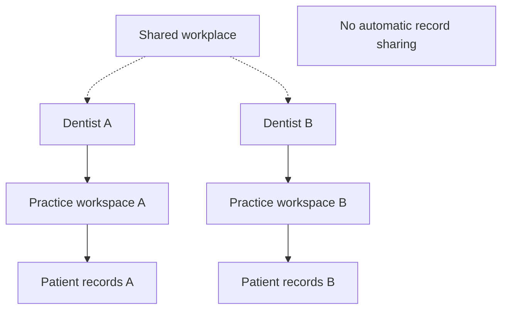

# Sinad — Dental Practice and Patient Appointment Management

[العربية](ar.md) · [English](en.md) · [Türkçe](tr.md)

**One practice workspace. Multiple workplaces. Explicit access to patient records.**

Sinad connects a dentist’s workplaces, services and schedule with a patient journey for discovering availability, requesting an appointment and following its status. Authorized care teams can use separate workflows for patient records, visits and the interactive odontogram.


Concept illustration of the practice and appointment model.

## Why Sinad?

A dentist may divide their week between a private practice and one or more medical centres. Managing schedules and appointment requests separately at each location makes it harder to see the dentist’s actual availability and increases the risk of conflicting bookings.

There is a second question beyond scheduling: **if two dentists work at the same centre, should they automatically have access to each other’s patient records?**

Sinad follows a **doctor-first practice model**. The dentist’s practice owns its workspace and records, while clinics and centres are represented as workplaces within that practice. A dentist can therefore organize work across several locations without treating a shared address as permission to access another practice’s clinical files.

### One interface, three languages

Users can choose their interface language. Arabic reads right to left, while English and Turkish read left to right. The labels below come from the localization resources.

- **العربية** — المواعيد · اللغة (RTL)
- **English** — Appointments · Language (LTR)
- **Türkçe** — Randevular · Dil (LTR)

## Two connected journeys

### Dentist journey

1. Account and eligibility or invitation
2. Set up practice, workplaces and services
3. Set hours and availability
4. Review appointment requests

### Patient journey

1. Create an account
2. Search for a dentist and service
3. Choose location and time, then request
4. Follow or request a change

Service duration, working hours and exceptions are configured per workplace. The server checks overlaps in absolute time across workplaces and time zones and protects existing bookings. When a request is submitted, it rechecks eligibility, availability and duplicates under the booking policy, including supported family-booking cases.

**Appointment request** — Pending review. **Confirmed appointment** — Separate example after approval.

Accepting a reschedule uses an atomic transaction that checks the original booking and updates the decision and its history together. Declining the change keeps the original booking. Cancelled appointments remain visible in the status history.

### A practice-level subscription

A dentist joins according to account and invitation eligibility, sets up a practice workspace and configures workplaces, services and hours. The practice-level subscription model supports plan or trial access where available and subscription-management workflows; multiple workplaces do not automatically require separate practice subscriptions. The patient account journey and visit billing are distinct.

Depending on configuration, the workflows include managing a plan or requesting cancellation. The Paddle evidence cited here comes from Sandbox.

## Beyond booking

The workspace supports patient-record search and archiving, requests to link a record to the practice, and granting or revoking care assignments. Administrative data and clinical notes are separated according to role and permission.

In the odontogram, authorized users select a tooth, surface and diagnostic layer and record the reason for a change for primary or permanent teeth. The server checks the expected revision and writes the change, event and audit entry in one transaction. It also supports history, authorized reversal and summary export.

The code covers recording visits, issuing invoices, linking payments and filtering by period, workplace and currency. Treatment plans and digital consent remain in development.

## Place is not permission

Sinad distinguishes between **who a user is** and **where a dentist provides care**. Four principal user roles shape the application:

1. **Dentist (Doctor):** manages the practice workspace, workplaces, services, schedule, appointments, and clinical follow-up within assigned permissions.
2. **Patient:** discovers eligible times, requests appointments or rescheduling, tracks their status, and manages links to their patient file.
3. **Reception and support staff (Staff):** coordinate appointments and delegated administrative tasks, without unrestricted clinical access simply by being staff.
4. **Platform administrator (Platform Admin):** handles selected test-environment governance tasks, such as doctor invitations, workplace-address review, and account states, without automatic access to clinical files.

A centre is registered as a workplace in the practice. Record access depends on membership in the dentist’s workspace, the care assignment and the applicable policy.



Both dentists can work at the same address. Each has an independent practice workspace and access to records requires authorization within that workspace.

## Engineering decisions and my contribution

I led the definition of the doctor-first ownership model and the separation of Sinad’s product scope and data environments. I also contributed to Flutter interfaces and the integration of identity, data, and booking flows, while helping define test scope and review observed results.

**Interface and practice context.** Support Arabic right-to-left and English/Turkish left-to-right layouts while carrying the active practice and role across views.

Flutter · Dart · Material 3 · Bloc/Cubit · TenantContextScope

**Identity, app integrity, and devices.** Keep user authentication separate from client application attestation, alongside source-level flows for approved account devices and verified-phone reauthentication on sensitive actions.

Firebase Auth · Firebase App Check · account_device_service

**Scheduling and atomic operations.** Detect schedule collisions across workplaces/time zones, revalidate booking eligibility, and decide rescheduling changes in server-side transactions.

Cloud Functions · TypeScript · Node.js 22 · Firestore Transactions

**Clinical data and authorization.** Version and audit odontogram edits; distinguish direct client access controlled by Security Rules from Admin SDK calls that need explicit server-side authorization.

Cloud Firestore/Storage Rules · odontogram_service · audit records

**Service integrations and subscriptions.** Subscription state belongs to the practice. Separate channels support notifications and invitations. Each integration has its own verification scope.

FCM · Postmark · Paddle Sandbox

```mermaid
flowchart TD
    client["Flutter client"]
    auth["User identity — Firebase Auth"]
    check["Client attestation — App Check"]
    direct["Direct access"]
    rules["Security Rules"]
    cloud["Firestore / Storage"]
    call["Server callable"]
    authorise["Membership, assignment and policy checks"]
    admin["Admin SDK · transaction when needed"]
    records["Practice-scoped data"]
    client --> auth
    client --> check
    auth -.-> direct
    auth -.-> call
    check -.-> direct
    check -.-> call
    direct --> rules --> cloud --> records
    call --> authorise --> admin --> records
```

Rules authorize direct access. The callable checks permissions before reading or writing through the Admin SDK. App Check helps attest the client.

## Technology, evidence, and exploration

- **Interface and experience:** Flutter · Dart · Material 3 · Bloc/Cubit · AR / EN / TR
- **Identity and access boundaries:** Firebase Auth · App Check · Firestore / Storage Security Rules
- **Services and business logic:** Cloud Functions · TypeScript · Firestore Transactions
- **Data and files:** Cloud Firestore · Cloud Storage · change and audit logs
- **Communication and integrations:** FCM · Postmark · Paddle Sandbox

### Available evidence

- **Explore the product experience.** The current preview domain. Access to protected features depends on the account, permissions and environment configuration. [Open the preview domain](https://test.sinaddental.com/)
- **Implementation evidence.** Separate synthetic-data rounds covered practice and schedule setup, requests, rescheduling and cancellation history. On 26 October 2026, a Chrome run documented an odontogram update, its audit entry and the denial after assignment was revoked. The production callable path for non-members remains a separate check.

**Availability.** Access to Sinad depends on the account and permissions. Commercial and clinical acceptance are separate. Real patient data and payment collection are outside the scope of this presentation.

[Continue reading on the website](https://yahyaalali.com/en/works/dental/) · [Back to selected work](../../README.md)
