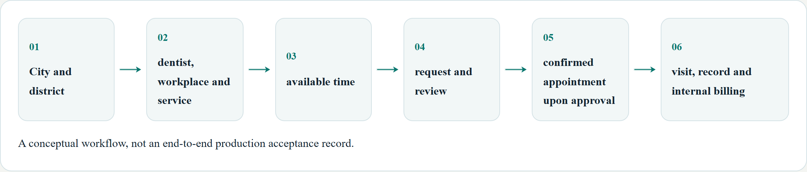
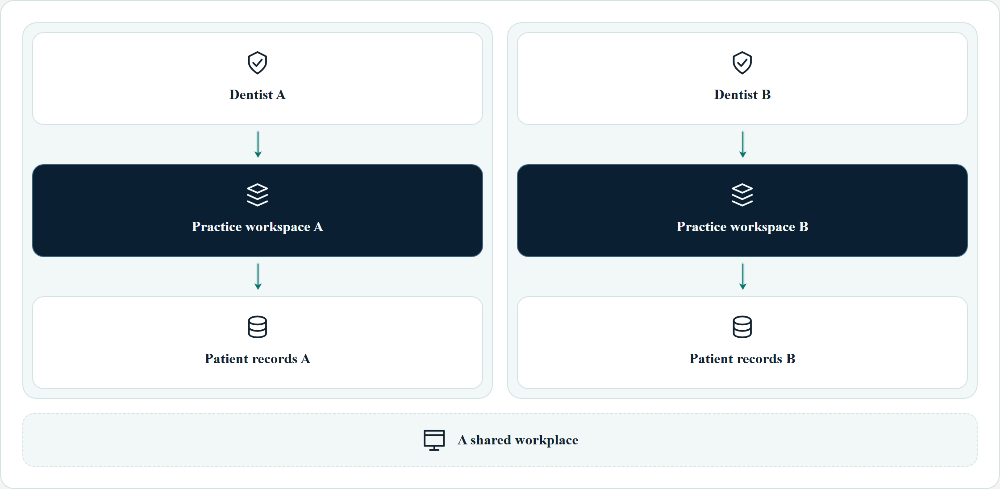
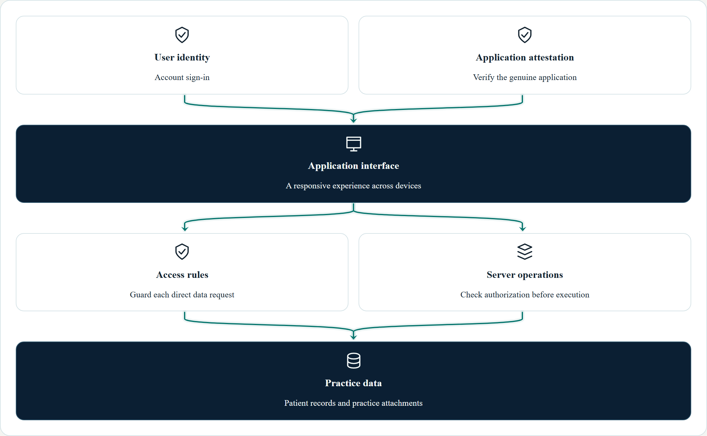

# SINAD

[العربية](ar.md) · [English](en.md) · [Türkçe](tr.md)

[Published case study](https://yahyaalali.com/en/works/dental/)

Digital Health · Web version available

Connected dental practice management, from the patient’s appointment to visit records and the dentist’s working day.

- **Field:** Dental practice management
- **Languages:** Arabic · English · Turkish
- **Availability:** Web version available

Conceptual architectural visual · actual interface captures below

SINAD is built around the idea that a dentist’s practice extends beyond a single clinic address. It brings workplaces, services, working hours, appointments and visits into a shared practice context, connecting them with the patient’s search, appointment request and follow-up. Access to patient records remains governed by each practice and user role.

## Vision and visual identity

A dentist may divide the week between a private clinic and another medical centre. Services, hours and appointments vary by workplace, while patient care and follow-up remain part of the dentist’s own practice. SINAD is designed to organise work around the dentist rather than a single address, and to give patients a clear path to a dentist, service, workplace and suitable time.

This model connects appointments, records and visits within an independent practice workspace and gives support staff defined responsibilities, without treating shared premises as permission to access another dentist’s records.

### Visual Identity

The name SINAD evokes support: a digital companion for the dentist’s working day and the patient’s journey. A tooth and the letter S connect the mark to its field and name, while navy, teal and gold create a composed professional appearance.

## Inside the SINAD experience

Selected scenes illustrate the journey from discovering a dentist to managing a practice and following a visit. The demonstration images are based on original application components populated with synthetic data.

### 01 — Discovering dentists and services

Search by city and district, with text normalisation that accommodates variations in Arabic and Turkish spelling. Explore dentists and their workplaces, then proceed to the service and displayed times.

### 02 — From availability to appointment request

Patients select a service, workplace and time, then follow the request or a proposed change. Pending requests remain distinct from confirmed appointments, with family-booking workflows subject to policy.

### 03 — A dentist’s day across workplaces

Manage services and durations, working hours and exceptions at multiple workplaces within the practice, with scheduling logic that checks for conflicts.

### 04 — Patient records and the interactive odontogram

Connect visits, records and dental charts in a single care context. The odontogram represents primary and permanent teeth, surfaces and clinical state layers (historical, diagnosis, planned and completed), with recorded changes and audit history.

**Primary teeth — supporting capture**

### 05 — Billing and financial follow-up

Internal billing records connect a visit to invoices, recorded payments and currencies within the assigned permissions, keeping financial follow-up in the context of practice work.

## A connected experience for dentist, patient and team

The roles meet at the appointment and visit, while each user works within a defined scope.

### Dentists

Manage their practice, workplaces, services, schedules, appointments, records, visits, odontogram and billing within their assigned scope.

### Patients

Search for dentists and workplaces, choose a service and time, submit or change an appointment request and follow its status, using a personal account separate from the dentist’s subscription.

### Reception and support staff

Coordinate delegated requests, tasks and administrative information; the role itself does not grant unrestricted access to clinical records.

### Platform administration

Coordinate account governance, dentist invitations and workplace reviews, keeping administrative permissions distinct from clinical access.

### From the practice to the phone

A responsive experience in Arabic, English and Turkish supports schedules and records on a computer and appointment follow-up on a phone. Its code foundation supports multiple platforms; public web access does not establish a commercial or app-store release.

### A subscription centred on the practice

The subscription model follows the dentist’s practice across workplaces, while patient accounts and visit billing remain separate. The published plan includes a trial and file allowance; a patient account does not require the dentist’s subscription. Consult the official product website for current pricing, trial, storage, renewal and cancellation terms. [Plan and subscription](https://sinaddental.com/pricing.html?lang=en).

## The engineering behind appointments and records

### Figure 01 — From discovery to visit

Diagram text and details

1. City and district
2. dentist, workplace and service
3. available time
4. request and review
5. confirmed appointment upon approval
6. visit, record and internal billing

A conceptual workflow, not an end-to-end production acceptance record.

### Figure 02 — Shared premises, independent records

Two dentists may work in the same centre while maintaining independent practice workspaces. Membership and care assignment govern record access; a shared address does not automatically confer access.

Diagram text and details

Dentist A

Practice workspace A

Patient records A

Dentist B

Practice workspace B

Patient records B

A shared workplace

### Figure 03 — Architecture and access boundaries

Protection starts with user identity and application attestation. Requests follow either direct access rules or server operations that check authorization before execution. Both routes reach practice data within their respective boundaries; the interface alone grants no access.

Diagram text and details

User identity

Account sign-in

Application attestation

Verify the genuine application

Application interface

A responsive experience across devices

Access rules

Guard each direct data request

Server operations

Check authorization before execution

Practice data

Patient records and practice attachments

**Selected engineering decisions**

### Appointment consistency

Revalidate availability upon submission, preserve existing appointments and resolve a rescheduling decision and related history in a server-side transaction. A rejected change leaves the original appointment intact.

### Clinical record consistency

Expected revisions, operation identifiers and recorded change history in the odontogram help prevent silent overwrites and preserve the context of an edit. The design includes FDI, Universal and Palmer numbering and source-level workflows for history, authorised undo and export.

### Account and device identity

Distinguish user identity from application attestation, with device approval, revocation and audit history in the account context.

### Financial separation

Internal visit invoices and recorded payments are distinct from the practice subscription and payment-provider settlement. Paddle integration evidence is scoped to its test environment; commercial acceptance is separate.

## Technologies, contribution and links

### Tools and Technologies

#### Interface and application

`Flutter` · `Dart`

#### Data and services

`Cloud Firestore` · `Cloud Storage` · `Cloud Functions`

#### Identity and security

`Firebase Authentication` · `App Check`

### My Contribution

I led the design of SINAD and the development of its doctor-first practice model. My work included the application interfaces, identity, appointment and data workflows, defining authorisation boundaries and reviewing test evidence. SINAD is an independent project designed to provide a scalable digital solution for dental practices.

The official website is available to visit; protected features depend on account access and permissions. The evidence shown comes from bounded test environments and does not constitute comprehensive clinical or commercial acceptance, or announce unpublished native releases.

### Project Links

### Project links

- [Visit Website](https://sinaddental.com/?lang=en)
- [Plan and Subscription](https://sinaddental.com/pricing.html?lang=en)
- [Published case study](https://yahyaalali.com/en/works/dental/)

[Back to projects](../../README.md)
