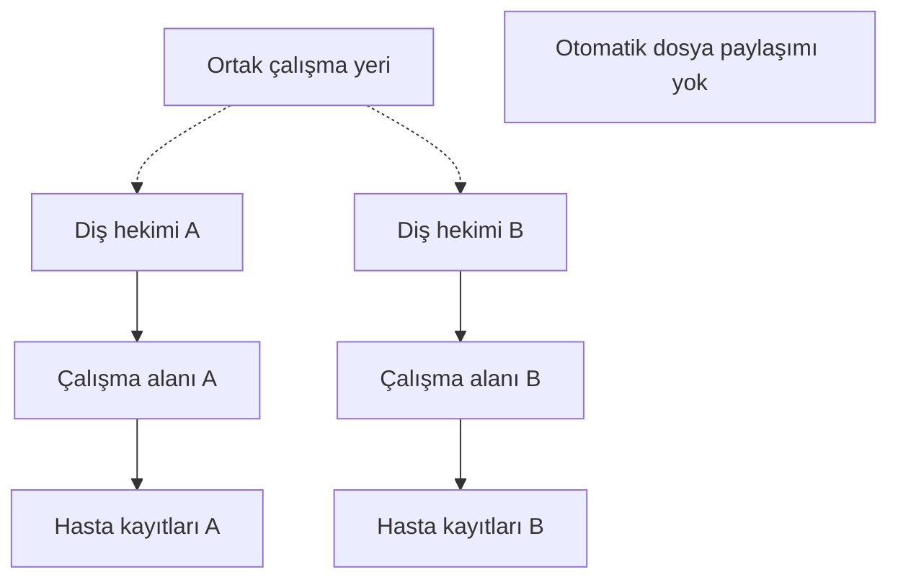

# Sinad — Diş Hekimi Çalışma Alanı ve Randevu Yönetimi

[العربية](ar.md) · [English](en.md) · [Türkçe](tr.md)

**Tek çalışma alanı. Birden fazla çalışma yeri. Hasta kayıtlarına yetkiye dayalı erişim.**

Sinad; diş hekiminin çalışma yerlerini, hizmetlerini ve takvimini, hastanın uygun saatleri inceleyip randevu talebi oluşturduğu ve durumunu izlediği akışla birleştirir. Hasta dosyaları, ziyaretler ve etkileşimli diş şeması yetkili kullanıcılar için ayrı iş akışlarıyla sunulur.


Çalışma alanı ve randevu modelinin kavramsal çizimi.

## Neden Sinad?

Bir diş hekimi haftanın farklı günlerinde kendi muayenehanesinde, bir tıp merkezinde veya başka kliniklerde görev yapabilir. Her yerin çalışma saatleri ve randevu talepleri ayrı ayrı yönetildiğinde, hekimin gerçekten ne zaman müsait olduğunu görmek zorlaşır; takvim çakışmaları da daha olası hâle gelir.

Bir de takvimden bağımsız bir soru vardır: **Aynı merkezde çalışan iki diş hekimi, birbirlerinin hasta dosyalarına kendiliğinden erişebilmeli midir?**

Sinad, **hekim merkezli çalışma alanı modeli (Doctor-First Practice)** üzerine kuruludur. Çalışma alanı ve kayıtlar ilgili hekime aittir; muayenehane veya tıp merkezi ise bu alana eklenen bir **çalışma yeri** olarak ele alınır. Böylece hekim birden fazla yerdeki iş akışını tek yerden düzenleyebilir. Ortak adres, başka bir hekimin klinik kayıtlarına erişim izni anlamına gelmez.

### Üç dilli arayüz

Kullanıcı arayüz dilini seçebilir. Arapça sağdan sola, İngilizce ve Türkçe soldan sağa okunur. Aşağıdaki başlıklar yerelleştirme kaynaklarından alınmıştır.

- **العربية** — المواعيد · اللغة (RTL)
- **English** — Appointments · Language (LTR)
- **Türkçe** — Randevular · Dil (LTR)

## İki bağlantılı süreç

### Hekimin süreci

1. Hesap ve uygunluk veya davet
2. Çalışma alanı, yerler ve hizmetler
3. Çalışma saatleri ve uygunluk
4. Randevu taleplerini inceleme

### Hastanın süreci

1. Hesap oluşturma
2. Hekim ve hizmet arama
3. Yer ve saat seçip talep gönderme
4. Randevuyu izleme veya değişiklik isteme

Hizmet süresi, çalışma saatleri ve istisnalar her çalışma yeri için tanımlanır. Sunucu, farklı çalışma yerleri ve saat dilimlerindeki mutlak zaman aralıklarının çakışmasını denetler ve mevcut randevuları korur. Talep gönderildiğinde, belirli aile randevuları da dâhil olmak üzere uygunluk, saat ve yinelenen talepler randevu politikasına göre yeniden doğrulanır.

**Randevu talebi** — İnceleme bekliyor. **Onaylanmış randevu** — Onay sonrası ayrı bir örnek.

Saat değişikliği onaylanırken atomik işlem özgün randevunun durumunu denetler ve kararı geçmiş kaydıyla birlikte yazar. Değişiklik reddedilirse ilk randevu korunur. İptal edilen randevular durum geçmişinde kalır.

### Çalışma alanına bağlı abonelik

Diş hekimi hesabını ve çalışma alanını oluşturur, ardından çalışma yerlerini, hizmetlerini ve saatlerini düzenler. Abonelik, hekimin tüm çalışma yerlerindeki çalışma alanını kapsar. Modelde deneme süresi, ücretli paket ve aboneliği yönetme, yenileme veya iptal etme seçenekleri bulunur. Hasta hesabı ve ziyaret faturalandırması hekim aboneliğinden ayrıdır.

Güncel fiyat, deneme süresi, dosya kotası ve abonelik koşulları resmî paket sayfasında yer alır. Bu incelemedeki Paddle kanıtı Sandbox ortamına aittir. [Paket ve abonelik](https://sinaddental.com/pricing.html?lang=tr)

## Randevunun ötesi

Çalışma alanı hasta dosyalarını aramayı ve arşivlemeyi, dosyayı çalışma alanına bağlama talebini ve klinik takip yetkisi vermeyi veya geri almayı destekler. İdari veriler ve klinik notlar role ve yetkiye göre ayrılır.

Yetkili kullanıcı süt veya kalıcı dişlerde dişi, yüzeyi ve tanı katmanını seçip değişiklik nedenini kaydeder. Sunucu beklenen revizyonu kontrol eder ve değişikliği, olayı ve denetim izini tek işlemde yazar. Geçmişi okuma, yetkili geri alma ve özet dışa aktarma akışları da bulunur.

Kaynak kod, ziyaret kaydı, ziyaret faturası, ödeme ilişkilendirmesi ve dönem, çalışma yeri ve para birimine göre filtreleme akışlarını içerir. Tedavi planları ve dijital onam geliştirme kapsamındadır.

## Mekân, erişim yetkisi değildir

Sinad, **kullanıcının rolü** ile **hekimin çalıştığı fiziksel yeri** birbirinden ayırır. Uygulamanın dört temel kullanıcı rolü vardır:

1. **Diş hekimi (Doctor):** Kendi çalışma alanını, çalışma yerlerini, hizmetlerini, takvimini, randevularını ve yetkili olduğu klinik süreçleri yönetir.
2. **Hasta (Patient):** Uygun saatleri bulur, randevu veya değişiklik talebi gönderir, durumu ve dosya bağlantılarını takip eder.
3. **Resepsiyon ve destek ekibi (Staff):** Yetki verilen idari görevleri ve randevu koordinasyonunu yürütür; bu rol tek başına sınırsız klinik erişim sağlamaz.
4. **Platform yöneticisi (Platform Admin):** Test ortamındaki hekim davetleri, çalışma yeri adreslerinin incelenmesi ve hesap durumları gibi belirli yönetim süreçlerini yürütür; klinik dosyalara otomatik erişim kazanmaz.

Merkez, hekimin çalışma alanına bir çalışma yeri olarak eklenir. Dosya erişimi çalışma alanı üyeliği, klinik takip yetkisi ve ilgili politikaya bağlıdır.



İki hekim aynı adreste çalışabilir. Her hekimin bağımsız bir çalışma alanı vardır ve dosyalara erişim bu alan kapsamında yetkilendirilir.

## Mimari kararlar ve katkım

Sinad'ın hekim merkezli sahiplik modelinin şekillendirilmesine, ürün kapsamının ve veri ortamlarının ayrı tutulmasına öncülük ettim. Flutter arayüzlerinin geliştirilmesine, kimlik, veri ve randevu akışlarının bütünleştirilmesine katkı sundum; test kapsamının belirlenmesi ve sonuçların incelenmesinde de görev aldım.

**Arayüz ve çalışma alanı bağlamı.** Arapça için sağdan sola, İngilizce ve Türkçe için soldan sağa arayüzler; ekranlar arasında etkin hekim alanı ve kullanıcı rolünün taşınması.

Flutter · Dart · Material 3 · Bloc/Cubit · TenantContextScope

**Kimlik, uygulama doğrulaması ve cihazlar.** Kullanıcı kimlik doğrulamasını istemci uygulamanın doğrulanmasından ayırmak; kaynak kodda onaylı hesap cihazları ve doğrulanmış telefonla yeniden kimlik doğrulama akışlarını ele almak.

Firebase Auth · Firebase App Check · account_device_service

**Takvim ve atomik işlemler.** Farklı çalışma yerleri ve saat dilimleri arasındaki çakışmaları denetlemek, randevu uygunluğunu yeniden doğrulamak ve değişiklik kararlarını sunucu tarafında tek işlemde tamamlamak.

Cloud Functions · TypeScript · Node.js 22 · Firestore Transactions

**Klinik kayıtlar ve yetkilendirme.** Odontogram değişikliklerini revizyon ve denetim iziyle kaydetmek; Security Rules ile denetlenen doğrudan istemci erişimini, Admin SDK kullanan ve ayrıca sunucu tarafı yetki kontrolü gerektiren fonksiyonlardan ayırmak.

Cloud Firestore/Storage Rules · odontogram_service · denetim kayıtları

**Hizmet entegrasyonları ve abonelik.** Abonelik durumu çalışma alanına bağlıdır. Bildirimler ve davetler ayrı kanalları kullanır. Her entegrasyonun doğrulama kapsamı farklıdır.

FCM · Postmark · Paddle Sandbox

```mermaid
flowchart TD
    client["Flutter istemcisi"]
    auth["Kullanıcı kimliği — Firebase Auth"]
    check["İstemci doğrulaması — App Check"]
    direct["Doğrudan erişim"]
    rules["Security Rules"]
    cloud["Firestore / Storage"]
    call["Sunucu işlevi"]
    authorise["Üyelik, atama ve politika kontrolü"]
    admin["Admin SDK · gerektiğinde işlem"]
    records["Çalışma alanı kapsamındaki veriler"]
    client --> auth
    client --> check
    auth -.-> direct
    auth -.-> call
    check -.-> direct
    check -.-> call
    direct --> rules --> cloud --> records
    call --> authorise --> admin --> records
```

Kurallar doğrudan erişim yetkisini belirler. Sunucu işlevi Admin SDK ile okuma veya yazma öncesinde yetkileri denetler. App Check istemcinin doğrulanmasına yardımcı olur.

## Teknolojiler, kanıtlar ve inceleme

- **Arayüz ve deneyim:** Flutter · Dart · Material 3 · Bloc/Cubit · AR / EN / TR
- **Kimlik ve erişim sınırları:** Firebase Auth · App Check · Firestore / Storage Security Rules
- **Hizmetler ve iş mantığı:** Cloud Functions · TypeScript · Firestore Transactions
- **Veri ve dosyalar:** Cloud Firestore · Cloud Storage · değişiklik ve denetim kayıtları
- **İletişim ve entegrasyonlar:** FCM · Postmark · Paddle Sandbox

### Mevcut kanıtlar

- **Sinad’ın resmî web sitesi.** Ürünü inceleyin, hekim ve hasta giriş noktalarına ulaşın ve paket ayrıntılarını görün. Korumalı işlevlere erişim hesap izinlerine bağlıdır. [Sinad’ın resmî web sitesini ziyaret edin](https://sinaddental.com/?lang=tr)
- **Uygulama kanıtları.** Ayrı sentetik veri turları çalışma alanı ve takvim kurulumunu, talepleri, saat değişikliklerini ve iptal geçmişini belgeledi. 26 Ekim 2026’daki Chrome çalışması diş şeması güncellemesini, denetim izini ve atama geri alındığında erişimin kapanmasını belgeledi. Üye olmayan hesap için üretimdeki sunucu işlevi ayrı bir doğrulama konusudur.

**Erişim ve doğrulama kapsamı.** Resmî site herkese açıktır. Korumalı işlevlere erişim hesaba ve izinlere bağlıdır. Ticari ve klinik kabul ayrı süreçlerdir. Bu vaka incelemesi üretimde gerçek hasta verisi kullanımını veya ödeme tahsilatını doğrulamaz.

[Web sitesinde okumaya devam edin](https://yahyaalali.com/tr/works/dental/) · [Seçili çalışmalara dön](../../README.md)
