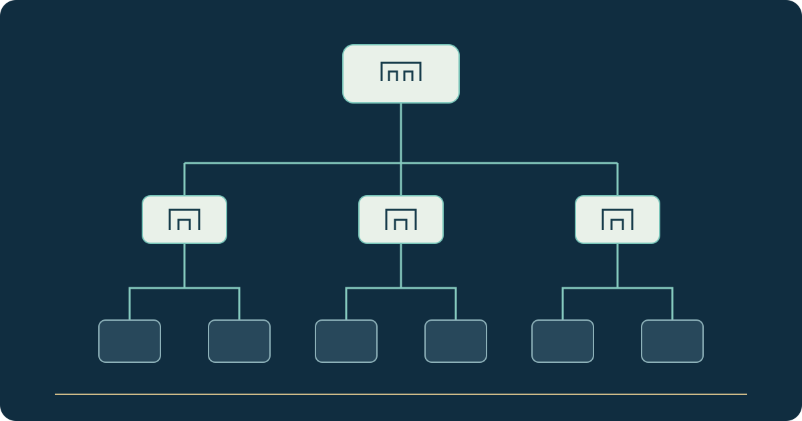

# Municipal Operations — From Deir Ezzor to a Wider Administrative Scope

**Stage: In development; the previous domain is paused**

This project began with municipal operations in Deir Ezzor. It supports workflows for activities, projects, tasks, support tickets and administrative reports.

Each operation is associated with its municipality so that staff can follow responsibilities and progress without searching through disconnected files and procedures.

I develop the Flutter application and its operational interfaces. The current implementation uses PocketBase as its preserved development baseline.

The development scope is being extended through a hierarchy of Syria, governorates and their municipalities. Work and permissions belong to the appropriate level. This requires revisiting relationships and responsibilities, not merely adding governorate names to a list. Nationwide operation is not the current stage.

The previous `dz-municipalities.com` destination is intentionally paused during this work, so it is not offered as an active demonstration.

[Read the project case study](https://yahyaalali.com/en/content-library/project/deir-ezzor-municipalities/) · [Back to selected work](../README.md)
