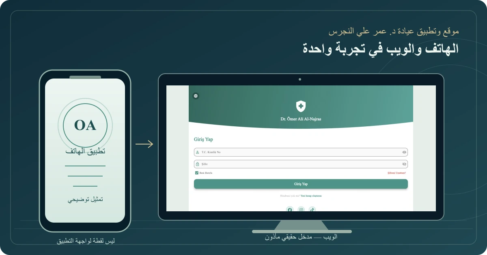

# عيادة د. عمر علي النجرس — الموقع والتطبيق

[العربية](ar.md) · [English](en.md) · [Türkçe](tr.md)

موقع وتطبيق Android لعيادة محددة، يجمعان التعريف بالطبيب وخدماته مع مدخل للمواعيد والتواصل، بواجهات عربية وإنجليزية وتركية.

**الحالة: منشور**

مدخل الويب من لقطة حقيقية مأذونة؛ الهاتف تمثيل توضيحي، وليس لقطة لواجهة التطبيق. لا يتضمن الغلاف بيانات مرضى، ولا يستخدم أصول سِناد.

لقطة فعلية من الواجهة العامة؛ ليست عرضًا للعمليات أو السجلات خلف الدخول.

## تجربة خاصة بالعيادة

طوّرت موقع عيادة د. عمر علي النجرس وتطبيقها على Android ليكونا مدخلًا إلى معلومات الطبيب وخدمات العيادة والتواصل معها. يتصل الحضور على الويب بالتطبيق على الهاتف، مع واجهات بالعربية والإنجليزية والتركية.

تشمل الوظائف المعروضة في صفحة التطبيق التعريف بالطبيب والخدمات، والأخبار، ومسار المواعيد وحساب المريض. يحتاج استكشاف الوظائف المرتبطة بالحساب إلى تسجيل الدخول؛ لا تُعرض في هذه الدراسة بيانات مرضى أو حجوزات فعلية.

## دوري وإتاحة العمل

أتولى تطوير الموقع والتطبيق لهذا العميل المحدد. يمكن زيارة [موقع العيادة](https://alnajrasclinic.com/) أو الاطلاع على [تطبيق عيادة د. عمر في Google Play](https://play.google.com/store/apps/details?id=com.yahyaalali.dental_clinic_app). يرتبط سجل المتجر بالحزمة الخاصة بهذا العمل، ويعرض YAHYA ALALI مطورًا له.

هذا المشروع مستقل عن [سِناد](https://yahyaalali.com/content-library/project/dental/)، الذي يتناول منتجًا لإدارة ممارسة الطبيب ومواقع عمله. تُظهر الصورة الحالية مدخل الموقع الفعلي؛ لا تمثل عرضًا لسجلات المرضى أو اختبارًا لعمل الحجز خلف الدخول.

## لمحة منظمة

- **المشكلة:** حضور العيادة على الويب والهاتف.
- **الجمهور:** زوار موقع العيادة وتطبيقها.
- **دوري:** تطوير الموقع وتطبيق Android ونشرهما.
- **المتاح للمراجعة:** تطوير الموقع والتطبيق ونشرهما عام 2026؛ الموقع يعرض اسم العيادة.

[متابعة القراءة داخل الموقع](https://yahyaalali.com/content-library/project/omar-clinic/) · [زيارة مدخل موقع العيادة](https://alnajrasclinic.com) · [العودة إلى قائمة الأعمال](../../README.ar.md)
