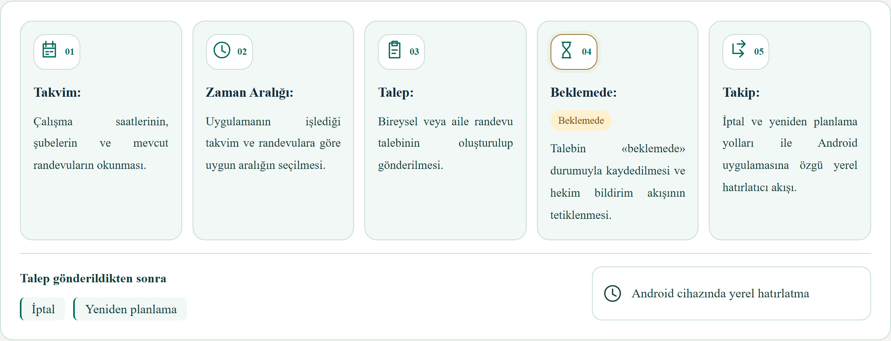
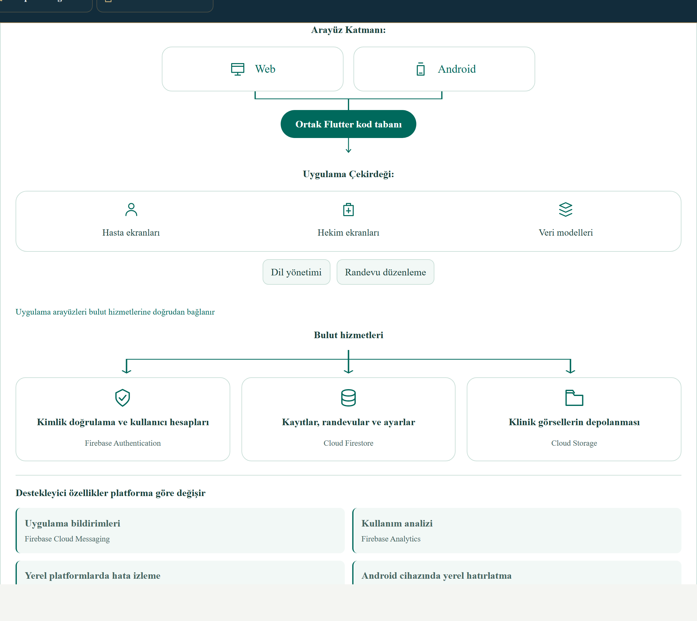

# Dr. Omar Ali Al-Najras Kliniği

[العربية](ar.md) · [English](en.md) · [Türkçe](tr.md)

[Yayımlanan proje incelemesi](https://yahyaalali.com/tr/works/omar-clinic/)

Dijital Sağlık / 2026

Klinik yönetimi ile hasta takibini web ve Android üzerinde birbirine bağlayan dijital bir deneyim.

- **Platformlar:** Ortak kod tabanını kullanan web sitesi ve Android uygulaması
- **Diller:** Arapça · Türkçe · İngilizce
- **Erişim:** Yayında olan web girişi ve Google Play uygulaması

Dr. Omar Ali Al-Najras Kliniği için web ve mobil deneyimini üç dilde tek bir yapıda buluşturan dijital bir çözüm. Hastaların randevu ve ziyaretlerini takip edebileceği sade bir alan ile hekimin ve klinik yönetiminin çalışma takvimlerini, klinik kayıtları ve günlük işleri yönetebileceği bağlantılı arayüzleri bir araya getirir.

Uygulama arayüzlerine dayalı açıklayıcı önizleme

## Vizyon ve Dijital Klinik Deneyimi

Modern bir sağlık kliniği, durağan bir tanıtım sayfasından fazlasına ihtiyaç duyar: randevu taleplerini düzenleyip takip yollarını bir araya getiren, hastayı hekimiyle düzenli iletişimde tutan ve yönetimin çalışma takvimleri ile kayıtları birbiriyle bağlantılı ekranlardan izlemesini sağlayan açık bir dijital kanal.

Bu çözüm, söz konusu ihtiyaçları Dr. Omar Ali Al-Najras Kliniği'ne özel tek bir yapıda düzenlemek üzere geliştirildi. Web arayüzü ile Android uygulamasını ek platformlara geliştirilebilir ortak bir kod tabanında birleştirir ve ilk ekrandan itibaren Arapça, Türkçe ve İngilizce desteği sunar. Proje yalnızca Dr. Omar'ın kliniğine özeldir; çoklu klinik yönetimine yönelik bağımsız bir ürün olan SINAD platformundan kapsam ve yapı bakımından ayrıdır.

### Görsel Kimlik

Diş figürü kliniğin diş hekimliği alanını belirtir; tıbbi haç ve onay işareti, bakım ve takibi çağrıştırır. Hekimin adı bu görsel öğeleri kliniğin kimliğiyle birleştirir; turkuaz renk arayüzlerde de sürdürülür.

## Uygulama Arayüzlerinden Görünümler

Bu bölüm, klinik deneyiminin beş önemli bölümünü gösterir. Her görsel, deneme verileriyle gerçek uygulama bileşenlerinden alınmış bir ekran görüntüsü ya da kaynak koda dayanarak hazırlanmış açıklayıcı bir önizleme olarak ayrı ayrı belirtilir.

Uygulama arayüzlerine dayalı açıklayıcı önizleme

### Üç Dilli Giriş Ekranı

Arapça, Türkçe ve İngilizce dillerinde hızlı erişim sağlayan; oturum açma, yeni hesap oluşturma, şifre kurtarma ve doğrudan klinik iletişim bağlantılarını içeren giriş noktası.

Uygulama arayüzlerine dayalı açıklayıcı önizleme

### Hasta Alanı ve Randevu Talepleri

Hastaların şube ve çalışma takvimine göre uygun zaman dilimlerini incelemesine, yeni randevu talebi oluşturmasına, iptal veya tarih değişikliği istemesine olanak tanıyan düzenli arayüz.

Uygulama arayüzlerine dayalı açıklayıcı önizleme

### Hekim Paneli ve Günlük Takvim

Gelen randevu taleplerini ve durumlarını tek yerde toplayarak hekimin gününü planlamasını ve hasta kayıtlarına hızla geçmesini kolaylaştıran çalışma alanı.

Yalıtılmış ortamda deneme verileriyle gerçek diş bileşeni

### Hasta Dosyası ve Etkileşimli Diş Şeması

Ziyaret geçmişi ve klinik görselleri düzenli biçimde sunan, ziyaret bağlamında diş seçimini destekleyen etkileşimli diş şemasıyla bütünleşen dosya ekranı.

Uygulama arayüzlerine dayalı açıklayıcı önizleme

### Klinik Yönetimi, Raporlar ve İçerik

Finansal raporları izleme, şube, çalışma saatleri ve hizmet kataloğunu yönetme, klinik haberlerini ve başarı galerisini güncelleme araçları.

## Çözüm Hasta ve Kliniğe Nasıl Hizmet Eder?

İşlevler, klinik deneyiminin iki tarafı etrafında düzenlenerek her kullanıcının kendi araçlarına doğrudan ulaşması hedeflendi:

### Hasta Deneyimi

1. Randevu talebi oluşturma, talep durumunu izleme, iptal veya tarih değişikliği isteme ve aile ziyaretlerini destekleme
   .
2. Bildirim akışları ve Android uygulamasında randevu öncesi yerel hatırlatıcı yolları
   .
3. Ziyaret geçmişini ve izin verilen klinik görselleri sunan kişisel profil; hekim bilgileri, klinik haberleri ve başarı galerisi
   .

### Hekim ve Yönetim Deneyimi

1. Hasta dosyalarının, ziyaret kayıtlarının, klinik görsellerin ve etkileşimli diş şemasının yönetimi
   .
2. Şubelerin, çalışma saatlerinin ve hizmet kataloğunun düzenlenmesi ile klinik finansal raporlarının takibi
   .
3. Hekim bilgileri, sosyal medya bağlantıları, duyurular ve başarı galerisinin uygulama içinden güncellenmesi
   .

## Randevu Akışı ve Sistem Mimarisi

Sistem, yalın bir kullanıcı deneyimini gereksiz ara katmanlar eklemeyen doğrudan bir teknik mimariyle birleştirir.

Talep yolculuğu

### Şekil 01 — Randevu Talebi Akışı

Şema metni ve ayrıntıları

1. 01
   **Takvim:**
   Çalışma saatlerinin, şubelerin ve mevcut randevuların okunması.
2. 02
   **Zaman Aralığı:**
   Uygulamanın işlediği takvim ve randevulara göre uygun aralığın seçilmesi.
3. 03
   **Talep:**
   Bireysel veya aile randevu talebinin oluşturulup gönderilmesi.
4. 04
   **Beklemede:**
   Beklemede
   Talebin «beklemede» durumuyla kaydedilmesi ve hekim bildirim akışının tetiklenmesi.
5. 05
   **Takip:**
   İptal ve yeniden planlama yolları ile Android uygulamasına özgü yerel hatırlatıcı akışı.

Talep gönderildikten sonra

- İptal
- Yeniden planlama

Android cihazında yerel hatırlatma

Sistem haritası

### Şekil 02 — Dijital Sistem Mimarisi

Şema metni ve ayrıntıları

1. **Arayüz Katmanı:**
   Web
   Android
   Ortak Flutter kod tabanı
2. **Uygulama Çekirdeği:**
   Hasta ekranları
   Hekim ekranları
   Veri modelleri
   Dil yönetimi
   Randevu düzenleme
3. Uygulama arayüzleri bulut hizmetlerine doğrudan bağlanır
   **Bulut hizmetleri**
   Kimlik doğrulama ve kullanıcı hesapları
   Firebase Authentication
   Kayıtlar, randevular ve ayarlar
   Cloud Firestore
   Klinik görsellerin depolanması
   Cloud Storage
   **Destekleyici özellikler platforma göre değişir**

- Uygulama bildirimleri
  Firebase Cloud Messaging
- Kullanım analizi
  Firebase Analytics
- Yerel platformlarda hata izleme
  Firebase Crashlytics
- Android cihazında yerel hatırlatma

## Teknoloji, Katkım ve Bağlantılar

### Araçlar ve Teknolojiler

#### Arayüz ve Çoklu Platform:

`Flutter` · `Material 3` · Üç dilli `ARB` yerelleştirme · `LanguageCubit`.

#### Hesaplar ve Veriler:

`Firebase Authentication` · `Cloud Firestore` · `Cloud Storage` · `AppointmentController`.

#### Bildirim ve İzleme:

`Firebase Cloud Messaging` · Android yerel hatırlatıcıları · `Analytics` · `Crashlytics`.

### Projeye Katkım

Kliniğin web ve mobil çözümünü ortak bir `Flutter` kod tabanı üzerinde tasarlayıp geliştirdim; üç dilli hasta ve hekim arayüzlerini, randevu ve ziyaret akışlarını, etkileşimli diş şemasını, yönetim modüllerini, `Firebase` entegrasyonunu, web yayımını ve Google Play kaydını üstlendim.

### Erişim ve Kapsam

Üç dilli web giriş ekranı çevrimiçi olarak erişilebilir durumdadır ve Android uygulaması Google Play üzerinde listelenmektedir. Korumalı hasta ve hekim akışlarına ilişkin açıklamalar ile arayüz görünümleri, hasta gizliliğini ve klinik hesaplarını korumak amacıyla deneme verileriyle kaynak kod üzerinden hazırlanmıştır.

### Proje Bağlantıları

### Proje bağlantıları

- [Siteyi Ziyaret Et](https://alnajrasclinic.com/)
- [Android Uygulaması](https://play.google.com/store/apps/details?id=com.yahyaalali.dental_clinic_app)
- [Yayımlanan proje incelemesi](https://yahyaalali.com/tr/works/omar-clinic/)

[Projelere dön](../../README.tr.md)
