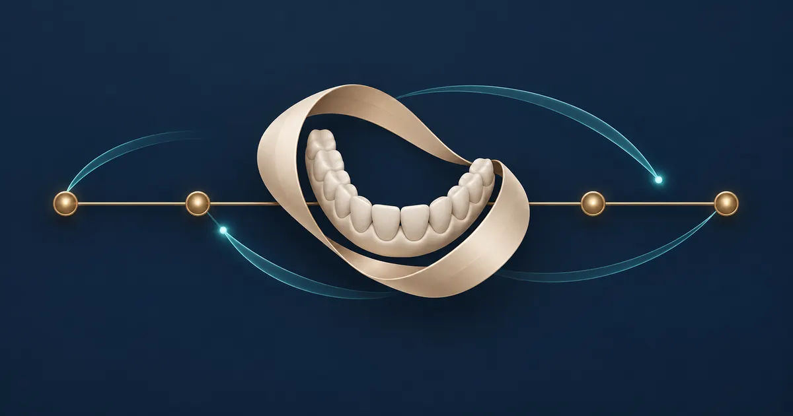

# Dr. Omar Ali Al-Najras Kliniği — web sitesi ve uygulama

[العربية](ar.md) · [English](en.md) · [Türkçe](tr.md)

Belirli bir diş kliniği için geliştirilen web sitesi ve Android uygulaması; hekim ve hizmet bilgilerini randevu ve iletişim girişleriyle Arapça, İngilizce ve Türkçe sunar.

**Aşama: Yayımlandı**

Bakım, randevu düzeni ve dijital iletişimi birleştiren üretilmiş kavramsal kapak. Uygulama ekranı veya tıbbi sonuç değildir; hasta verisi ya da Sinad görseli içermez. Gerçek uygulama görüntüsü aşağıda ayrı olarak korunmuştur.

Gerçek genel arayüz ekran görüntüsü; giriş arkasındaki kayıtların veya işlemlerin gösterimi değildir.

## Kliniğe özel deneyim

Dr. Omar Ali Al-Najras Kliniği’nin web sitesini ve Android uygulamasını, hekime ve klinik hizmetlerine ilişkin bilgilere ve iletişim seçeneklerine ulaşmak için geliştirdim. Web sitesi mobil uygulamayla birlikte sunuluyor; arayüzler Arapça, İngilizce ve Türkçe kullanılabiliyor.

Uygulamanın mağaza açıklamasında hekim ve hizmet bilgileri, haberler, randevu girişi ve hasta hesabı yer alıyor. Hesaba bağlı işlevler giriş gerektiriyor; bu çalışmada hasta kayıtları veya gerçek randevular gösterilmiyor.

## Katkım ve erişim

Bu müşteri için web sitesini ve uygulamayı geliştirdim. [Kliniğin sitesini](https://alnajrasclinic.com/) ziyaret edebilir veya [Dr. Omar’ın klinik uygulamasını Google Play’de](https://play.google.com/store/apps/details?id=com.yahyaalali.dental_clinic_app) inceleyebilirsiniz. Mağaza kaydı, projeye ait paketle eşleşiyor ve geliştirici olarak YAHYA ALALI’yi gösteriyor.

Bu çalışma, hekimin bağımsız çalışma alanını ve iş yerlerini düzenleyen [SINAD’dan](https://yahyaalali.com/tr/content-library/project/dental/) ayrıdır. Mevcut ekran görüntüsü sitenin gerçek girişini gösterir; hasta kayıtları veya giriş sonrasındaki randevu sürecinin test edilmiş bir gösterimi değildir.

## Kısa bakış

- **Problem:** Kliniğin web ve Android üzerindeki varlığı.
- **Hedef kitle:** Kliniğin web sitesi ve uygulamasını ziyaret edenler.
- **Katkım:** Web sitesi ve Android uygulamasının geliştirilmesi ve yayımlanması.
- **İncelenebilenler:** 2026 yılında web sitesi ve uygulamanın geliştirilmesi ve yayımlanması; web sitesi kliniğin adını gösteriyor.

[Sitede okumayı sürdür](https://yahyaalali.com/tr/content-library/project/omar-clinic/) · [Klinik sitesinin girişini aç](https://alnajrasclinic.com) · [Çalışma listesine dön](../../README.tr.md)
