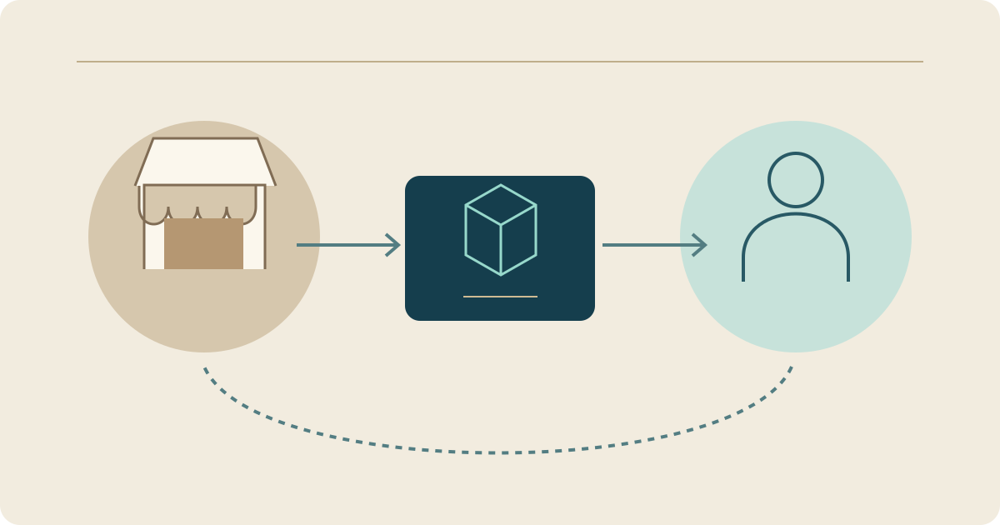

# Rawaj — A Multi-Role Marketplace

**Stage: In development**

## Context

Rawaj connects seller, buyer and platform-management workflows. Its engineering scope includes orders, returns, disputes and settlements, with role-based permissions and explicit interface contracts.

Product presentation connects the seller and buyer. An order then opens a sequence with different responsibilities for both parties and the platform team: following its state, handling a return request and resolving a dispute or settlement. These journeys are being developed and connected progressively; the project is not yet a completed commercial launch.

## My role

I created the project and develop its application, server and data integration. Development began in 2026 and remains in progress.

## Technical structure

| Layer                   | Selected technology             |
| ----------------------- | ------------------------------- |
| Application             | Flutter and Dart                |
| Server                  | TypeScript, Node.js and Express |
| Persistent data         | PostgreSQL                      |
| Cache                   | Redis                           |
| Real-time communication | Socket.IO                       |

The structure separates the user experience, business logic, persistent data and real-time communication. Features are developed incrementally within this scope.

[Read the project case study](https://yahyaalali.com/en/content-library/project/rawaj/) · [Back to selected work](../README.md)
