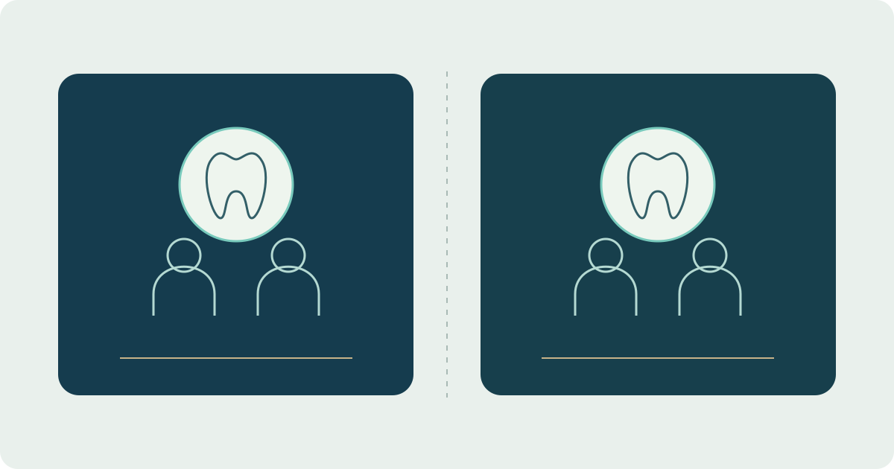

# Sinad — Connected Dental Care

**Stage: Test environment**

Sinad connects patient and clinician workflows around dental appointments and clinic interaction. I develop the Flutter application and its Firebase integration.

A practice belongs to its doctor; a centre or clinic is a work location in that doctor's schedule. Two doctors working at the same centre have separate practice spaces: sharing a location does not automatically share patient records. A patient's booking journey connects the doctor, service, location and available time.

The current web destination is an explicitly labelled test environment. Appointment journeys have been exercised with synthetic test data; this does not make the environment a service for real patient records or establish clinical-production readiness.

[Open the test-environment sign-in](https://test.sinaddental.com/) · [Read the project case study](https://yahyaalali.com/en/content-library/project/dental/) · [Back to selected work](../README.md)
