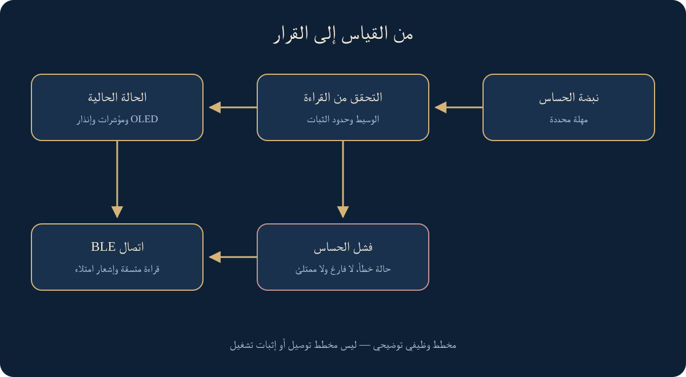

# صندوق القمامة الذكي — من القياس إلى تنبيه موثوق

[العربية](ar.md) · [English](en.md) · [Türkçe](tr.md)

نموذج أكاديمي باستخدام ESP32 وBLE، طوّرت مراجعته البرمجية لفصل القياس عن القرار، ومعالجة فشل الحساس وتنظيم التنبيه والعرض بثلاث لغات.

مراجعة برمجية مختبرة؛ العتاد غير مختبر

غلاف مفاهيمي مولّد؛ توضع صور النموذج والدارات أدناه بوصفها أدلة مستقلة.

## الفكرة والسياق

كيف نميّز امتلاء الحاوية من قراءة حساس غير صالحة؟ يعالج هذا النموذج الفكرة بقياس المسافة، وعرض الحالة على شاشة صغيرة ومؤشرات ضوئية وصفارة، وإتاحتها عبر اتصال بلوتوث منخفض الطاقة. ليس نظام جمع نفايات ميدانيًا أو منصة سحابية.

## الأصل والمراجعة الحالية

كان المصدر الأكاديمي الأصلي يقيس المسافة، ويعرضها على OLED، ويستخدم أربعة مؤشرات وإنذارًا مع إشعار BLE عند الامتلاء. يحمل المصدر اسمي في تعليق التأليف، بينما مكتبات ESP32 وAdafruit من عمل أصحابها. لا يثبت التعليق وحده جميع المساهمات في التقرير أو تجميع العتاد.

وجّهت هذه المراجعة المحددة في أكتوبر 2026 لفصل القياس والتحقق والتصنيف عن العرض والاتصال، مع الحفاظ على الهدف ومُعرّفات BLE. التحسين الجديد مرحلة لاحقة، وليس إعادة نسبة إلى تاريخ التسليم الجامعي القديم.

## من القراءة إلى القرار

تُقرأ نبضة الحساس بمهلة صريحة مقدارها 30 ملليثانية. القراءة غير الصالحة تمثل خطأ، ولا تتحول إلى «فارغ» أو «ممتلئ». تُصفّر نافذة الترشيح وتُخفى المسافة القديمة عند الفشل. تمر القراءة الصالحة بوسيط ثلاث عينات، ثم تصنيف بهامش ثبات قابل للضبط لتقليل التبدل قرب الحدود.

تبقى حدود المسافة الأصلية 10 و20 و35 و50 سم إعدادات أولية، مع هامش 0.5 سم. هذه ليست معايرة مثبتة لحاوية أو حساس متاح؛ يلزم ضبطها وفق القياسات الفعلية قبل اختبار الجهاز.

| المثال التوضيحي       | القرار                   | العرض والتنبيه                                          |
| --------------------- | ------------------------ | ------------------------------------------------------- |
| أول قراءة صالحة: 5 سم | ممتلئ وفق الإعداد الأولي | أربعة مؤشرات وصفارة؛ إشعار واحد للعميل المتصل           |
| انتهاء مهلة الحساس    | خطأ الحساس، لا امتلاء    | لا مسافة قديمة، ولا إنذار امتلاء؛ قراءة BLE بحالة الخطأ |

الأمثلة أعلاه مدخلات اختبار مصطنعة، لا قياسات جهاز فعلي.

## الاتصال والعرض

معالجة الاتصال والفصل وإعادة الإعلان مستقلة عن حالة الحاوية. إشعار الامتلاء عند الانتقال إليها أو الاتصال، مع فاصل أدنى محدد، لا في كل دورة. تبقى رسالة الامتلاء الموروثة ثابتة للتوافق، بينما تتاح الحالات الأخرى للقراءة دون تحويلها إلى إنذار امتلاء.

مسار الكتابة لا يضيف أوامر تحكم: المدخل الفارغ أو المفرط مرفوض، والمجهول، بما فيه الأمر القديم بلا وظيفة، لا ينفذ فعلًا ولا يستبدل القراءة. نصوص الشاشة والتوثيق بالعربية والإنجليزية والتركية؛ اللغة إعداد بناء، وليست تطبيق هاتف جديدًا. عبارات العربية مصيّرة كاملة للحفاظ على اتصال الحروف.

## ما اختُبر وما بقي

نجحت 44 حالة C++ محلية للحدود والقراءات غير الصالحة والترشيح والجدولة والإشعارات واتصال BLE وفشل الشاشة والمدخلات. نجح فحص صياغة محوّل Arduino باللغات الثلاث باستخدام تعريفات اختبار محلية. وباختبار منفصل، نجح بناء الشيفرة المنقحة على هدف ESP32 العام باستخدام Arduino CLI 1.5.1 ونواة 3.3.12 والمكتبات المحددة في 16 أكتوبر 2026.

استُخدمت أداة بناء محمولة ومعزولة دون تثبيت عام. لا يثبت نجاح الترجمة توافق اللوحة الفعلية أو سلامة توصيل الحساس، ولا يزال اختبار العتاد مؤجلًا. لا ادعاء دقة أو طاقة أو زمن استجابة مقيس أو جاهزية ميدانية. يُفصل الرسم الوظيفي عن إعادة البناء التاريخية ومخطط التوصيل المرجعي المشروط أدناه؛ لم يُختبر المخطط المرجعي عمليًا.

تُنشر نسخة منقحة محددة من الشيفرة والاختبارات الآن؛ يبقى التاريخ الخاص وأصول المقرر خارج الحزمة العامة.

## مسار البيانات والحالة — رسم توضيحي

## الدارة التاريخية والمرجع المشروط

يوثق الرسم TRIG على GPIO5 وEcho على GPIO18، وOLED على 21/22، والصفارة على 27، وأربعة مؤشرات امتلاء على 32/33/26/25 ومؤشر طاقة على GPIO14. اتصال Echo من حساس يعمل عند 5 فولت مباشرة بالمدخل 18 خطر كهربائي في المصدر التاريخي، لا تعليمات تركيب.

يتطلب المرجع مقسم جهد على Echo ومقاومة لكل LED وأرضيًا مشتركًا، ويشترط فحص نوع الصفارة وتيارها والشاشة قبل البناء. لم يثبت اختبار عتاد لهذا المرجع. تتيح [الحزمة العامة المنقحة](../../hardware/smart-bin/README.ar.md) الشيفرة واختبارات المنطق و[دليل التوصيل](../../hardware/smart-bin/WIRING.md) دون تاريخ المصدر الخاص. [فيديو المقرر](https://youtu.be/GwyfZ4DQr9k) يوثق العرض الأصلي، لا سلامة الدارة المصححة.

[متابعة القراءة داخل الموقع](https://yahyaalali.com/content-library/project/smart-bin/) · [العودة إلى الأعمال](../../README.ar.md)
