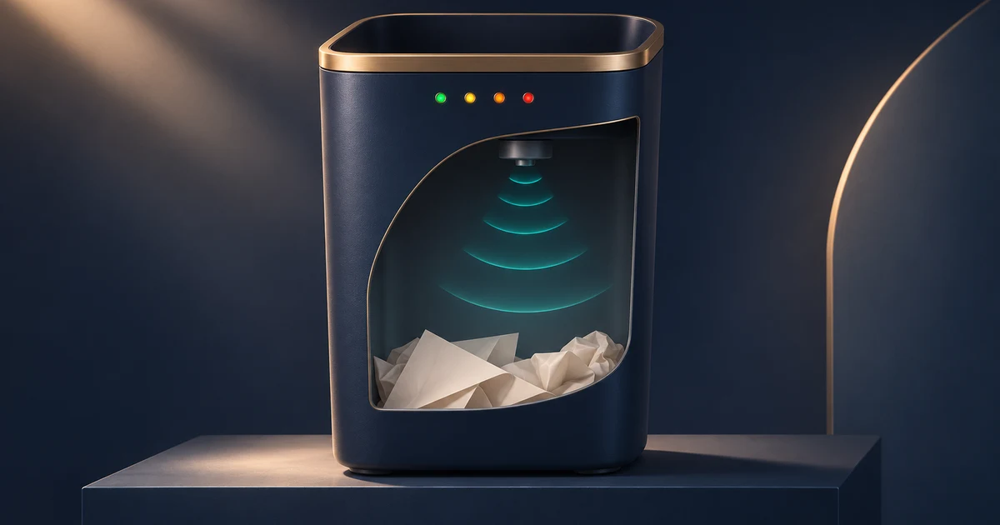
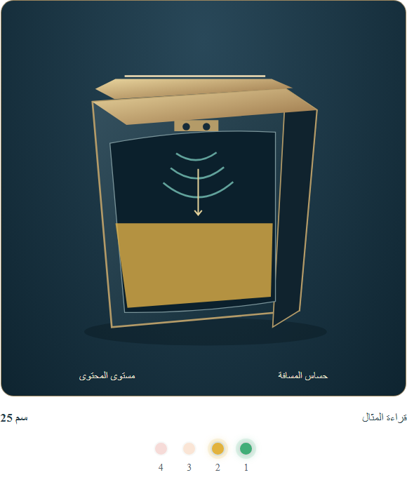
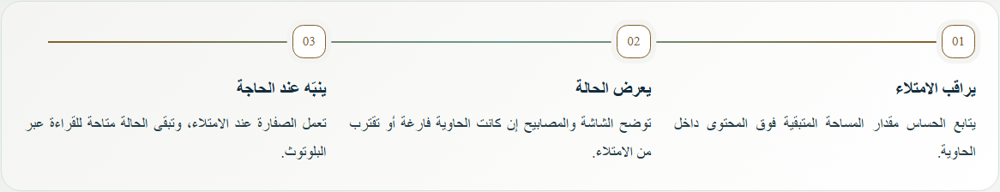
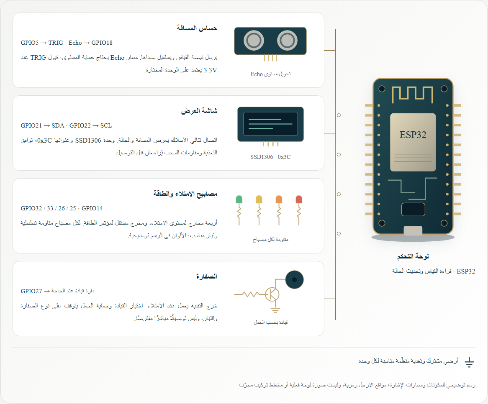

# الصندوق الذكي

[العربية](ar.md) · [English](en.md) · [Türkçe](tr.md)

[دراسة الحالة المنشورة](https://yahyaalali.com/works/smart-bin/)

أنظمة مدمجة · استشعار واتصال

اعرف متى تحتاج الحاوية إلى التفريغ

صندوق ذكي يتابع مستوى امتلاء حاوية النفايات، ويعرضه على شاشة ومصابيح واضحة، مع تنبيه صوتي عند الامتلاء وإمكانية قراءة الحالة من هاتف قريب عبر البلوتوث.

صورة توضيحية مولدة لشرح فكرة الجهاز، وليست صورة للنموذج الفعلي.

لغات العرض: العربية · الإنجليزية · التركية

تُختار لغة شاشة الجهاز عند تجهيز البرنامج.

## جرّب مراقبة الامتلاء

هل بقيت مساحة في الحاوية، أم حان وقت تفريغها؟ هذا هو السؤال الذي يجيب عنه المشروع. يراقب حساس مثبت في الأعلى المساحة المتبقية داخل الحاوية؛ ثم يعرض الجهاز مستوى الامتلاء وينبّه عند وصوله إلى الحالة الممتلئة. ويمكن قراءة الحالة من هاتف قريب عبر البلوتوث، دون الحاجة إلى اتصال بالإنترنت.

الصورة شرح ثابت للمحاكاة، وليست قراءة من جهاز متصل. التفاعل والصوت متاحان في دراسة الحالة على الموقع.

[جرّب المحاكاة والمثال الصوتي](https://yahyaalali.com/works/smart-bin/#smart-bin-section-0)

### يراقب الامتلاء

يتابع الحساس مقدار المساحة المتبقية فوق المحتوى داخل الحاوية.

### يعرض الحالة

توضح الشاشة والمصابيح إن كانت الحاوية فارغة أو تقترب من الامتلاء.

### ينبّه عند الحاجة

تعمل الصفارة عند الامتلاء، وتبقى الحالة متاحة للقراءة عبر البلوتوث.

## تنبيه واضح بدل التخمين

### اعرف مقدار المساحة المتبقية

تظهر المسافة ومستوى الامتلاء على الشاشة. ويزداد عدد المصابيح المضاءة تدريجيًا كلما ارتفع مستوى المحتوى.

### تنبيه قصير عند الامتلاء

عند امتلاء الحاوية تصدر الصفارة نبضة قصيرة تتكرر كل 5 ثوانٍ. يتوقف التنبيه عندما تزول حالة الامتلاء.

### تابع الحالة من هاتف قريب

يتيح البلوتوث قراءة الحالة واستقبال إشعارات التغير من عميل متوافق. يلزم الاشتراك في الإشعارات؛ ولا يحتاج الجهاز إلى خدمة سحابية.

### لا تخلط العطل بالحاوية الفارغة

إذا تعذر القياس، تظهر حالة عطل بدل إبقاء قراءة قديمة. تومض المصابيح الأربعة معًا، دون تشغيل صفارة الامتلاء.

ألوان الشرح توضيحية؛ يحدد البرنامج المستوى بعدد المصابيح المضاءة، لا بألوان ثابتة.

## الجهاز في صورة أوضح

رسوم توضيحية مولدة لتقريب فكرة الجهاز ومكوناته، دون تقديمها كصور للعتاد المنفذ. أما النموذج الأصلي وطريقة تجربته فتجدها في الفيديو.

تصورات مولدة لشرح الفكرة؛ شاهد النموذج الفعلي في الفيديو.

## الهوية البصرية

تستمد العلامة شكلها من الحاوية نفسها، وتُظهر شرائح متدرجة تعبّر عن ارتفاع المحتوى داخلها. تشير الموجات العلوية إلى الاستشعار، ويجمع التكوين المجسّم الكحلي والذهبي والفيروزي في هوية هندسية هادئة. الرمز يشرح فكرة المشروع، ولا يمثل اعتمادًا تجاريًا أو صورة للجهاز الفعلي.

## المكونات والتقنيات

الحساس يلتقط القياس، والمتحكم يحوله إلى مستوى امتلاء، ثم تظهر النتيجة على الشاشة والمصابيح وتصل إلى عميل بلوتوث قريب. لكل جزء دور واضح داخل الجهاز.

### داخل الدارة: من الحساس إلى التنبيه

تقرأ لوحة ESP32 المسافة، ثم توصل النتيجة إلى الشاشة والمصابيح والصفارة. توضح الخريطة التالية وظيفة كل قطعة وإشاراتها كما حددها البرنامج، لتسهيل فهم الجهاز دون الخلط بينها وبين ترتيب أرجل لوحة بعينها.

رسم توضيحي للمكونات ومسارات الإشارة؛ مواقع الأرجل رمزية، وليست صورة لوحة فعلية أو مخطط تركيب مجرّب.

#### حساس المسافة

GPIO5 → TRIG · Echo → GPIO18

يرسل نبضة القياس ويستقبل صداها. مسار Echo يحتاج حماية المستوى؛ قبول TRIG عند 3.3V يعتمد على الوحدة المختارة.

#### شاشة العرض

GPIO21 → SDA · GPIO22 → SCL

اتصال ثنائي الأسلاك يعرض المسافة والحالة. وحدة SSD1306 وعنوانها 0x3C؛ توافق التغذية ومقاومات السحب يُراجعان قبل التوصيل.

#### مصابيح الامتلاء والطاقة

GPIO32 / 33 / 26 / 25 · GPIO14

أربعة مخارج لمستوى الامتلاء، ومخرج مستقل لمؤشر الطاقة. لكل مصباح مقاومة تسلسلية وتيار مناسب؛ الألوان في الرسم توضيحية.

#### الصفارة

GPIO27 → دارة قيادة عند الحاجة

خرج التنبيه يعمل عند الامتلاء. اختيار القيادة وحماية الحمل يتوقف على نوع الصفارة والتيار، وليس توصيلًا مباشرًا مفترضًا.

#### قبل التوصيل الفعلي

نوع لوحة التطوير والحساس ووحدة الشاشة والصفارة يحتاج إلى تحديد وفحص. لا توصل خرج Echo بجهد 5V إلى ESP32 مباشرة؛ يلزم تحويل مستوى مناسب. مصابيح البيان تحتاج مقاومة مستقلة لكل فرع، والصفارة قد تحتاج دارة قيادة. افصل التغذية أثناء التوصيل، وتحقق من الجهود والتيار وتأثير GPIO5 في الإقلاع.

[مرجع الشركة المصنّعة للجهود والأطراف](https://docs.espressif.com/projects/esp-faq/en/latest/hardware-related/hardware-design.html)

### برمجة الجهاز

**ESP32 · C++ · Arduino** — لقراءة الحساس وتحديد مستوى الامتلاء وتنظيم التنبيه.

### الشاشة والمصابيح

**OLED SSD1306 · I²C · Adafruit GFX** — لعرض المسافة والحالة، مع دعم نصوص عربية وإنجليزية وتركية.

### اتصال البلوتوث

**BLE · GATT** — لقراءة حالة الحاوية وتشخيص الشاشة، واستقبال إشعارات من جهاز قريب.

## التطوير والخطوة التالية

طُوّر برنامج الجهاز واختُبرت استجابته للقراءات والأعطال والتنبيهات والاتصال. الخطوة التالية هي تجربة النسخة المطوّرة على القطع الفعلية وضبط القياس داخل الحاوية المختارة.

يلزم التحقق من التوصيل الكهربائي، وضبط الحساس، وتجربة دقة القياس والصفارة والبلوتوث على العتاد والهاتف. المشروع يراقب الامتلاء؛ ولا يقيس وزن النفايات أو ينظم جمعها تلقائيًا.

### التحقق البرمجي وحدود التجربة

سُجل في التحقق البرمجي بتاريخ 27 نوفمبر 2026 نجاح 65 حالة منطق و10 حالات لمحوّل الجهاز، وبناء البرنامج بالعربية والإنجليزية والتركية على هدف ESP32 العام. هذه نتائج برمجية، وليست إثبات تشغيل أو معايرة على جهاز فعلي.

[شاهد فيديو النموذج](https://www.youtube.com/watch?v=GwyfZ4DQr9k)

[دراسة الحالة المنشورة](https://yahyaalali.com/works/smart-bin/)

### الشيفرة وحقوق الاستخدام

المصدر المعتمد محفوظ في مستودع خاص، ويمكن طلب الوصول إليه من المالك. لا يمنح نشر دراسة الحالة ترخيصًا عامًا لإعادة استخدام الشيفرة أو مواد الهوية.

[طلب الوصول إلى المصدر](https://yahyaalali.com/contact/)

[العودة إلى قائمة المشروعات](../../README.ar.md)
