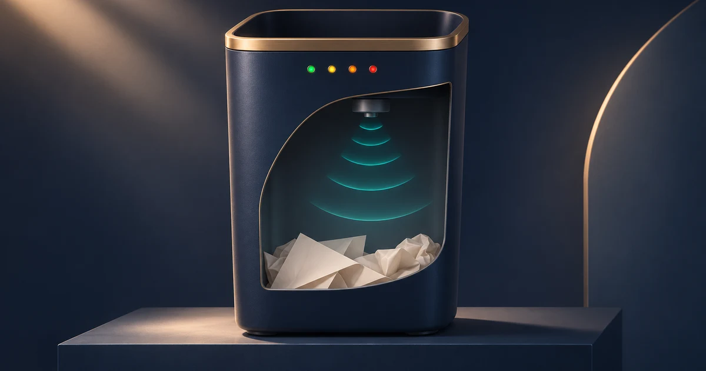
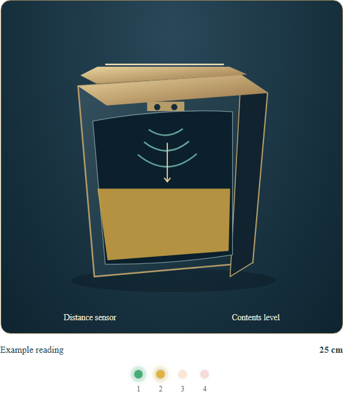
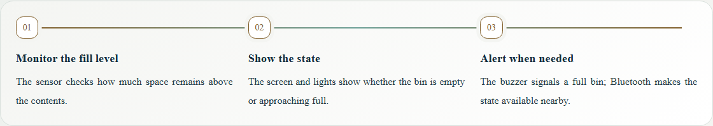
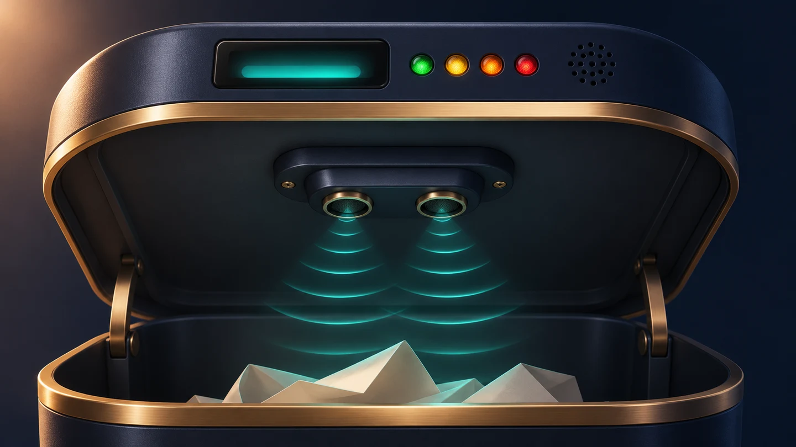
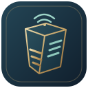
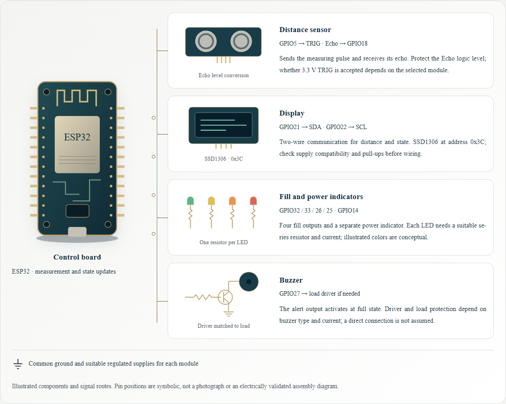

# Smart Bin

[العربية](ar.md) · [English](en.md) · [Türkçe](tr.md)

[Published case study](https://yahyaalali.com/en/works/smart-bin/)

Embedded systems · Sensing and connectivity

Know when the bin needs emptying

A smart bin prototype that monitors waste-container fill, shows its state on a screen and indicator lights, sounds an alert when full, and lets a nearby phone read the state over Bluetooth.

Generated illustration explaining the device concept, not a photograph of the real prototype.

Display languages: Arabic · English · Turkish

The device display language is selected when building its firmware.

## Explore the fill level

Is there still room in the bin, or is it time to empty it? That is the question this project answers. A sensor above the contents monitors the remaining space. The device shows the fill level and sounds an alert when the bin is full. A compatible nearby phone can also read the state over Bluetooth, without an internet connection.

This is a static explanatory view, not a reading from a connected device. The interactive simulation and sound are available in the website case study.

[Try the simulation and sound example](https://yahyaalali.com/en/works/smart-bin/#smart-bin-section-0)

### Monitor the fill level

The sensor checks how much space remains above the contents.

### Show the state

The screen and lights show whether the bin is empty or approaching full.

### Alert when needed

The buzzer signals a full bin; Bluetooth makes the state available nearby.

## Clear alerts, less guesswork

### See the remaining space

The screen shows distance and fill state. More indicator lights turn on as the contents rise.

### A short alert when full

At the full state, a short buzzer pulse repeats every 5 seconds. The alert stops when that state clears.

### Read the state nearby

A compatible Bluetooth client can read the state and subscribe to change notifications. No cloud service is required.

### Tell a fault from an empty bin

If a measurement fails, the device reports a fault instead of retaining an old reading. All four lights blink together, without the full-bin buzzer.

Colors are illustrative. The software uses the number of lit indicators, not fixed lamp colors.

## A closer look at the concept

Generated illustrations explain the concept and the roles of its components. They are not photographs of the built hardware. The video shows the original prototype and its demonstration.

Generated concept illustrations; see the actual prototype in the video.

## Visual identity

The mark takes its form from the container itself. Graduated bands express the rising contents, while the upper waves suggest sensing. A dimensional navy, brass and teal composition gives the project a calm engineering identity. It represents the concept, not a commercial certification or a photograph of the real device.

## Components and technologies

The sensor takes the measurement. The controller turns it into a fill state. The screen, lights and buzzer present that state, while a nearby Bluetooth client can read it. Each component has a clear job.

### Inside the circuit: sensing to alert

The ESP32 reads distance and sends the result to the display, indicator lights and buzzer. This map explains each part and the signals assigned in the firmware, without presenting symbolic locations as the physical pin layout of a specific board.

Illustrated components and signal routes. Pin positions are symbolic, not a photograph or an electrically validated assembly diagram.

#### Distance sensor

GPIO5 → TRIG · Echo → GPIO18

Sends the measuring pulse and receives its echo. Protect the Echo logic level; whether 3.3 V TRIG is accepted depends on the selected module.

#### Display

GPIO21 → SDA · GPIO22 → SCL

Two-wire communication for distance and state. SSD1306 at address 0x3C; check supply compatibility and pull-ups before wiring.

#### Fill and power indicators

GPIO32 / 33 / 26 / 25 · GPIO14

Four fill outputs and a separate power indicator. Each LED needs a suitable series resistor and current; illustrated colors are conceptual.

#### Buzzer

GPIO27 → load driver if needed

The alert output activates at full state. Driver and load protection depend on buzzer type and current; a direct connection is not assumed.

#### Before physical assembly

The development board, sensor, display breakout and sounder still need identification and checks. Never connect a 5 V Echo output directly to the ESP32; suitable level conversion is required. Each LED needs its own series resistor, and the buzzer may need a load driver. Disconnect power while wiring and verify voltages, current and GPIO5 boot behavior.

[Manufacturer guidance on voltages and pins](https://docs.espressif.com/projects/esp-faq/en/latest/hardware-related/hardware-design.html)

### Device software

**ESP32 · C++ · Arduino** — Read the sensor, determine fill level and schedule alerts.

### Screen and indicators

**OLED SSD1306 · I²C · Adafruit GFX** — Display distance and state with Arabic, English and Turkish text support.

### Bluetooth connectivity

**BLE · GATT** — Read bin state and display diagnostics, and receive notifications nearby.

## Development and next steps

The device software has been developed and checked for readings, faults, alerts and connection behavior. The next step is to test this version on the actual components and calibrate it for the selected container.

Electrical wiring, sensor calibration, measurement accuracy, buzzer behavior and phone Bluetooth compatibility need physical verification. The project monitors fill; it does not weigh waste or automatically manage collection.

### Software verification and physical limits

The software evidence dated 27 November 2026 records 65 logic cases, 10 actual-adapter cases with host fakes, and firmware builds in Arabic, English and Turkish for the generic ESP32 target. These are software results, not proof of device operation or calibration.

[Watch the prototype video](https://www.youtube.com/watch?v=GwyfZ4DQr9k)

[Published case study](https://yahyaalali.com/en/works/smart-bin/)

### Source and reuse

The maintained source is held in a private repository; access may be requested from the owner. Publishing this case study grants no general reuse licence for source code or identity material.

[Request source access](https://yahyaalali.com/en/contact/)

[Back to the project list](../../README.md)
