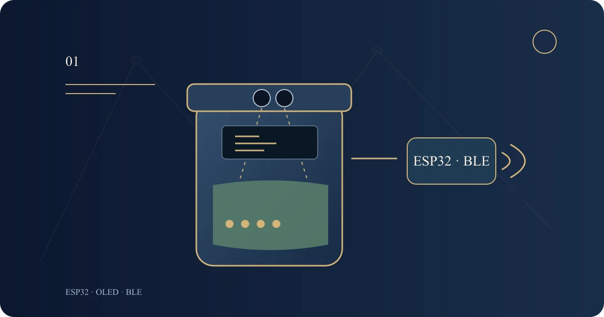

# Smart Bin — from sensing to a dependable alert

[العربية](ar.md) · [English](en.md) · [Türkçe](tr.md)

An ESP32 and BLE academic prototype, refined to separate measurement from decisions, handle sensor faults and organise alerts and display in three languages.

Software refinement tested; hardware not tested

Code-authored functional concept, not an assembled-device photograph or experimental result.

## Idea and context

How can a bin distinguish a full container from an invalid sensor reading? This prototype explores distance sensing, a compact display, four LEDs and a buzzer, with the state available over Bluetooth Low Energy. It is not a deployed waste-collection service or cloud platform.

## Original work and current refinement

The original academic sketch measured distance, displayed it on an OLED, drove four indicators and an alarm, and sent a BLE full notification. Its attribution comment carries my name; ESP32 and Adafruit libraries belong to their authors. That comment alone does not establish every report or hardware contribution.

I directed this bounded October 2026 refinement to separate sensing, validation and classification from display and connection handling, while preserving the purpose and BLE identifiers. These changes are a later phase, not part of the old academic submission date.

## From reading to decision

The sensor pulse has an explicit 30 ms deadline. An invalid reading becomes a fault, never an inferred empty or full state. A fault resets the filter and hides the old distance. Valid readings pass through a three-sample median and configurable hysteresis to reduce switching near a boundary.

The original 10/20/35/50 cm distance bands remain provisional defaults, with a 0.5 cm margin. They are not a measured calibration of an available bin or sensor; bench measurements must establish appropriate settings.

| Illustrative input        | Decision                            | Display and alert                                         |
| ------------------------- | ----------------------------------- | --------------------------------------------------------- |
| First valid reading: 5 cm | Full under the provisional settings | Four LEDs and buzzer; one event for a connected client    |
| Sensor timeout            | Sensor fault, not full              | No old distance or full alarm; BLE READ reports the fault |

These are synthetic software-test inputs, not device measurements.

## Connection and display

Connection, disconnection and re-advertising are independent of fill state. A full event is sent on entry or connection, subject to a minimum interval, not every loop. The legacy full payload remains a fixed compatibility value; other states can be read without generating new full alerts.

WRITE adds no control commands: empty or oversized input is rejected, and unknown input, including the original no-op command, performs no action or READ replacement. Display text and documentation are available in Arabic, English and Turkish. Language is a build setting, not a new phone application. Complete Arabic labels are rasterized to preserve shaping.

## Verification and remaining limits

44 native C++ cases passed for boundaries, invalid readings, filtering, scheduling, alerts, BLE connection changes, display failure and inputs. Three language variants passed adapter syntax checks using local declaration stubs; these are not actual ESP32 builds.

An existing ESP32 toolchain was unavailable; no system-wide tools were installed. Firmware compilation, board and sensor identification, wiring checks and physical tests remain pending. No measured accuracy, energy, latency or field-readiness claim is made. Illustrations are neither assembled-device photographs nor wiring plans.

Source, history and detailed tests remain private. The public link presents the case study and selected safe results only.

## Data and state flow — functional illustration

[Continue reading on the website](https://yahyaalali.com/en/content-library/project/smart-bin/) · [Back to selected work](../../README.md)
