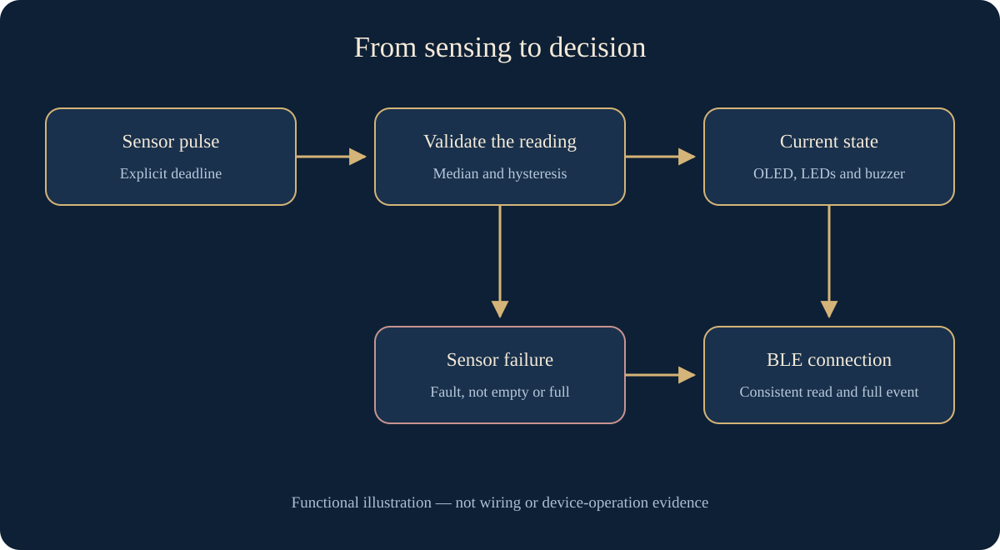
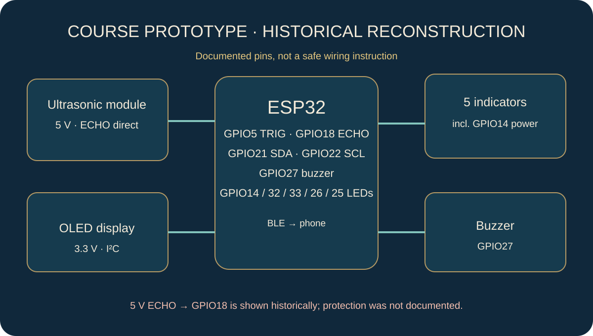
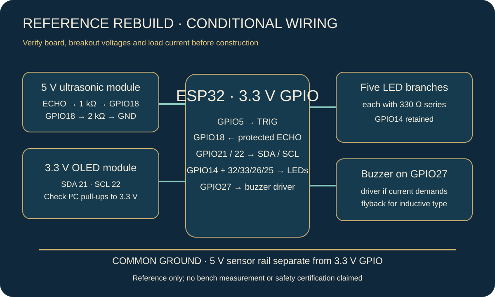

# Smart Bin — from sensing to a dependable alert

[العربية](ar.md) · [English](en.md) · [Türkçe](tr.md)

An ESP32 and BLE academic prototype, refined to separate measurement from decisions, handle sensor faults and organise alerts and display in three languages.

Software refinement tested; hardware not tested

Code-authored functional concept, not an assembled-device photograph or experimental result.

## Idea and context

How can a bin distinguish a full container from an invalid sensor reading? This prototype explores distance sensing, a compact display, four LEDs and a buzzer, with the state available over Bluetooth Low Energy. It is not a deployed waste-collection service or cloud platform.

## Original work and current refinement

The original academic sketch measured distance, displayed it on an OLED, drove four indicators and an alarm, and sent a BLE full notification. Its attribution comment carries my name; ESP32 and Adafruit libraries belong to their authors. That comment alone does not establish every report or hardware contribution.

I directed this bounded October 2026 refinement to separate sensing, validation and classification from display and connection handling, while preserving the purpose and BLE identifiers. These changes are a later phase, not part of the old academic submission date.

## From reading to decision

The sensor pulse has an explicit 30 ms deadline. An invalid reading becomes a fault, never an inferred empty or full state. A fault resets the filter and hides the old distance. Valid readings pass through a three-sample median and configurable hysteresis to reduce switching near a boundary.

The original 10/20/35/50 cm distance bands remain provisional defaults, with a 0.5 cm margin. They are not a measured calibration of an available bin or sensor; bench measurements must establish appropriate settings.

| Illustrative input        | Decision                            | Display and alert                                         |
| ------------------------- | ----------------------------------- | --------------------------------------------------------- |
| First valid reading: 5 cm | Full under the provisional settings | Four LEDs and buzzer; one event for a connected client    |
| Sensor timeout            | Sensor fault, not full              | No old distance or full alarm; BLE READ reports the fault |

These are synthetic software-test inputs, not device measurements.

## Connection and display

Connection, disconnection and re-advertising are independent of fill state. A full event is sent on entry or connection, subject to a minimum interval, not every loop. The legacy full payload remains a fixed compatibility value; other states can be read without generating new full alerts.

WRITE adds no control commands: empty or oversized input is rejected, and unknown input, including the original no-op command, performs no action or READ replacement. Display text and documentation are available in Arabic, English and Turkish. Language is a build setting, not a new phone application. Complete Arabic labels are rasterized to preserve shaping.

## Verification and remaining limits

44 native C++ cases passed for boundaries, invalid readings, filtering, scheduling, alerts, BLE connection changes, display failure and inputs. Three language variants passed adapter syntax checks using local declaration stubs. Separately, the refined sketch compiled for a generic ESP32 target on 2026-10-16 with Arduino CLI 1.5.1, core 3.3.12 and pinned libraries.

A portable isolated toolchain was used without system-wide installation. Compilation does not establish exact-board compatibility or safe sensor wiring; physical tests remain pending. No measured accuracy, energy, latency or field-readiness claim is made. The functional illustration is distinct from the historical reconstruction and conditional reference wiring below; the reference has not been bench-tested.

A bounded refined source and host tests are now public; private development history and course originals remain outside the package.

## Data and state flow — functional illustration

## Historical pins and conditional rebuild

The original material assigns TRIG to GPIO5, Echo to GPIO18, OLED to 21/22, buzzer to 27, fill LEDs to 32/33/26/25 and the fifth power indicator to GPIO14. A 5 V sensor Echo directly reaching GPIO18 is a documented hazard, not a wiring recommendation.

The reference adds an Echo voltage divider, individual LED resistors and common ground; buzzer driver and OLED requirements depend on the exact modules. It has not been built or bench validated. The [public sanitized source package](../../hardware/smart-bin/README.md) includes code, host tests and a [trilingual wiring guide](../../hardware/smart-bin/WIRING.md), but no private history. [The course video](https://youtu.be/GwyfZ4DQr9k) remains evidence of the historical demonstration only.

[Continue reading on the website](https://yahyaalali.com/en/content-library/project/smart-bin/) · [Back to selected work](../../README.md)
