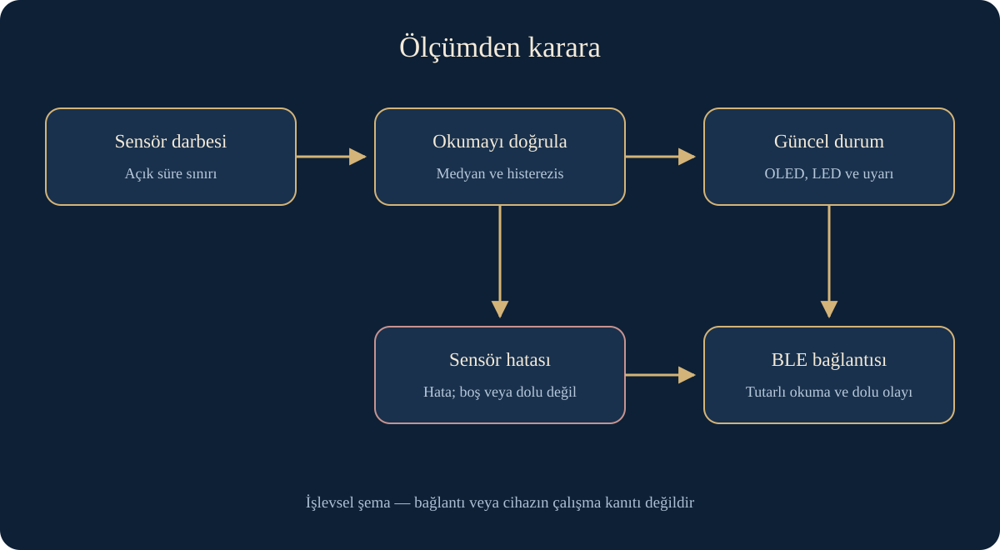

# Akıllı çöp kutusu — ölçümden güvenilir uyarıya

[العربية](ar.md) · [English](en.md) · [Türkçe](tr.md)

Ölçümü karardan ayırmak, sensör hatalarını ele almak ve uyarı ile üç dilli gösterimi düzenlemek için iyileştirilen ESP32 ve BLE tabanlı akademik prototip.

Yazılım iyileştirmesi test edildi; donanım test edilmedi

Kodla hazırlanmış işlevsel tasvir; monte edilmiş cihaz fotoğrafı veya deney sonucu değildir.

## Fikir ve bağlam

Bir kutu, gerçek doluluğu geçersiz sensör okumasından nasıl ayırır? Bu prototip mesafe ölçümü, küçük ekran, dört LED ve sesli uyarıyı; Bluetooth Low Energy üzerinden okunabilen durumla birleştirir. Sahada kullanılan atık toplama hizmeti veya bulut platformu değildir.

## Özgün çalışma ve güncel iyileştirme

Özgün akademik sketch mesafeyi ölçüyor, OLED üzerinde gösteriyor, dört gösterge ile alarmı çalıştırıyor ve dolulukta BLE bildirimi gönderiyordu. Kaynak açıklamasında adım yer alır; ESP32 ve Adafruit kütüphaneleri kendi yazarlarına aittir. Bu açıklama tek başına rapor ve donanımdaki tüm katkıları kanıtlamaz.

Ekim 2026 tarihli sınırlı iyileştirmeyi; ölçüm, doğrulama ve sınıflandırmayı ekran ve bağlantı yönetiminden ayırmak için yönlendirdim. Amaç ve BLE kimlikleri korundu. Değişiklikler sonraki bir aşamadır; eski akademik teslim tarihine ait değildir.

## Okumadan karara

Sensör darbesi için açık 30 ms süre sınırı vardır. Geçersiz okuma hata olur; boş veya dolu sayılmaz. Hata süzgeci sıfırlar ve eski mesafeyi gizler. Geçerli okuma üç örnekli medyan ve ayarlanabilir histerezisle değerlendirilerek sınır yakınındaki geçişler azaltılır.

Özgün 10/20/35/50 cm sınırları, 0,5 cm payla geçici varsayılan olarak korunur. Bunlar mevcut kutu veya sensör için ölçülmüş kalibrasyon değildir; uygun ayarlar fiziksel ölçümle belirlenmelidir.

| Açıklayıcı girdi        | Karar                     | Gösterim ve uyarı                                        |
| ----------------------- | ------------------------- | -------------------------------------------------------- |
| İlk geçerli okuma: 5 cm | Geçici ayarlara göre dolu | Dört LED ve sesli uyarı; bağlı istemciye tek olay        |
| Sensör zaman aşımı      | Sensör hatası, dolu değil | Eski mesafe veya dolu alarmı yok; BLE READ hata bildirir |

Bunlar yapay yazılım testi girdileridir, cihaz ölçümleri değildir.

## Bağlantı ve gösterim

Bağlanma, kopma ve yeniden ilan doluluktan bağımsızdır. Dolu olayı duruma girişte veya bağlantıda, asgari zaman aralığıyla gönderilir; her döngüde tekrarlanmaz. Eski dolu iletisi sabit uyumluluk değeri olarak kalır. Diğer durumlar yeni dolu alarmı üretmeden okunabilir.

WRITE yeni kontrol komutu eklemez. Boş veya fazla uzun girdi reddedilir; özgün işlemsiz komut dâhil bilinmeyen girdi işlem yapmaz veya READ değerini değiştirmez. Ekran metinleri ve belgeler Arapça, İngilizce ve Türkçedir. Dil bir derleme ayarıdır, yeni telefon uygulaması değildir. Arapça etiketler harflerin birleşimini koruyacak şekilde tam olarak rasterleştirilir.

## Doğrulama ve kalan sınırlar

Sınırlar, geçersiz okumalar, süzgeç, zamanlama, bildirimler, BLE bağlantı değişiklikleri, ekran hatası ve girdiler için 44 yerel C++ senaryosu geçti. Yerel bildirim tanımlarıyla üç dilde bağdaştırıcı sözdizimi kontrolü geçti. Ayrı bir denetimde iyileştirilmiş sketch, 16 Ekim 2026'da Arduino CLI 1.5.1, çekirdek 3.3.12 ve sabitlenmiş kütüphanelerle genel ESP32 hedefi için derlendi.

Genel sisteme kurulum yapmadan taşınabilir ve yalıtılmış araç zinciri kullanıldı. Derleme kesin kart uyumluluğunu veya güvenli sensör bağlantısını kanıtlamaz; fiziksel testler bekliyor. Ölçülmüş doğruluk, enerji, gecikme veya saha kabulü iddiası yoktur. İşlevsel görsel, aşağıdaki tarihsel yeniden kurulum ve koşullu bağlantı şemasından ayrıdır; başvuru şeması tezgahta denenmedi.

Sınırlı, temizlenmiş kaynak ve bilgisayar testleri artık açıktır; özel geliştirme geçmişi ve ders özgünleri paket dışındadır.

## Veri ve durum akışı — işlevsel şema

## Tarihsel uçlar ve koşullu yeniden kurulum

Özgün kaynak TRIG için GPIO5, Echo için GPIO18, OLED için 21/22, sesli uyarı için 27, doluluk LED'leri için 32/33/26/25 ve beşinci güç göstergesi için GPIO14 kullanır. 5 V sensör Echo çıkışının GPIO18'e doğrudan ulaşması belgelenmiş tehlikedir, bağlantı önerisi değildir.

Başvuru şeması Echo gerilim bölücüsü, ayrı LED dirençleri ve ortak toprak ekler; sesli uyarı sürücüsü ve OLED gereksinimleri kesin modüle bağlıdır. Kurulup tezgahta doğrulanmadı. [Temizlenmiş genel kaynak paketi](../../hardware/smart-bin/README.tr.md) kod, bilgisayar testleri ve [üç dilli bağlantı kılavuzu](../../hardware/smart-bin/WIRING.md) içerir; özel geçmişi içermez. [Ders videosu](https://youtu.be/GwyfZ4DQr9k) yalnız tarihsel gösterimin kanıtıdır.

[Sitede okumayı sürdür](https://yahyaalali.com/tr/content-library/project/smart-bin/) · [Çalışmalara dön](../../README.tr.md)
