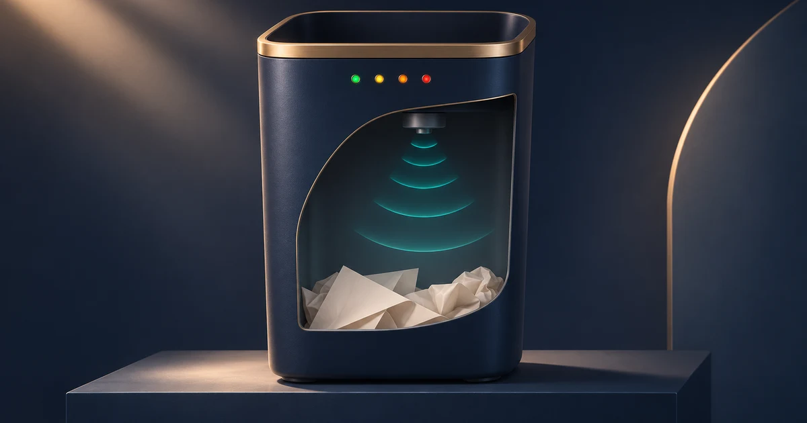
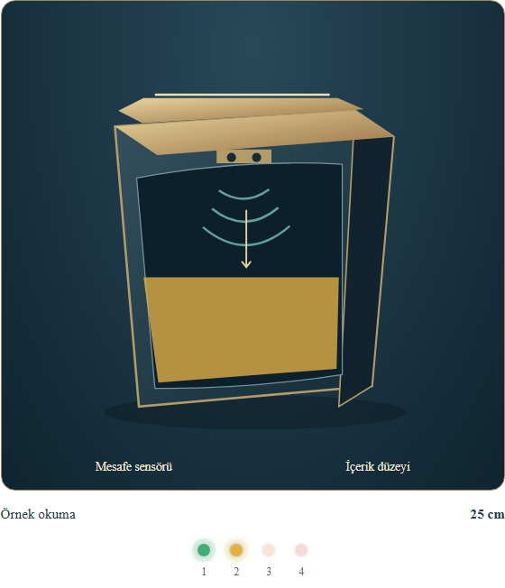
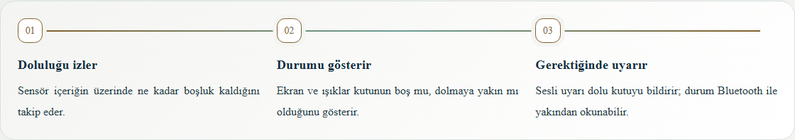
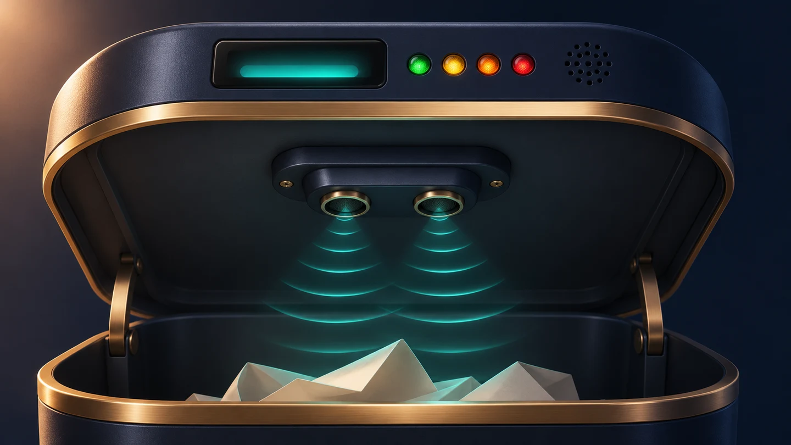
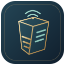
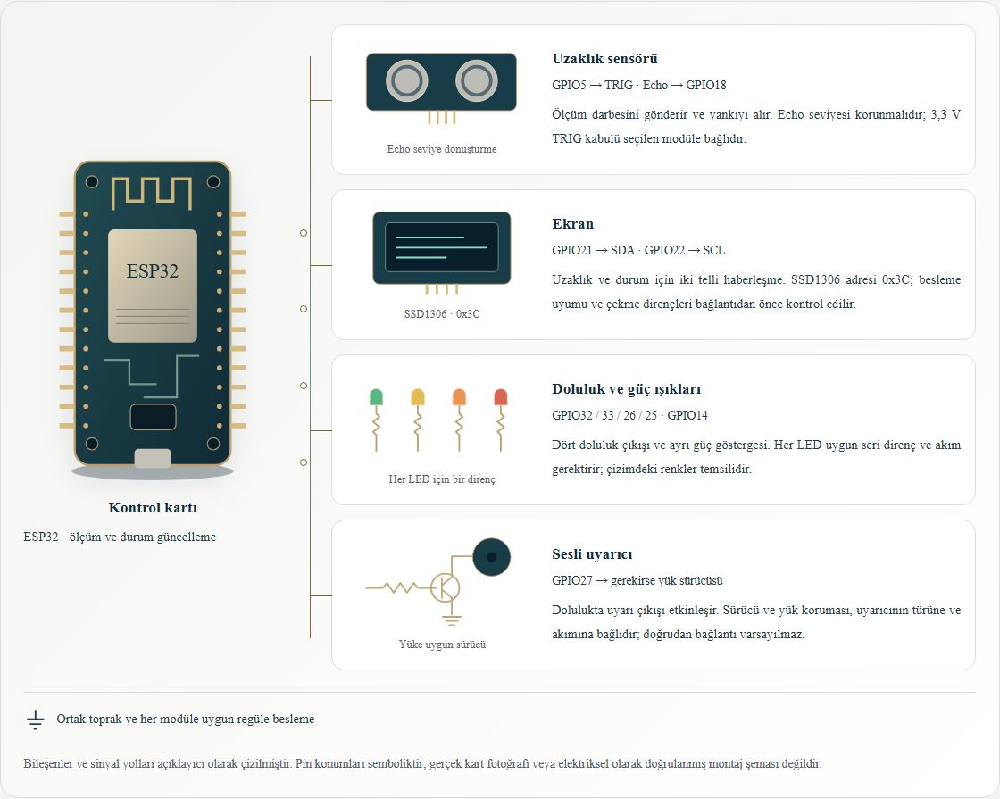

# Akıllı Çöp Kutusu

[العربية](ar.md) · [English](en.md) · [Türkçe](tr.md)

[Yayımlanan proje incelemesi](https://yahyaalali.com/tr/works/smart-bin/)

Gömülü sistemler · Algılama ve bağlantı

Kutunun ne zaman boşaltılması gerektiğini bilin

Atık kutusunun doluluk düzeyini izleyen; durumu ekran ve ışıklarla gösteren, dolduğunda sesli uyarı veren ve yakındaki telefondan Bluetooth ile okunmasını sağlayan akıllı kutu prototipi.

Cihaz fikrini açıklayan üretilmiş görsel; gerçek prototipin fotoğrafı değildir.

Ekran dilleri: Arapça · İngilizce · Türkçe

Cihazın ekran dili firmware derlenirken seçilir.

## Doluluk düzeyini deneyin

Kutuda hâlâ yer var mı, yoksa boşaltma zamanı geldi mi? Proje bu soruyu yanıtlar. İçeriğin üzerindeki sensör kalan boşluğu izler. Cihaz doluluk düzeyini gösterir ve kutu dolduğunda sesli uyarı verir. Uyumlu yakındaki bir telefon da internet bağlantısı olmadan Bluetooth üzerinden durumu okuyabilir.

Bu görsel, bağlı bir cihazın ölçümü değil, simülasyonun sabit açıklamasıdır. Etkileşim ve ses örneği web sitesindeki incelemede kullanılabilir.

[Simülasyonu ve ses örneğini dene](https://yahyaalali.com/tr/works/smart-bin/#smart-bin-section-0)

### Doluluğu izler

Sensör içeriğin üzerinde ne kadar boşluk kaldığını takip eder.

### Durumu gösterir

Ekran ve ışıklar kutunun boş mu, dolmaya yakın mı olduğunu gösterir.

### Gerektiğinde uyarır

Sesli uyarı dolu kutuyu bildirir; durum Bluetooth ile yakından okunabilir.

## Tahmin yerine açık uyarı

### Kalan boşluğu görün

Ekranda mesafe ve doluluk durumu gösterilir. İçerik yükseldikçe daha fazla gösterge ışığı yanar.

### Dolunca kısa sesli uyarı

Dolu durumda kısa bir ses darbesi her 5 saniyede tekrarlanır. Doluluk durumu ortadan kalktığında uyarı durur.

### Durumu yakından takip edin

Uyumlu Bluetooth istemcisi durumu okuyabilir ve değişim bildirimlerine abone olabilir. Bulut hizmeti gerekmez.

### Boş kutuyu arızayla karıştırmayın

Ölçüm alınamazsa eski değer yerine arıza gösterilir. Dört ışık birlikte yanıp söner; dolu kutu uyarısı çalmaz.

Renkler açıklama amaçlıdır. Yazılım sabit renkler yerine yanan ışık sayısını kullanır.

## Cihaz fikrine yakından bakış

Üretilmiş görseller cihaz fikrini ve bileşenlerin görevlerini açıklar; yapılmış donanımın fotoğrafları değildir. Özgün prototipin gösterimini videoda izleyebilirsiniz.

Üretilmiş kavramsal görseller; gerçek prototip videodadır.

## Görsel kimlik

Simge biçimini kutunun kendisinden alır. Kademeli çizgiler içeriğin yükselişini, üstteki dalgalar algılamayı anlatır. Lacivert, altın ve turkuaz tonlardaki hacimli yapı sakin bir mühendislik kimliği oluşturur. İşaret fikri temsil eder; ticari onay veya gerçek cihaz fotoğrafı değildir.

## Bileşenler ve teknolojiler

Sensör ölçümü alır, denetleyici bunu doluluk durumuna çevirir. Ekran, ışıklar ve sesli uyarı sonucu gösterir; yakındaki Bluetooth istemcisi de okuyabilir. Her bileşenin görevi açıktır.

### Devrenin içinde: ölçümden uyarıya

ESP32 uzaklığı okur; sonucu ekrana, gösterge ışıklarına ve sesli uyarıya aktarır. Bu harita, parçaların görevini ve yazılımda tanımlı sinyalleri gösterir; sembolik konumlar belirli bir kartın fiziksel pin dizilimi değildir.

Bileşenler ve sinyal yolları açıklayıcı olarak çizilmiştir. Pin konumları semboliktir; gerçek kart fotoğrafı veya elektriksel olarak doğrulanmış montaj şeması değildir.

#### Uzaklık sensörü

GPIO5 → TRIG · Echo → GPIO18

Ölçüm darbesini gönderir ve yankıyı alır. Echo seviyesi korunmalıdır; 3,3 V TRIG kabulü seçilen modüle bağlıdır.

#### Ekran

GPIO21 → SDA · GPIO22 → SCL

Uzaklık ve durum için iki telli haberleşme. SSD1306 adresi 0x3C; besleme uyumu ve çekme dirençleri bağlantıdan önce kontrol edilir.

#### Doluluk ve güç ışıkları

GPIO32 / 33 / 26 / 25 · GPIO14

Dört doluluk çıkışı ve ayrı güç göstergesi. Her LED uygun seri direnç ve akım gerektirir; çizimdeki renkler temsilidir.

#### Sesli uyarıcı

GPIO27 → gerekirse yük sürücüsü

Dolulukta uyarı çıkışı etkinleşir. Sürücü ve yük koruması, uyarıcının türüne ve akımına bağlıdır; doğrudan bağlantı varsayılmaz.

#### Fiziksel bağlantıdan önce

Geliştirme kartı, sensör, ekran modülü ve sesli uyarıcının türü belirlenip kontrol edilmelidir. 5 V Echo çıkışını ESP32’ye doğrudan bağlamayın; uygun seviye dönüştürme gerekir. Her LED ayrı seri direnç, sesli uyarıcı ise yüke göre sürücü gerektirebilir. Bağlantı sırasında gücü kesin; gerilimleri, akımı ve GPIO5 açılış davranışını doğrulayın.

[Üreticinin gerilim ve pin rehberi](https://docs.espressif.com/projects/esp-faq/en/latest/hardware-related/hardware-design.html)

### Cihaz yazılımı

**ESP32 · C++ · Arduino** — Sensörü okur, doluluk düzeyini belirler ve uyarıları zamanlar.

### Ekran ve ışıklar

**OLED SSD1306 · I²C · Adafruit GFX** — Mesafe ve durumu Arapça, İngilizce ve Türkçe metin desteğiyle gösterir.

### Bluetooth bağlantısı

**BLE · GATT** — Kutu durumu ve ekran tanısını okumayı, yakından bildirim almayı sağlar.

## Geliştirme ve sonraki adım

Cihaz yazılımı geliştirildi; ölçüm, arıza, uyarı ve bağlantı davranışı test edildi. Sonraki adım bu sürümü gerçek bileşenlerle denemek ve seçilen kutu için kalibre etmektir.

Elektrik bağlantıları, sensör kalibrasyonu, ölçüm doğruluğu, sesli uyarı ve telefonla Bluetooth uyumu fiziksel test gerektirir. Proje doluluğu izler; atığı tartmaz veya toplama işlemini otomatik yönetmez.

### Yazılım doğrulaması ve fiziksel sınırlar

27 Kasım 2026 tarihli yazılım kanıtı 65 mantık durumunu, konak sahteleriyle 10 gerçek bağdaştırıcı durumunu ve genel ESP32 hedefi için Arapça, İngilizce ve Türkçe firmware derlemelerini kaydeder. Bunlar yazılım sonuçlarıdır; gerçek cihaz çalışması veya kalibrasyonu kanıtı değildir.

[Prototip videosunu izle](https://www.youtube.com/watch?v=GwyfZ4DQr9k)

[Yayımlanan proje incelemesi](https://yahyaalali.com/tr/works/smart-bin/)

### Kaynak ve kullanım hakları

Güncel kaynak özel bir depoda tutulur; erişim sahibinden talep edilebilir. Bu incelemenin yayımlanması, kaynak kod veya kimlik materyali için genel kullanım lisansı vermez.

[Kaynak erişimi talep et](https://yahyaalali.com/tr/contact/)

[Proje listesine dön](../../README.tr.md)
