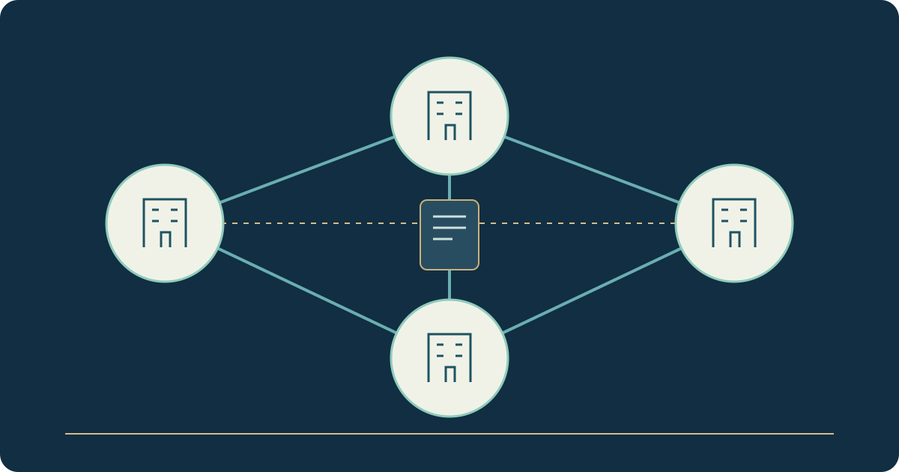

# THIQAH — Organisation Identity and Business Relationships

**Stage: In development**

THIQAH is a network for organising and documenting relationships and dealings between businesses. It is distinct from Rawaj's seller-and-buyer marketplace.

The current implementation includes a multilingual interface, identity and session foundations, and minimum organisation creation, reading and profile updates with server-side permissions. I develop these foundations before the business workflows that depend on them.

Invitations, memberships, branches, invoices, receivables, payments and disputes remain later work. They are not presented as completed services or as a guarantee against fraud.

[Read the project case study](https://yahyaalali.com/en/content-library/project/thiqah/) · [Back to selected work](../README.md)
