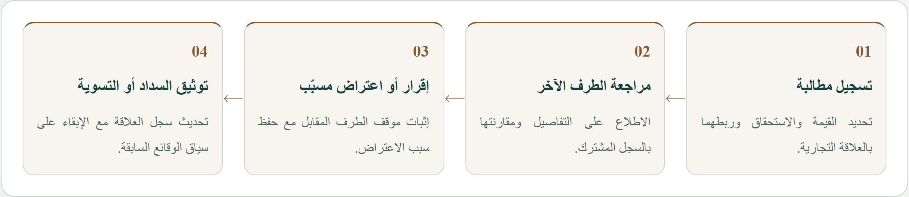
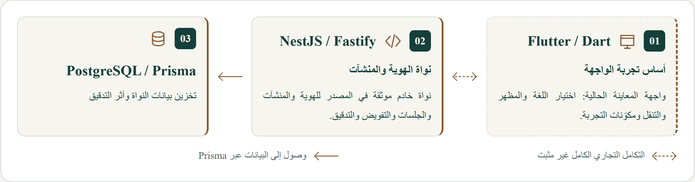

# ثِقة

[العربية](ar.md) · [English](en.md) · [Türkçe](tr.md)

[دراسة الحالة المنشورة](https://yahyaalali.com/works/thiqah/)

شبكة تجارية بين المنشآت (B2B) · قيد التطوير

THIQAH

من المصافحة التجارية إلى سجل مشترك يفهمه الطرفان

- **نموذج المنتج:** B2B
- **اللغات:** العربية · الإنجليزية · التركية
- **الحالة:** قيد التطوير

شبكة رقمية بين المنشآت تُطوَّر لتمنح الموردين والتجار سياقًا مشتركًا أوضح لعلاقاتهم التجارية، يجمع المطالبات والإقرارات والتسويات في سجل واحد.

تصور مفاهيمي

## سجل مشترك، وقيمة للطرفين

عندما تتوزع الفواتير والدفعات بين الرسائل والدفاتر، يصبح الاتفاق على ما حدث أصعب من تسجيله. تنطلق ثِقة من فكرة بسيطة: أن يقرأ طرفا العلاقة التاريخ نفسه، مع وضوح ما سُجّل وما أُقرّ وما يحتاج إلى مراجعة.

### للمورد وفريقه الميداني

سياق واحد بدل متابعة الأرقام في قنوات متفرقة.

- ربط المطالبة بالمنشأة وبموعد استحقاقها.
- قراءة الدفعات والتعديلات في سياق الواقعة الأصلية.
- العودة إلى تاريخ العلاقة عند متابعة الحساب.

### للتاجر والإدارة المالية

مراجعة مفهومة قبل الإقرار، وأثر واضح بعده.

- مراجعة كل مطالبة ومعرفة مصدرها.
- إقرار صريح أو اعتراض موضّح بالأسباب.
- حفظ التصحيحات والتسويات ضمن تاريخ مشترك.

## من المطالبة إلى التسوية

تكتسب الأرقام معناها حين يتضح موقف الطرف المقابل. يسير التصور من تسجيل المطالبة إلى مراجعتها، ثم يحفظ الإقرار أو الاعتراض وما ينتهي إليه من تسوية.

تصوّر لمسار العمل المصمّم، وليس واجهة معاملات عاملة.

نص المخطط وتفاصيله

1. **تسجيل مطالبة**
   تحديد القيمة والاستحقاق وربطهما بالعلاقة التجارية.
2. **مراجعة الطرف الآخر**
   الاطلاع على التفاصيل ومقارنتها بالسجل المشترك.
3. **إقرار أو اعتراض مسبّب**
   إثبات موقف الطرف المقابل مع حفظ سبب الاعتراض.
4. **توثيق السداد أو التسوية**
   تحديث سجل العلاقة مع الإبقاء على سياق الوقائع السابقة.

تصور مفاهيمي — ليس لقطة من التطبيق الفعلي

## هوية تعبّر عن الترابط

حلقتان متشابكتان لطرفين مستقلين يجمعهما سجل واحد، وثلاث نقاط تستحضر حرف «ث» من «ثِقة». يجمع البترولي العميق والذهبي الدافئ بين الوضوح والترابط.

- بترولي عميق
- ذهبي دافئ
- عاجي هادئ

### دلالات الهوية البصرية

## نافذة على المعاينة الحالية

معاينة استكشافية مبكرة للواجهة والمكوّنات، وليست المنتج التجاري النهائي.

تتيح المعاينة الحالية استكشاف اللغة والمظهر والتنقل وعناصر الواجهة ببيانات تجريبية في الذاكرة، دون حسابات أو معاملات تجارية حقيقية.

[زيارة الموقع ↗](https://thiqah-preview.pages.dev/)

تفصيل من لقطة حقيقية للمعاينة العامة، التُقطت في 22 نوفمبر 2026. الإطار يعرض منطقة المحتوى.

## بنية تحمل الفكرة إلى الأمام

تقوم الفكرة على أساسين منفصلين: تجربة Flutter للواجهة، ونواة خادم لإدارة الهوية والمنشآت والتفويض. يُظهر المخطط ما يسنده المصدر، مع إبقاء التكامل والرحلات التجارية في موضعها المصمّم.

### الوحدات التجارية القادمة — تصميم وخطط

الفواتير والمستحقات والإقرارات والاعتراضات والسداد والتسويات امتداد تجاري مصمّم. لا تثبت المعاينة الحالية اتصالًا تجاريًا كاملًا بنواة الخادم أو تنفيذ هذه الرحلات حيًا.

نص المخطط وتفاصيله

Flutter / Dart

### أساس تجربة الواجهة

واجهة المعاينة الحالية: اختيار اللغة والمظهر والتنقل ومكوّنات التجربة.

NestJS / Fastify

### نواة الهوية والمنشآت

نواة خادم موثقة في المصدر للهوية والمنشآت والجلسات والتفويض والتدقيق.

PostgreSQL / Prisma

تخزين بيانات النواة وأثر التدقيق

التكامل التجاري الكامل غير مثبت

وصول إلى البيانات عبر Prisma

### الأدوات والتقنيات

#### أساس تجربة الواجهة

Flutter · Dart · GoRouter

#### نواة الهوية والمنشآت

NestJS · Fastify · OpenAPI

#### تخزين بيانات النواة وأثر التدقيق

PostgreSQL · Prisma

### دوري في المشروع

أتولى رؤية المنتج وتصميم تجربته متعددة اللغات وهندسة نواته، انطلاقًا من حاجة الطرفين إلى سجل أوضح للعلاقة التجارية.

### روابط المشروع

- [زيارة الموقع](https://thiqah-preview.pages.dev/)
- [دراسة الحالة المنشورة](https://yahyaalali.com/works/thiqah/)

[العودة إلى قائمة المشروعات](../../README.ar.md)
