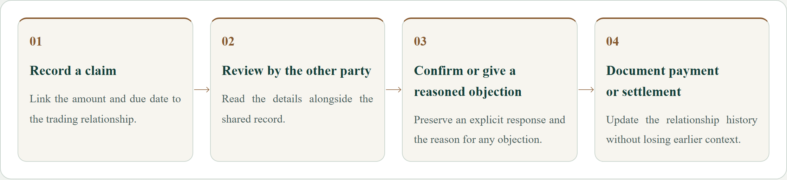
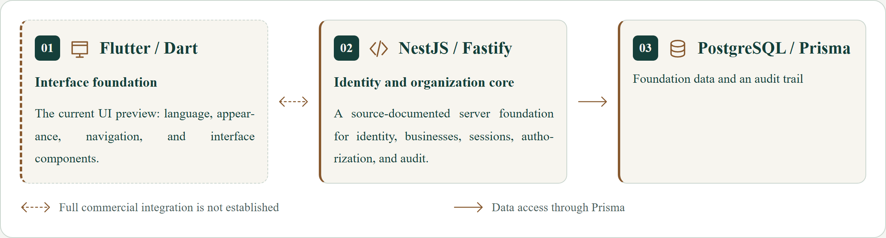

# THIQAH

[العربية](ar.md) · [English](en.md) · [Türkçe](tr.md)

[Published case study](https://yahyaalali.com/en/works/thiqah/)

B2B trade network · In Development

From a handshake to a shared record both parties understand

- **Product model:** B2B
- **Languages:** Arabic · English · Turkish
- **Status:** In Development

A B2B network being developed to give suppliers and retailers a clearer shared context for their commercial relationships, bringing claims, confirmations, and settlements into one record.

Conceptual illustration

## One shared record. Value for both sides.

When invoices and payments are scattered across messages and notebooks, agreeing on what happened becomes harder than recording it. THIQAH starts with a simple idea: both parties should be able to read the same history and distinguish what was recorded, confirmed, or still needs review.

### For suppliers and field teams

One context instead of tracing figures across separate channels.

- Associate a claim with its business and due date.
- Read payments and adjustments alongside the original event.
- Return to the relationship history when following up accounts.

### For retailers and finance teams

An understandable review before confirmation, and a clear trail afterward.

- Review each claim and understand its source.
- Give an explicit confirmation or a reasoned objection.
- Keep corrections and settlements within a shared history.

## From a claim to settlement

Figures become meaningful when the other party’s position is clear. The proposed journey takes a documented claim through review, preserves confirmation or objection, and connects the outcome to the relationship history.

A conceptual view of the designed workflow, not a working transaction interface.

Diagram text and details

1. **Record a claim**
   Link the amount and due date to the trading relationship.
2. **Review by the other party**
   Read the details alongside the shared record.
3. **Confirm or give a reasoned objection**
   Preserve an explicit response and the reason for any objection.
4. **Document payment or settlement**
   Update the relationship history without losing earlier context.

Conceptual illustration — not a screenshot of the actual application

## An identity built around connection

Two interlocking links represent independent parties connected by one shared record. The three dots recall the Arabic letter Tha in ثِقة. Deep petroleum and warm gold bring clarity and connection to the identity.

- Deep petroleum
- Warm gold
- Quiet ivory

### Visual identity meaning

## A window into the current preview

An early exploratory preview of the interface and components, not the final commercial product.

The current preview lets visitors explore language, appearance, navigation, and interface elements using in-memory sample data, without real accounts or commercial transactions.

[Visit Website ↗](https://thiqah-preview.pages.dev/?lang=en)

A detail from a real public-preview capture taken on 22 November 2026. The frame shows the content area.

## An architecture for the next step

The idea rests on two separate foundations: the Flutter interface and a backend core for identity, organizations, and authorization. This diagram reflects source-backed foundations while keeping integration and commercial journeys in their designed scope.

### Future commercial modules — design and plans

Invoices, receivables, confirmations, objections, payments, and settlements form the designed commercial extension. The current preview does not establish full commercial integration with the server foundation or live execution of these journeys.

Diagram text and details

Flutter / Dart

### Interface foundation

The current UI preview: language, appearance, navigation, and interface components.

NestJS / Fastify

### Identity and organization core

A source-documented server foundation for identity, businesses, sessions, authorization, and audit.

PostgreSQL / Prisma

Foundation data and an audit trail

Full commercial integration is not established

Data access through Prisma

### Tools and Technologies

#### Interface foundation

Flutter · Dart · GoRouter

#### Identity and organization core

NestJS · Fastify · OpenAPI

#### Foundation data and an audit trail

PostgreSQL · Prisma

### My Contribution

I lead the product vision, multilingual experience design, and foundation architecture, guided by both parties’ need for a clearer shared trading record.

### Project Links

### Project links

- [Visit Website](https://thiqah-preview.pages.dev/?lang=en)
- [Published case study](https://yahyaalali.com/en/works/thiqah/)

[Back to projects](../../README.md)
