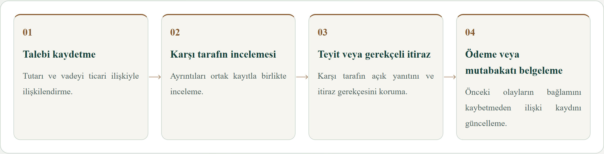
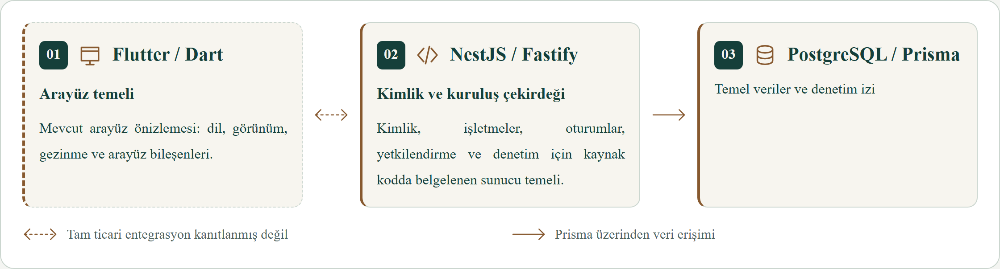

# THIQAH

[العربية](ar.md) · [English](en.md) · [Türkçe](tr.md)

[Yayımlanan proje incelemesi](https://yahyaalali.com/tr/works/thiqah/)

İşletmeler arası ticaret ağı (B2B) · Geliştirme Aşamasında

Bir el sıkışmadan iki tarafın da anladığı ortak bir kayda

- **Ürün modeli:** B2B
- **Diller:** Arapça · İngilizce · Türkçe
- **Durum:** Geliştirme Aşamasında

Tedarikçiler ve perakendeciler için ticari ilişkileri daha anlaşılır bir ortak bağlama taşıyan; talepleri, teyitleri ve mutabakatları tek kayıtta buluşturmak üzere geliştirilen bir B2B ağı.

Kavramsal görsel

## Ortak bir kayıt, iki taraf için değer

Faturalar ve ödemeler mesajlara ve defterlere dağıldığında, ne olduğu konusunda anlaşmak kayıt tutmaktan daha zor hâle gelir. THIQAH basit bir fikirden yola çıkar: iki taraf da aynı geçmişi okuyabilmeli; kaydedileni, teyit edileni ve incelenmesi gerekeni ayırt edebilmelidir.

### Tedarikçi ve saha ekipleri için

Farklı kanallarda rakam aramak yerine ortak bir bağlam.

- Talebi ilgili işletme ve vade tarihiyle ilişkilendirmek.
- Ödemeleri ve düzeltmeleri ilk olayın bağlamında okumak.
- Hesap takibinde ilişkinin geçmişine dönebilmek.

### Perakendeci ve finans ekipleri için

Teyit öncesinde anlaşılır inceleme, sonrasında açık bir iz.

- Her talebi inceleyip kaynağını anlamak.
- Açık teyit veya gerekçeli itiraz sunmak.
- Düzeltmeleri ve mutabakatları ortak geçmişte korumak.

## Talepten mutabakata

Rakamlar, karşı tarafın tutumu netleştiğinde anlam kazanır. Tasarlanan akış, belgelenen talebi incelemeye taşır; teyidi veya itirazı korur ve sonucu ilişkinin geçmişine bağlar.

Tasarlanan iş akışının kavramsal gösterimi; çalışan bir işlem arayüzü değildir.

Şema metni ve ayrıntıları

1. **Talebi kaydetme**
   Tutarı ve vadeyi ticari ilişkiyle ilişkilendirme.
2. **Karşı tarafın incelemesi**
   Ayrıntıları ortak kayıtla birlikte inceleme.
3. **Teyit veya gerekçeli itiraz**
   Karşı tarafın açık yanıtını ve itiraz gerekçesini koruma.
4. **Ödeme veya mutabakatı belgeleme**
   Önceki olayların bağlamını kaybetmeden ilişki kaydını güncelleme.

Kavramsal görselleştirme — gerçek uygulamanın ekran görüntüsü değildir

## Bağ kuran bir kimlik

Birbirine geçen iki halka, tek bir ortak kayıtla bağlanan bağımsız tarafları simgeler. Üç nokta, ثِقة adındaki Arapça Tha harfini çağrıştırır. Derin petrol ve sıcak altın tonları kimliğe netlik ve bağlılık kazandırır.

- Derin petrol
- Sıcak altın
- Sakin fildişi

### Görsel kimliğin anlamı

## Mevcut önizlemeye bir bakış

Arayüz ve bileşenlere yönelik erken bir keşif önizlemesi; nihai ticari ürün değildir.

Mevcut önizleme, gerçek hesaplar veya ticari işlemler olmadan, bellekteki örnek verilerle dil, görünüm, gezinme ve arayüz öğelerinin keşfedilmesini sağlar.

[Siteyi Ziyaret Et ↗](https://thiqah-preview.pages.dev/?lang=tr)

22 Kasım 2026 tarihinde herkese açık önizlemeden alınmış gerçek bir görüntüden ayrıntı. Çerçeve içerik alanını gösterir.

## Sonraki adıma hazırlanan mimari

Fikir iki ayrı temele dayanır: Flutter arayüzü ile kimlik, kuruluşlar ve yetkilendirme için sunucu çekirdeği. Şema, kaynak kodun desteklediği temelleri gösterirken entegrasyonu ve ticari akışları tasarım kapsamıyla ayırır.

### Gelecekteki ticari modüller — tasarım ve planlar

Faturalar, alacaklar, teyitler, itirazlar, ödemeler ve mutabakatlar tasarlanan ticari uzantıyı oluşturur. Mevcut önizleme, sunucu temeliyle tam ticari entegrasyonu veya bu akışların canlı çalıştığını kanıtlamaz.

Şema metni ve ayrıntıları

Flutter / Dart

### Arayüz temeli

Mevcut arayüz önizlemesi: dil, görünüm, gezinme ve arayüz bileşenleri.

NestJS / Fastify

### Kimlik ve kuruluş çekirdeği

Kimlik, işletmeler, oturumlar, yetkilendirme ve denetim için kaynak kodda belgelenen sunucu temeli.

PostgreSQL / Prisma

Temel veriler ve denetim izi

Tam ticari entegrasyon kanıtlanmış değil

Prisma üzerinden veri erişimi

### Araçlar ve Teknolojiler

#### Arayüz temeli

Flutter · Dart · GoRouter

#### Kimlik ve kuruluş çekirdeği

NestJS · Fastify · OpenAPI

#### Temel veriler ve denetim izi

PostgreSQL · Prisma

### Projeye Katkım

Her iki tarafın daha açık bir ortak ticari kayda duyduğu ihtiyaçtan yola çıkarak ürün vizyonunu, çok dilli deneyim tasarımını ve temel mimarisini yürütüyorum.

### Proje Bağlantıları

### Proje bağlantıları

- [Siteyi Ziyaret Et](https://thiqah-preview.pages.dev/?lang=tr)
- [Yayımlanan proje incelemesi](https://yahyaalali.com/tr/works/thiqah/)

[Projelere dön](../../README.tr.md)
